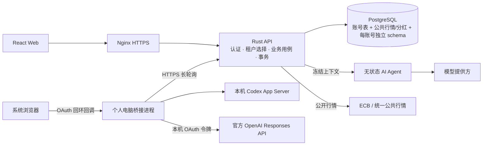
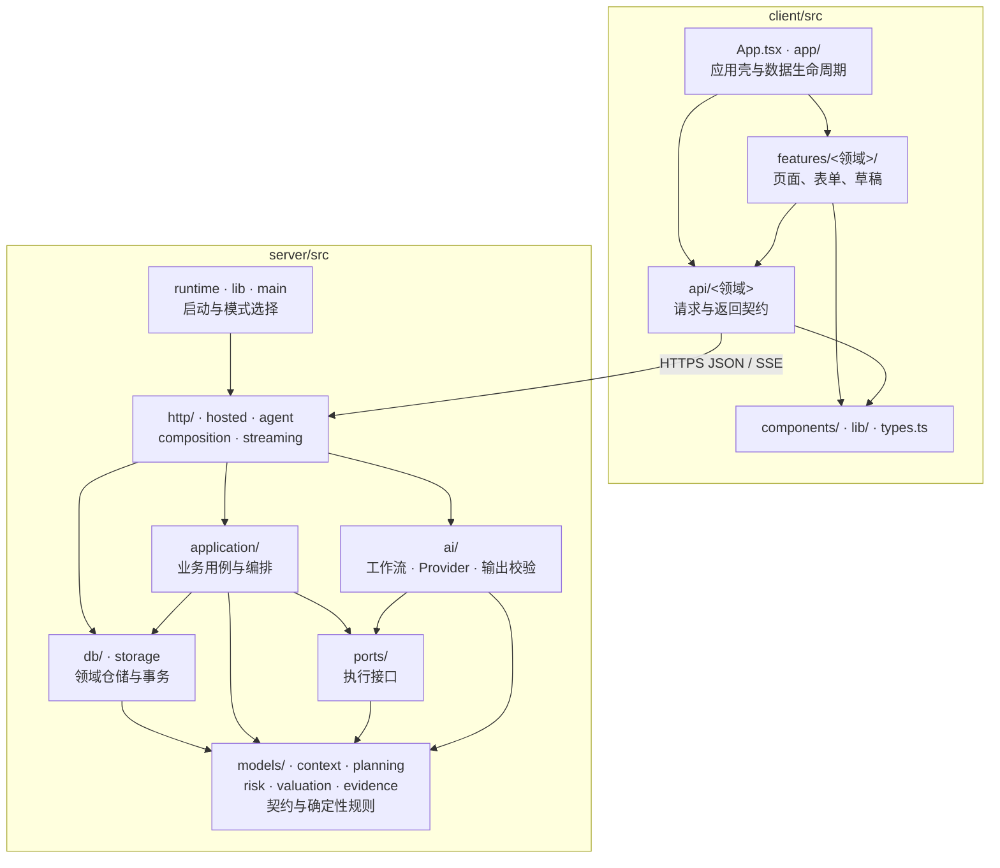
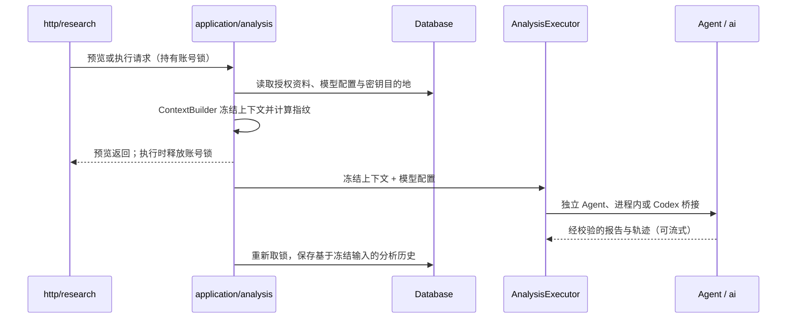

# 架构

本文是全局代码设计的总体说明：系统由哪些运行单元组成、源码如何分层、依赖朝哪个方向、状态和事务归谁、关键数据怎样流动，以及哪些不变量不能被局部改动破坏。修改跨模块结构前先读本文；具体模块的扩展步骤与开发流程见 [模块边界与开发约束](module-boundaries.md)，部署与运维见 [自建宿主机服务](self-hosting.md)。

当前产品主线是[买点观察](buy-watch.md)：认可名单 → 收盘检查 → 变化提醒 → 结合真实交易讨论 → 周末复盘。已有财务、AI 和研究模块提供支撑；模块地图列出已存在能力，不构成功能扩展路线图。

本文只描述当前生产路径。各模块的行为规范、实现与验证入口见[当前 spec 索引](README.md)。长期有效的架构变化必须在同次提交中更新本文与 [模块边界](module-boundaries.md)；一次性的验收数据和逐批研究参数不写入本文。

## 1. 系统形态

项目是模块化单体：一个 Rust 二进制按启动参数承担不同角色，一个 React 单页应用，一个 PostgreSQL。没有微服务、消息总线或持久作业队列。

同一个 `mario-server` 二进制由 [`runtime.rs`](../server/src/runtime.rs) 选择运行角色：

| 角色 | 触发条件 | 入口 | 数据 |
| --- | --- | --- | --- |
| 多用户 API（默认） | 必须设置 `DATABASE_URL` | `hosted::serve` | PostgreSQL，按账号 schema 隔离 |
| 无状态 Agent | `MARIO_ROLE=agent` | `agent::serve` | 无数据库，只接收 API 发来的冻结任务 |
| Codex 桥接 worker | `--codex-bridge <站点>` | `codex_bridge_worker::run` | 用户电脑执行，不监听桥接端口，不读 `auth.json` |
| ChatGPT 官方桥接 worker | `--chatgpt-bridge <站点>` | `codex_bridge_worker::run_chatgpt` | 用户电脑执行；OAuth 令牌留在本机，直连官方 Responses |
| 本机 ChatGPT 账号管理 | `--chatgpt-auth <命令>` | `chatgpt_auth::command` | 浏览器 OAuth 仅回环回调；注册、刷新和退出；不连接业务数据库 |
| 维护命令 | `--reset-password` | `runtime.rs` | 重置指定账号密码 |
| 公开分红清单导出 | `--export-watch-dividends <CSV>` | `runtime` → `market_data/watch_archive` | 内置公开资料，不连接账号数据库 |

PostgreSQL 是唯一的数据存储，没有单机或免登录模式。本地开发（`npm run dev`）与测试使用同一条多用户路径：[`scripts/postgres-cluster.mjs`](../scripts/postgres-cluster.mjs) 在 `.runtime/dev` 维护持久开发集群，或为测试创建一次性集群；开发者在浏览器注册账号，与生产流程一致。

生产部署由 [`deploy.sh`](../deploy.sh) 在宿主机以 systemd 启动一个主运行器（[`scripts/host-runtime.mjs`](../scripts/host-runtime.mjs)），依次拉起 PostgreSQL、Agent（仅监听本机端口）和 API；Nginx 反向代理 API 与静态网页。推送代码不等于部署。

部署中的系统依赖安装与 systemd 管理使用 root；用户工具安装、构建和主运行器统一使用非 root 服务账号。`deploy.sh` 在下载工具和停服前准备该账号的 home，自动修复默认专用 home 与 Rust 工具目录的历史归属、所有者写入及遍历权限，不递归接管整个 home 或跟随工具链接修改外部文件。已有数据库继续使用原所有者，数据与事务归属不变。具体范围与异常处理见 [部署权限](deploy-madeagents.md#服务用户-home-与工具目录权限)。

## 2. 设计原则

1. **服务端是唯一事实来源。** 前端只持有已显示快照和未保存草稿；金额、会计结果、估值状态和数据版本都由服务端计算并返回。
2. **账号隔离由服务端决定。** 请求不能指定租户；认证后由服务端按用户 ID 选择数据库连接，账号数据不进入跨账号缓存；`mario_market` 保存公共目录、行情及分红事实，供所有账号复用；目录维护的操作者 ID 仅作内部元数据。
3. **写入有版本，财务写入有回执。** 业务写入与数据版本在同一事务推进；客户端用 `If-Match` 提交，过期写入返回 409；财务写入的回执与领域变化同事务提交，丢失响应可以安全重放。
4. **精确金额。** 金额以十进制原文和精确值持久化，浮点只作展示投影；前端显示不经过二进制浮点重算。
5. **AI 只消费冻结输入。** 分析前在服务端读取、授权、冻结上下文并计算指纹；AI 模块不读数据库、不写资产、不执行交易，模型输出必须经过结构校验才成为结果。新生成的每条个人事实须有非空且授权的原值引用；这保证可回查，不代替语义核对，历史报告保留原文读取。
6. **可替换能力经端口注入。** 模型执行与行情查询通过 `ports/` 中的 trait 注入，测试可以替换；不为普通仓储查询或单步 CRUD 增加抽象层。
7. **单一生产路径。** 非兼容更新删除旧实现；只为存量数据恢复保留隔离的迁移适配，并写明移除条件（见第 9 节）。

## 3. 分层与依赖方向

箭头表示"可以依赖"。底层（契约与确定性规则）不依赖任何上层；`ports/` 只依赖契约，实现放在适配器中；`application/` 不认识 Axum、Agent 进程或具体行情供应商。简单仓储查询与单次 CRUD 允许沿用 HTTP → `Database` 的直接路径。

`npm run check:architecture`（[`scripts/check-architecture.mjs`](../scripts/check-architecture.mjs)）静态强制以下规则，并检测前后端依赖循环：

| 范围 | 禁止 |
| --- | --- |
| 前端功能页 | 引用 `app/`、`App.tsx`、`main.tsx`；引用其他功能目录 |
| 前端共享层 | `lib/`、`components/`、`api/`、`types.ts` 引用功能页或应用壳；`lib/` 引用 `api/`；`api/` 跨领域互相引用 |
| 前端可达性 | 任何生产模块无法从 `main.tsx` 到达 |
| 契约与确定性规则 | `models`、`context`、`planning`、`risk`、`valuation`、`evidence` 依赖仓储、网络、传输、`application`、`ai` 或 `ports` |
| `ports` | 依赖 `models`、`context`、`error` 以外的模块 |
| `ai` | 依赖仓储、账号、行情供应商、传输适配器或 `application` |
| 公共价格与分红模块 | `db/public_prices`／`db/public_dividends` 引用公开契约、`storage`、错误类型以外的模块；`application/public_prices`／`application/watch_market` 引用契约、仓储、端口、错误类型以外的模块 |
| `db` | 依赖 `application`、`ai`、`agent`、`http`、`hosted`、`runtime` 或行情网络模块 |
| `application` | 依赖传输/进程适配器或具体行情供应商；应用层直接引用 `ai` |
| `agent` | 依赖 `db`、`storage`、`accounts`、`application`、`http`、`hosted`、`runtime` |
| 本机 OAuth | `chatgpt_auth` 依赖业务、账号或 AI 实现；在线 HTTP/Agent、领域及仓储依赖本机凭据；`ai/chatgpt.rs` 以外的 AI 模块读取本机 OAuth |
| 网站 OIDC | `openai_login` 依赖账号仓储、模型执行或本机授权；`hosted` 以外的模块依赖网站 OIDC |
| `secrets`、行情适配器 | `secrets` 依赖 `error` 以外模块；`market_data` 依赖 `models`、`ports`、`error` 以外模块或持有静态可变资源 |
| 通用 | 非 `db` 模块使用通配导入；契约、仓储、应用层使用 `axum`；`application`/`ports` 直接使用 `reqwest`；`storage.rs` 以外直接使用数据库驱动 |

静态检查与编译、行为测试互补，不能证明宏展开或所有运行时路径的隔离。新增或调整边界时同步更新检查器及其测试，不通过扩大豁免掩盖耦合。

## 4. 后端模块地图

| 模块 | 职责 |
| --- | --- |
| `main.rs`、`lib.rs`、`runtime.rs` | 进程入口、模块声明、环境与参数解析、模式选择、维护命令、优雅退出 |
| `composition.rs` | 装配模型连接器与桥接注册端口，创建行情供应商，组装 `MarketServices`，拥有后台刷新任务并在服务退出时取消 |
| `hosted.rs` | 多用户模式：公开注册/登录路由、认证中间件、并发槽位、账号锁、`If-Match` 版本检查、财务回执重放、导出/导入、CORS、静态网页 |
| `http/` | 按领域注册路由（`watch`、`portfolio`、`research`、`reviews`、`settings`、`codex_bridge`）并转换输入输出；`policy.rs` 定义免版本检查的显式例外；`error.rs` 把领域错误映射为 HTTP 状态 |
| `accounts.rs`、`accounts/openai.rs`、`authentication.rs` | 自建账号、Argon2 密码、随机会话（库内只存哈希）、撤销与登录限速、持久化超级账户权限；可选网站 OpenAI 身份映射、短期 OAuth 事务及显式关联；Agent 令牌的常量时间比较 |
| `openai_login.rs`、`hosted/openai.rs` | 网站身份登录：前者只做官方 OIDC 配置、授权码交换和签名声明校验，不访问账号或模型；后者转换 HTTP/Cookie、编排账号事务、固定站点重定向与一次性交接；与本机 `chatgpt_auth` 及订阅执行无依赖 |
| `application/` | 跨仓储与外部端口的用例：`watch`（账号观察检查）、`watch_catalog`（公共目录及来源补齐）、`dividend_calendar`（公开计划刷新与账号范围投影）、`analysis`（冻结、预览、执行、保存）、`portfolio`/`prices`/`public_prices`/`fx`（共享价格、账号估值与汇率编排）、`model_settings`（模型接口切换、冻结连接测试与注入的管理端口）、`codex_bridge`（账号配对） |
| `ports/` | `analysis::AnalysisExecutor` 与事件通道，`model::ModelConnector` 与 `BridgeRegistry`（只接收冻结目的地或配对 ID，不访问账号库）；`market::FxRateProvider`、`SecurityPriceProvider`、`SecurityHistoryProvider`、`WatchMarketProvider`、`CatalogSourceProvider` |
| `agent.rs` | `AgentExecutor`：配置 `MARIO_AGENT_URL` 时把冻结任务发给独立 Agent，否则进程内执行；Codex 桥接任务始终在 API 进程经桥接中继执行。同文件提供 Agent HTTP 服务 |
| `ai/` | `orchestrator` 按 `workflow`（当前 v9）执行可选搜索与单次报告生成；格式错误只修复一次；`provider` 定义模型接口，API 侧实现为 `native_provider`（供应商 HTTP 接口）与 `bridge`（经配对桥接中继），`codex` 和 `chatgpt` 只由用户电脑上的桥接 worker 调用，分别使用 Codex 登录和 Mario 自己的官方 OAuth 注册；`structured_output` 负责确定性引用、输出校验；资料检索和连续原文摘录归领域层 `evidence`；`streaming` 解析流式草稿 |
| `codex_bridge_worker.rs` | 用户电脑上的共用桥接进程，固定注册及授权会话，长轮询 API 领取任务，选择 Codex App Server 或官方 ChatGPT Responses；模型目录及推理取令牌时在凭据锁内核对同一会话，不借用重新登录后的授权；不上传 OpenAI 凭据 |
| `chatgpt_auth.rs`、`chatgpt_auth/` | 本机官方 OAuth、签名身份和 scopes 校验、多注册选择、跨进程串行刷新、原子凭据保存及退出；仅由本机运行角色与 `ai/chatgpt.rs` 调用，不依赖业务数据库 |
| `market_data.rs`、`market_data/history.rs`、`market_data/watch.rs` | 汇率、完整五年日线与公司行动、分红及计划来源；价格的前复权／原值及完整来源成组取得，不持有价格缓存、不读写账号数据 |
| `db/`、`storage.rs` | `PublicDividends` 拥有公开分红资料库，`PublicWatch` 拥有公共公司目录、独立版本、公共行业最新观察及分红计划快照；`Database` 门面下的账号领域仓储（观察名单与历史、持仓、成交、期权关联与报价、现金、公司行动、金额、每日资产、汇率、研究、复盘、设置、凭据）、财务回执与日志、快照构建、同步/备份格式与校验、schema 迁移；`storage.rs` 是唯一的 PostgreSQL 驱动适配：专用客户端线程、动态类型行、事务与 `search_path` 绑定的账号 schema；API 持有有界租户连接复用器，HTTP 与后台账号任务租用连接，归还前回滚并清理会话状态 |
| `models.rs`、`models/` | 序列化契约、值校验、精度与日期规则、买点观察计算、期权合约计价及多空头重放、推理事件与执行时限 |
| `context.rs` / `context/fact_sheet.rs`、`planning.rs`、`risk.rs`、`valuation.rs`、`evidence.rs` | 确定性计算：分析上下文构建与预览、再平衡规划、风险检查、估值状态、本地证据检索 |
| `attachments.rs`、`secrets.rs`、`streaming.rs`、`error.rs` | 附件解码与文本提取、主密钥加解密（AAD 绑定 schema 与用途）、共享 SSE 响应、统一错误类型 |

## 5. 前端模块地图

| 模块 | 职责 |
| --- | --- |
| `main.tsx`、`App.tsx` | 挂载、页面组合与导航；跨页动作（如 `onAsk`、`onOpenSettings`）由应用壳接收并转发；离开将卸载的编辑页前确认未保存草稿，取消历史跳转时恢复当前地址 |
| `app/useApplicationData.ts` | 服务端数据生命周期：启动、快照与模型配置加载、自动同步、请求代次、草稿保护与远程更新提示 |
| `app/navigation.ts` | 视图、导航分组与标签 |
| `features/watch` | 默认买点观察页：`BuyWatch` 拥有草稿、请求与筛选状态，`WatchList` 展示列表/卡片，`WatchSignals` 绘制轨道和参考价格，`WatchTrends` 展示服务端历史曲线与金叉、拥有显示范围和查看日期，`WatchDetails` 展示依据与原交易，`WatchWeekly` 展示已保存日期矩阵，`WatchCatalogEditor` 持有公共目录草稿、公司查询输入和打开时的独立版本，`DividendCalendar` 拥有日历范围、日期窗口、日期选择与只读轮询；通过应用壳进入讨论 |
| `features/portfolio` | 我的情况：持仓、成交、股票关联期权与报价、现金、汇率、每日资产、资产历史与财务日志 |
| `features/methodology` | 左侧独立入口“投资方法论”：编辑账号专属提示词、保存及填入初始范本；页面持有草稿，应用壳负责同步保护 |
| `features/research` | 问答（流式回复、报告、引用来源）与研究证据工作台 |
| `features/reviews`、`features/settings`、`features/account` | 复盘；模型设置、问答预设与 Codex 桥接；网页账号与服务端数据备份/外部自选 JSON 导入。`ServerData` 管理文件/粘贴草稿、来源账户预览及覆盖前备份，应用壳经 `ModelSettings.accountSettings` 插槽将账号、服务器连接与备份导入装配到唯一的设置页（模型配置加载失败时由应用壳直接渲染），不产生跨功能导入依赖 |
| `api/<领域>.ts` | 领域请求与返回契约；`api/portfolio.ts` 选择需要串行的快速编辑，排队顺序归账号会话，`api/portfolio/financialRequest.ts` 负责单次财务请求与回执核对 |
| `lib/httpClient.ts`、`transport.ts`、`requestPolicy.ts` | 认证、超时与只读重试、版本采纳、账号切换保护、请求类别 |
| `lib/accountSession.ts`、`autoSync.ts`、`syncEvents.ts`、`webSession.ts`、`useRequestGuard.ts` | 每账号会话的版本、同步屏障、写入计数、排队顺序与取消；版本轮询、数据事件、网页会话与多账号、过期响应抑制 |
| `components/`、其余 `lib/`、`types.ts` | 无功能生命周期的展示组件、格式化与日期工具、共享契约类型 |

### 页面加载边界

买点观察与应用壳同步加载；资产、日历、资料、复盘、方法论、问答、账号数据及设置通过模块顶层 `React.lazy` 声明按需加载。`DeferredPage` 提供各页独立的 Suspense 和错误边界，侧栏导航在加载期间可用；失败只有经用户确认才重新加载页面。问答的边界始终挂载在原常驻容器内，切换其他页不卸载对话；页面草稿与原离开确认继续按原生命周期管理。

### 界面与显示约定

- `main.tsx` 先加载 `styles/tokens.css`，再加载基础样式和工作区样式，通过共享 `InterfaceProvider` 挂载 Ant Design 的中文语言与主题。主题从同一份 CSS 变量读取颜色、字体、字号和圆角；现有领域控件继续消费统一变量。视觉语言为暖色纸面与陶土强调色，页面标题和对话正文使用系统衬线字体，数字保持无衬线等宽；明暗外观跟随系统 `prefers-color-scheme`，两套色板都只在 `tokens.css` 定义，`InterfaceProvider` 监听系统切换并选用 Ant Design 明暗算法，不提供单独的外观偏好。吸顶位置栏、菜单和提示使用半透明模糊材质，抽屉为悬浮面板；动效共用 `--ease` 与弹簧曲线 `--ease-spring`，减少动态效果偏好下全部关闭。应用壳提供桌面侧栏与顶部位置导航；移动端（≤900px）使用底部图标栏，依次为买点、持仓、存款、问答和“更多”，持仓与存款直达我的情况的对应分区（分区由应用壳持有并受控传给 `MyFacts`），“更多”以底部面板打开其余入口；买点观察的主要操作、搜索与登录表单采用 Ant Design。沿用 lucide 图标，不请求外部字体，不引入图表框架。
- `app/useDisplayPreferences.ts` 拥有浏览器本地显示偏好，通过受控属性传给资产页和共享设置表单，再更新根节点 `data-pnl`、`data-mask-amounts`。默认红涨绿跌，可切换绿涨红跌；盈亏统一使用 `--up/--down` 并配符号，买卖方向用中性描边。偏好不进入账号数据库、备份或写入版本。
- `lib/format.ts` 直接对十进制源字符串舍入和分组，金额按币种精度补齐（通常两位，JPY 为零位），数量和价格可显式指定精度，负号使用 `−`。数字列右对齐并采用等宽数字；数值输入保留原文，不把千分位文本写进原生数值控件。
- 结构化金额使用 `data-money`，金额输入使用 `data-money-input`；隐藏金额只影响显示，原文、复制和导出仍含真实数据。它不构成数据脱敏或加密。
- `Callout`、`Badge`、`DataStamp`、`Menu`、`Skeleton`、`EmptyState` 和 `Drawer` 只提供共享展示与可访问交互。菜单支持键盘与关闭后焦点恢复；抽屉保留草稿保护、忙碌锁定、背景隔离和焦点约束。
- 同步入口集中在侧栏状态块，移动端顶部显示同一状态。汇率由“我的情况”页头入口打开抽屉。页面内容上限 1440px，阅读和表单页上限 960px。
- 数据问题只在相关持仓行显示一次，按 `IssueCode` 提供汇率、拆合股、交易链或存款核对入口；总览显示问题数量并定位到该行。日期、来源和参考价使用中性元数据，其他币种存款与常用币种共用列表。缺汇率或持仓金额不可用时不以旧历史总值替代当前总值。
- `features/portfolio/useAssetHistory` 持有最近 30 条每日记录的请求，供 `AssetOverview` 的总额、变化与迷你走势使用。资产总览读取服务端每日精确总额或会计快照；前端只投影曲线坐标，不新增会计合计、持仓占比或汇兑计算。“我的情况”分为“投资持仓”和“存款与收支”两类，后者在同一页组合存款列表与月度收支设置。
- “我的情况”使用 Ant Design 的总览与指标卡、分类标签页、操作按钮和输入框，密度与响应式布局由 `features/portfolio/portfolio.css` 管理。分类内容放在对应标签面板中，编辑或保存期间锁定分类切换；持仓表保留币种分组、排序、行内问题定位与共享菜单。金额仍通过原生数值输入的 Ant Design `Input` 保留原始十进制字符串，不通过数值组件重新舍入；资产编辑、交易和收支继续沿用原有领域校验与财务 API。
- 问答提供实际资料预览，已完成报告的引用在抽屉查看；流式阶段只映射服务端状态，未知阶段保留原文。来源、方法论版本等元信息仅显示契约中实际存在的字段。

## 6. 关键数据流

### 6.1 多用户请求生命周期

1. Nginx 转发到 API；公开路由包含注册、登录、登出、可选 OpenAI 网站登录配置／发起／回调／交接和服务信息，请求体上限 16 KB。OpenAI 发起和交接接口校验 Origin，关联还必须提供有效 Mario 会话；回调只信任浏览器绑定且可一次性消费的 state。
2. 私有路由先取并发槽位（业务 24、认证 2），满载返回繁忙。
3. 校验 Bearer 会话，按用户 ID 读取数据库中的超级账户权限并打开该账号 schema 的连接，取数据库 advisory 账号锁并读取数据版本。
4. 写入请求（由 `http/policy.rs` 判定）比较 `If-Match`；不一致时，财务写入先查回执，命中则确认原操作已提交并返回当前快照，否则返回 409 与当前版本。
5. 构造含已认证用户 ID、超级账户标记、该账号连接与共享依赖的 `RequestContext`，交给领域路由；响应带 `x-data-revision` 与 `no-store`。连接关闭时释放残留的会话锁。

网站身份登录由 API 验证 OpenAI 身份后建立原有 Mario 会话。`mario_auth` 的外部身份按 issuer + client ID + subject 映射到 users；邮箱碰撞需要原账号登录后明确关联，不自动合并。10 分钟 OAuth 事务与 120 秒会话交接均由 PostgreSQL 原子消费，HttpOnly 临时 Cookie 绑定浏览器；回调整页返回固定站点，交接只返回 Mario 自有会话。OpenAI 原始令牌只在校验期间存在内存，不持久化或返回网页。流程及申请见 [网站 ChatGPT 登录](chatgpt-sign-in.md)。

### 6.2 AI 分析

预览与执行共享 `AnalysisService::prepare`，避免授权与指纹出现两套实现。执行失败不写历史；外部模型运行期间不持有账号锁。AI 上下文统一使用 `facts` 事实卡，精确金额去重、比例在领域层计算，`facts.dataIssues` 合并问题码、影响持仓、计算范围与期权再平衡排除信息；每项持仓带最近 20 笔交易原值与已录入总笔数，现金按币种提供余额及核对状态；原始档案、会计双份投影、规则、复盘与每日资产不进入上下文。估值计算链和研究原文分别冻结在 `BuiltContext.valuationEvidence`、`evidenceCatalog` 并写入轨迹审计；模型输入使用紧凑 JSON，问题明确提到的观察公司优先提供已保存的最新及本周观察证据，剩余额度由关键词检索补齐，共最多5条、每条最多2000字，原文与模型片段共同冻结指纹；输出校验保留结构、证据 ID 与原值引用规则，不强制动作逐字匹配固定文案。追问单独冻结 previousTurn（上一轮问题、结论与动作，总计至多 800 字符），当前 question 不拼接历史；历史摘要不可作为事实引用。历史分析冻结上下文不改写。新报告使用回答、建议、事实和可选追问的契约；唯一生产工作流 v9 仍是单次生成与至多一次格式修复，按问题需要展开依据、推理和条件，不强制所有行动带金额或比例。字符预算与详实建议要求见[工作流规范](ai-workflow.md#结构化输出契约)，结构／授权校验不替代语义质量评阅。`models/analysis_history` 隔离历史报告的读取类型，生成只接受当前契约；v8 同形记录保留原文，本次没有数据迁移或新增财务写入。

投资方法论通过 `GET/PUT /api/investment-methodology` 管理，正文与初始范本契约归 `models/methodology.rs`，使用账号 schema 内的 `settings[investment.methodology]` 保存。没有存量值时返回初始范本，不执行隐式写入。准备时服务端读取已保存正文并纳入冻结 payload、预览指纹和历史轨迹；生成流程消费冻结的方法论正文，数据解释、来源校验与输出格式仍由系统约束。更改方法论使旧预览失效，已启动分析继续使用冻结版本。

### 6.3 行情与汇率

`composition::MarketRuntime` 装配 `market_data/history::PublicMarketSource`、`db/public_prices::PublicPrices` 和 `application/public_prices::PublicPriceService`。公共仓储在 `mario_market.price_histories` 每证券一行原子保存完整五年日线、前复权基准、原价、来源和采集时间；不包含账号、数量或密钥。`PublicPriceService` 实现价格与历史端口，持仓和 `SharedWatchProvider` 都消费它，只有一个公共事实来源。`market_data/watch` 继续负责分红与计划，不再独立请求或缓存价格。

公共编排拥有按证券并发合并、来源并发预算及更新截止；仓储拥有跨进程刷新租约、令牌校验、失败退避与整组版本写入，网络不占用仓储事务。进程启动及既有五分钟循环刷新消费者仍在使用的证券，过期无人使用的记录仅保留不继续抓取；来源日期倒退和较慢旧请求不能覆盖新版本。窗口、时限、价格口径及恢复行为统一见[市场数据](market-data.md)。只处理持仓、观察及明确查询涉及的公开证券，不扩展为全市场扫描。

证券价格统一东方财富优先、Yahoo 降级。`models/market/eastmoney` 维护公开市场标识、币种与来源 URL 的确定性约束，来源解析与仓储证据校验共用；`market_data/history/overseas` 只负责港美股证券精确解析、同源日线及完整拆合股资料，不读账号或持有私有缓存。东方财富行动资料缺失时可用 Yahoo 补充同一证券的行动证据，价格序列不混源；无法核验时沿用整组降级。仍使用原公共版本、账号估值事务和备份格式，无存储迁移；旧来源证据继续按其真实来源读取。

持仓和趋势使用同一前复权序列，股息率仍使用对应原收盘值，实际成交和成本保持原值。`application/prices` 拥有账号估值应用，`GET /snapshot` 在账号锁内采用公共库已经存在的新收盘价，不访问外部来源；只在价格事实变化时沿原事务更新精确会计、估值证据、当日资产观测及账号版本，返回最终完整快照。版本、汇率 GET 不采用新价格或刷新汇率。缺少公共资料时读取保留原参考价，首次准备及到期更新由共享服务完成，成功持久化后再向账号报价。其他账号下一次读取即可应用公共最新有效价格；已冻结的过去每日观测和分析依据不重写。

显式及后台持仓刷新在锁内冻结输入，来源等待期解锁，取回后逐持仓比较版本，交易、编辑、删除及新估值优先；无代码资产、现金和期权保持原边界。报价预览只在共享服务等待期间释放请求锁，结束后先重取锁再返回，不写账号；前端不从局部报价 GET 提前接受新的全量数据基准。保存和核验估值的现有锁边界及未解决等待见第 10 节。

### 股票与关联期权

期权以 `holding_options` 绑定账号内同账户、同币种的标的股票，自身复用持仓和成交。`models/options` 按整数张数、每单位权利金及显式合约乘数独立重放：多头为权利金资产，空头为有符号负债，不混入股票股数与成本。`db/options` 维护不可变合约定义、独立人工报价及 `stockOptionTotals` 展示投影；现金、审计、回执、每日观测与数据版本沿用同一仓储事务。组合会计按底层资产计数一次，股票列表按标的汇总显示。普通股票行情与拆股计算不得作用于期权；未平仓期权及其标的排除普通再平衡动作，目标权重仍参与组合校验，其他持仓按完整组合总值计算偏差，行权、被指派、保证金及合约调整尚无自动处理路径。到期作废只接受到期日经核对后的显式记录。每日观测冻结合约元数据，备份 v23 包含关联，旧版无期权备份可事务恢复。

快照构建先读取全部 `SnapshotData`，由 `amounts` 生成精确会计投影，`valuation::issues` 唯一判定问题，再单次构建快照；`planning` 根据问题码、完整组合分母及期权排除清单计算精确再平衡。目标权重合计不为 100%（十进制容差 1e-8）只阻止再平衡，通过 `invalidTargetWeights` 和 `targetTotalPct` 表达。规划日期覆盖参与分母的全部持仓，包括只排除动作的期权及标的。不可用持仓的列表、详情和交易汇总不展示不可靠的派生数字，原始成交仍可核对。快照派生字段不持久化，不改变备份格式。

### 6.4 同步、备份与恢复

前端按版本轮询，版本变化后才拉取快照，没有离线写入队列或实时推送。投资方法论随账号备份的 settings 行导出，恢复前校验非空及 4000 字符上限；缺少该项的旧备份恢复为初始范本。沿用现有备份结构，不新增 schema 迁移；恢复失败整体回滚。账号导出/导入使用版本化的同步数据集（`db/sync_format.rs`），导入在单一事务内校验表关联、精确金额与财务一致性后整体替换，失败整次回滚。宿主机级加密备份包含 `mario_auth`、`mario_market` 和全部 `user_<uuid>` schema；单账号 JSON 备份只包含该账号观察、估值证据及最后使用的分红依据，不携带或替换公共五年行情。宿主机级加密备份与迁移见 [服务器间打包、下载与恢复](data-migration.md)。

### 6.5 买点观察

趋势图沿用本节观察路径：`application/watch_market` 经公共价格服务提供同源日线与交易日期，`models/watch` 统一归一价格，`models/watch/trends` 纯计算周 BOLL、月中轨、长短周中轨及实际金叉。结果以五年窗口内的可选 `Observation.trends` 随原观察事务保存，账号历史与公共最新快照仍各归原仓储，不增加服务、状态来源或 schema。`WatchEvidence` 在自选及公共详情装配 `WatchTrends`，前端只作曲线坐标与日期范围投影；历史不足独立留空，不改变观察条件和提醒，图表不自动进入 AI 上下文。窗口、暂态、缺口和旧观察补齐行为统一见[趋势 spec](buy-watch.md#股价趋势与金叉图)。JSON 浮点解析启用精确往返，保存和恢复不改变已计算的指标值。

观察桌面默认“自选”，其后按固定十一个领域浏览超级账户人工维护的公共公司。目录契约及校验归 `models/watch/catalog`，`server/data/watch-catalog.json` 在首次建库时初始化 61 家公司；旧目录按发布版本一次性执行用户明确授权的名单迁移；线上名单、独立版本、最后维护者及时间归 `db/public_watch` 的 `mario_market.watch_catalog`，后续启动不覆盖。资料包含代码、名称、行业、核查日期及交易所/公司报告来源。`application/watch_catalog` 编排公共检查，依赖公开仓储、领域计算和行情端口；`db/public_watch` 在 `mario_market.watch_snapshots` 保存各公司的最新成功结果及检查状态，只依赖公开契约、错误类型和 `storage`，不读取账号表。`composition` 装配公共服务并管理启动补查及每 30 分钟检查的任务；复用 19:00 截止规则、同一观察计算器、参考价与公共行情/分红能力。相同标的在途检查合并，分红请求受分红适配器的最多 2 并发限制，价格复用公共服务独立预算，单轮 120 秒；已完成当前截止日则跳过，缺项、失败和行情滞后可重试，失败保留已有日期和结果。公共快照不产生个人观察、提醒或账号版本变更，整站备份包含公共表，个人 JSON 备份不包含它。

`PUT /watch/catalog` 由 HTTP 根据认证后的 `is_superuser` 校验权限，普通账号返回 403；`application/watch_catalog` 把保存交给公共仓储。仓储事务锁定目录行，校验现有领域身份不变、证券及已有来源合法、代码唯一，允许来源待补齐，并比较请求自带的公共 `revision`，内容、版本及维护元数据同时提交；冲突返回 409。该 PUT 是 `http/policy` 显式声明的账号 `If-Match` 例外，前端 `requestPolicy` 不把它当作个人资料写入；公共仓储仍强制独立版本比较。编辑器冻结打开时的内容与版本，轮询不能提高草稿版本，冲突保留草稿且仅在用户确认后重读。移除成员不改个人自选或账本；在途检查只更新行情快照，不能恢复成员。检查每轮读取持久目录，动态按证券合并并发，新增公司无需重启即可参与检查。

公司来源由 `CatalogSourceProvider` 注入公共目录服务，网络适配在 `market_data/watch_catalog`。`POST /watch/catalog/resolve` 只对超级账户开放，HTTP 在网络期间释放账号锁，输入精确简称或代码，返回已确认公司及可用来源，不写库、不检查账号版本；前端不再提供来源和日期输入。适配器从官方证券目录匹配唯一沪深 A 股身份，再查巨潮年报公告，核对证券/组织标识、公告日、全文类型和可信路径；失败允许已确认身份保持来源待补充，不伪造报告。证券目录仅作实例内身份查询缓存（成功一天、失败一分钟），不写入全市场研究库；报告查询最多并发 2 个，不执行模型。

公共检查与缺失来源补齐并行，生命周期仍归 `composition` 的既有半小时任务；补齐每轮上限 30 秒，只请求当前名单中 `sourcesCheckedOn` 缺失或来源不足的公司。`db/public_watch::complete_sources` 在独立公共事务中核对公司仍存在且待补资料未改，只更新来源及核查日期并推进目录版本，保留最后人工维护者信息；失败保留已有资料，删除或编辑后的在途结果不能覆盖当前目录。来源缺失不参与买点规则，不停用可计算的行情。

目录发布迁移归领域契约和公共仓储：v1 → v2 依据明确添加代码清单重组领域、合并 33 家指定公司；v2 → v3 仅按另一份清单补入经用户授权核验的 8 家，不重放已应用的旧清单。v3 → v4 只按券商代码清单新增券商领域和公司，全目录去重且保留已有公司的分组与资料，不重放前两批名单。各步均保留既有自定义资料及未被本批点名的手动删除，和公共版本推进在同一事务提交；旧整站备份可以顺序升级。旧版本解析只服务数据迁移/恢复，生产目录唯一为 v4；后续重启不恢复移除公司，不修改个人名单或备份格式。停止支持相关旧整站备份恢复后，可删除对应解析及合并适配，原名单、来源与筛选审计仍由 Git 追溯。

`accounts` 首次添加 `users.is_superuser` 时只升级已有的 `lokinko.cs@gmail.com`；注册默认 FALSE，后续重启不重新授予。角色与账号 ID 绑定，每次认证从库中读取，不信任客户端标记或缓存会话角色，也不扩大账号数据访问范围。权限和公共目录进入整站备份，不进入个人 JSON。升级失败由数据库语句/事务回滚，保留已有个人数据；旧程序不消费新目录，回退须先保留新版整站备份。

列表与详情分开读取：`db/watch::watch_board` 用固定三次业务查询读取规则、批量自选行及本周记录，最新观察在同一批量查询用 LATERAL 按证券取最近一条，并计算未读状态；`db/public_watch::summaries` 一次批量读取当前目录成员的摘要，应用层按目录装配。SQL 在传输前去掉 `trends` 与 `dividendHistory`，本周记录保留历史日周指标、规则与状态，供矩阵和授权复盘使用；完整 payload 仍按原账号/公共事务保存，无新增缓存或迁移。`GET /watch/{symbol}/observation` 返回本账号现有条目的完整行；`GET /watch/catalog/{symbol}/observation` 返回当前公共目录成员完整行，并按账号规则投影。两者沿用认证和账号锁，只读已有观察，不读取外部来源或改写数据版本。前端 `useWatchDetail` 拥有已打开详情的读取、取消与重试，不把完整趋势写回列表状态；更新摘要、切换公司和卸载均使旧结果失效。首屏先完成自选读取，再加载公共摘要；30 秒轮询仅读取当前分组。

`GET /watch/catalog` 只读快照，`POST /watch/catalog/refresh` 按行业执行检查，HTTP 保持认证与 `If-Match` 并在网络期间释放账号锁。行业页每 30 秒读取快照，不通过 GET 抓取来源。前端的 `WatchDisplayRow` 将公共市场数据与可选个人观察分开，同一 `WatchList`、`WatchSignals` 和 `WatchEvidence` 复用公司对比及依据展示；公共公司不伪造个人条目。自选状态由个人名单匹配，加入自选使用原 `PUT /watch` 的 `ifAbsent` 添加语义，仓储事务保留已存在条目及其个人设置。页面拥有分组、搜索和筛选；切换分组清空筛选，保留排序与视图。行业详情不装配个人交易、网格、提醒或周内矩阵。

账号规则归 `db/watch/rules`，保存在现有账号 `settings` 表的 `watch.rules` 键，以整数基点记录股息门槛与日周百分比；各周期支持下轨、中轨、上轨及附近／不高于／不低于。规则保存与旧条件提醒清除在同一账号事务内进行，同时比较草稿打开时的 `expectedRules`；HTTP 的账号 `If-Match` 继续强制。`GET /watch` 返回当前规则与服务端默认值，个人与行业列表对已有行情做账号只读投影；共享检查及持久快照仍只含公开事实，HTTP 适配器按认证账号规则投影返回，不回写公共库。后台个人检查使用规则，提交时再次读取当前配置并重算，避免在途旧规则覆盖。配置更改本身不制造提醒；新行情与按新规则解释的既有事实比较。历史观察冻结规则及精确股息条件结果，周内矩阵和 AI 复盘按各记录当时规则解释，当前规则单独说明。前端 `WatchRuleStrip`（条件栏逐项弹出编辑）拥有草稿、旧配置和冲突恢复，默认值只来自服务端；业务比较仍只在领域层。

自选采用同一份账号观察结果生成紧凑列表、卡片与详情。`models/watch::dividend_prices` 从已保存观察的十进制 TTM 分红生成各档参考价及与收盘价的距离，`db/watch::watch_board` 将该只读投影放在 `WatchRow.dividendPrices`；不写历史观察、不修改备份数据格式，也不产生新的行情请求。前端只格式化金额与绘图，不重算参考价；搜索、排序、持仓/规则筛选和视图切换由观察页管理，日周 BOLL 和最终关注状态继续来自服务端。`presentation` 先按账号置顶状态分组，再按页面所选指标排序；表头和菜单共用页面排序状态。股息网格编辑归 `features/watch`，`gridDraft` 按用户间距和两个方向的股数递增比例生成可编辑档位；`models/watch/grid` 校验配置金额、档位、整数股数与生成设置，用十进制按单轮下跌和反弹路径测算实际用款、预算差额、卖出不足及余股估值（不强制清仓）；`db/watch::watch_board` 使用同一最新观察生成参考价与测算投影，前端仅呈现。

[买点观察助手](buy-watch.md)是当前默认入口。`models/watch/rules` 定义账号观察配置与日周比较，`models/watch` 统一计算 TTM 和关注状态；默认是 5% 股息率、日线 BOLL 下轨 ±2% 及周收盘价 ≤ 周线 BOLL 中轨，`application/watch` 通过 `WatchMarketProvider` 获取输入；`application/watch_market` 从公共价格服务读取日线和交易日期，从公共分红仓储及 `market_data/watch` 读取已实施分红。`composition` 管理按账号后台检查的生命周期，不自动执行 AI。

`market_data/history` 校验证券、交易所、时间戳与日期，国内原价与前复权按日期对齐，失败后整组回退 Yahoo；其中 `history/fund_actions` 只解析基金独立的完整拆分档案，不能以股票分红表或缺失页面推定基金没有拆分。基金代码范围、来源校验、Yahoo 有界重试及失败边界见[市场数据](market-data.md#来源与五年窗口)。`models/market/history` 定义精确序列、来源与复权基准一致性及报价；`application/watch_market` 负责观察投影。观察的上证交易日参考也从同一公共价格库读取；不能跨供应商拼接序列。`models/watch` 继续独立完成既有日周条件和趋势计算，公共价格更新不直接制造个人观察或提醒，账号检查仍按原事务保存。

公开分红主资料由 `db/public_dividends::PublicDividends` 在 PostgreSQL `mario_market.dividend_histories` 保存，按证券一行完整事件集。API 启动时事务初始化并从 `market_data/watch_archive` 提供的版本化原件资料包载入 202 份可用历史；启动种子不能覆盖覆盖日期更新或同日采集时间更新的资料。基础包与明确证券范围的补充包在 `watch_archive` 按证券合并，较新完整历史优先；未复核证券和 CSV 导出均保留各自真实覆盖日。公共库只读写公开分红，不读取账号表或租户 schema，不推进账号数据版本。

`application/watch_market::SharedWatchProvider` 装饰观察端口，其分红路径先查公共分红库，缺失或截止日期不足时才调用来源；同一进程对同一证券合并在途抓取，成功后立即持久化，其他用户及服务重启后直接复用。失败保留原值和日期，并作 60 秒内存退避，避免多账号同时放大失败；手动检查清除分红失败退避，仍复用已覆盖当日的成功分红；价格到期与失败退避统一归公共价格服务。来源适配器不访问数据库。观察价格从同一公共价格服务读取；内容版本变化可重算当前观察，采集时间变化本身不触发无效重算。装配及公共连接生命周期归 `composition`，仍是现有模块化单体。

`db/watch` 在账号 schema 的 `watch_entries`、`watch_observations`、`watch_dividends` 保存名单、逐日观察、未读状态和账号最后采用的分红依据。置顶与网格方案是名单 JSON 中各自独立的字段，经现有认证与版本检查分别更新；随账号备份保存，缺字段默认为未置顶或未配置。账号 schema 15 的网格升级（v27 引入，当前 v28 备份继续保留）将旧比例方案经 `db/watch_grid_migration` 事务移动为 `previousGridPlan` 历史参考，不推测金额/股数；旧计算路径删除，`models/watch/grid_archive` 仅保留历史契约与校验，旧备份停止支持后可移除此适配。新方案与历史参考均保留，失败整体回滚。网格只是用户输入的假设计划，不生成账本写入。应用层比较公共资料与账号已有依据，采用覆盖日期优先、同覆盖日期采集时间优先的较新版本；公共资料更新时，已检查过的账号也重新评估。账号依据是快照及账号备份恢复的保留资料，不反向汇入公共主库；删除条目不删除公共资料，不改变其他用户的名单或观察。

网络期间释放账号锁，提交前重新核对条目的观察输入与创建时间；置顶与网格编辑不影响已开始的检查；账号观察、检查状态及最后采用依据同事务写入；公开分红抓取成功独立落库，行情失败或用户随后删除条目不撤销公开事实。未知结果不伪装为信号退出。事件金额为十进制字符串，股息率随实际价格和 TTM 窗口重算，覆盖不足时只停用当前股息率。当前观察的 `dividendEvents` 保留本次 TTM 窗口事件及资料日期；独立的可选 `dividendHistory` 保存按实际行情日向前 36 个日历月（含两端）的已实施事件，供详情检查连续性，不参与 TTM 计算。旧观察缺字段时只展示原 TTM 证据，下次成功检查补齐，不追溯重写。前端 `features/watch/WatchDividends` 统一展示税前当次每十股口径、送转、来源和 TTM 标记；公共资料更新只触发当前实际行情日的重算，更早交易日及已完成分析的冻结依据保持原值。周报和授权问答沿用原有冻结路径，前端仍通过应用壳进入讨论。账号 schema 15 和备份 v28 沿用显式 `Band.reference`（`lower`／`middle`／`upper`）及 `matchesRule`，`distancePct` 表示相对该参考轨的百分比距离。升级和旧备份导入在原事务内调用 `db/watch::migrate_rules`，以保存的收盘价、分红和轨道重算观察条件与状态，移除 `nearLower`，清除旧条件提醒并允许当前行情日重新检查；价格、来源、日期和已完成分析的冻结原文不变。迁移失败整体回滚；此适配仅服务旧观察备份，不保留旧条件的生产判定。新增公共 schema 在 API 启动时幂等创建，整站备份恢复规则见[数据迁移](data-migration.md)。

#### 分红日历

`models/watch/calendar` 定义公开分红计划、进度、局部问题码和 30 天只读投影，不依赖数据库或网络。`market_data/watch/plans` 经 `WatchMarketProvider::dividend_plans` 从东方财富结构化数据校验完整分页、证券身份、公告日期、方案状态、金额及日期顺序。历史分红与计划共用一处分页获取和来源并发预算（2），各自独立解析；空值、未来实施安排与预案不反向写入已实施历史。来源缺可靠派息日时保持空值，不以除息日代替。

`application/dividend_calendar` 只依赖领域、公开仓储、端口和错误：按当前公共目录与 HTTP 提供的本账号名单合并范围，读取缓存生成窗口内已公布实施安排的日期事件和逐公司覆盖元数据。它不读取账号仓储、私有事实或 AI。`composition` 在既有半小时公共/个人循环调用到期检查，`application/dividend_calendar` 按持久化的上次尝试时间保证同一证券两次自动抓取至少间隔 24 小时，成功和失败共用该间隔；未到期及重启后只复用缓存，首次缺资料可抓取；没有手动刷新入口。按证券合并在途请求，每轮最多 120 秒；个人循环先冻结授权代码，网络期间释放账号锁，计划失败不阻断价格检查。生命周期仍归原后台任务，未新增运行角色或定时服务。

`db/public_watch/calendar` 在公共 schema 的 `dividend_plan_snapshots` 按证券保存计划及采集元数据。单次原子 upsert 比较尝试时间，失败保留较新的成功计划与日期，较慢的旧请求不得覆盖新结果。快照不保存账号 ID、私人名称或理由，不修改目录版本、账号版本、TTM 历史或财务事务。启动在公共仓储原初始化事务幂等创建新表；不改账号 schema 和 JSON 备份版本。已有数据不转换，新增缓存可由来源重建；迁移失败回滚公共初始化，旧程序回退前应保留新版整站 PostgreSQL 备份。

HTTP 只提供已认证的 `GET /watch/dividend-calendar`，只读缓存并按当前自选返回投影。前端 `features/watch/DividendCalendar` 是应用壳直接装配的独立页面（视图 `calendar`），经 `api/watch` 只读获取；筛选属于展示状态（`data-presentation`），不进入草稿保护。后台缓存可以跨账号复用；返回范围和个人名称始终按当前会话计算，不暴露其他账号名单。详见[分红日历](buy-watch.md#分红日历)。

## 7. 状态与事务归属

外部自选 JSON 的格式适配归 `db/watchlist_import`：将所选来源账户转换为当前同步数据集，复用 `db/trades` 的十进制重放及 `db/sync_store` 的唯一恢复事务。HTTP 仍只负责认证、版本和空账号/显式覆盖政策；格式转换不执行网络、逐笔业务写入或历史现金结算，不修改公共数据。无 schema 或备份版本变更，失败保留原数据，覆盖前备份与恢复边界见[账号与同步](cloud-sync.md#外部自选-json-导入)。

| 状态 | 所有者 | 说明 |
| --- | --- | --- |
| 启动配置、行情供应商、模型管理端口、AI 执行器 | 进程（`runtime`、`composition`） | 可替换，不持有账号数据 |
| 公共行业目录及最新观察 | 契约归领域层，持久目录、独立版本与快照归 `db/public_watch` | 超级账户维护现有领域内的公司；公共仓储不读账号表、不写个人记录，目录事务比较独立版本；后台任务归 `composition` |
| 五年公共行情及刷新状态 | `db/public_prices` + `application/public_prices` | 按证券原子版本；持久租约和退避、同进程合并；只有公开事实，不推进账号版本 |
| 会话与账号 | `accounts` | 会话仅存哈希，可撤销；网站 OpenAI 身份映射、账号创建／关联／会话签发归同一事务；短期 OAuth 事务原子消费后不重放 |
| 账号业务数据与版本 | `db` 领域仓储 | 业务写入、回执、日志、投影与版本同事务提交 |
| 模型配置与凭据 | `db/settings.rs` + `db/secrets.rs` + `secrets.rs` | 接口、地址、模型名、密文与目标绑定由 `save_model_configuration` 在同一事务写入，失败保留原配置；主密钥加密，AAD 绑定账号 schema 与用途 |
| 公开分红计划快照与日历范围 | `db/public_watch/calendar` + `application/dividend_calendar` | 来源事实公共缓存，账号范围仅作实时投影；失败保留成功资料，整站备份保留；不进入已实施历史、账号版本或资产 |
| 公开分红主资料 | `db/public_dividends` + `application/watch_market` | 所有账号复用；只有公开来源和内置原件可写入，整站备份保留；没有账号 ID 或个人记录 |
| 账号观察规则 | `db/watch/rules` 的账号 settings | 规则及旧提醒清除同事务保存；随 v28 个人备份导出，旧备份缺项恢复默认值，校验失败整次回滚 |
| 观察名单、置顶和网格方案、最后采用的分红依据、收盘历史与未读状态 | `db/watch` | 独立于财务账本；按账号事务保存，后台网络不持有账号锁，来源失败保留上次观测日期 |
| 冻结分析输入 | 单次分析请求 | 执行期间不可变，结果记录输入版本与轨迹 |
| 桥接配对 | `application/codex_bridge` + `ai/bridge` | 只存配对摘要与短期通道，不接触 OpenAI 凭据；沿用 `codex-bridge` 协议，不区分本机登录实现 |
| ChatGPT 官方注册与令牌 | 用户电脑的 `chatgpt_auth/store` | 系统用户专属配置目录；稳定 host ID、按 subject + issued client ID 分开的注册；锁内轮换和原子替换；不是业务数据库或账号备份 |
| 已显示快照、同步状态 | `app/useApplicationData` | 请求代次防止旧响应覆盖新数据 |
| 传输版本、同步屏障与在途请求 | `lib/accountSession`，由 `webSession` 的账号边界创建与失效 | 切换或退出时取消旧请求、释放等待并拒绝旧结果；旧同步与写入只结束自己的会话 |
| 显示偏好 | `app/useDisplayPreferences` | 当前浏览器 localStorage；不触发同步、账号写入或数据迁移 |
| 未保存草稿与单页请求状态 | 各功能页 | 应用层只知道是否需要保护 |

### 连接复用与阶段观测

`hosted` 拥有绑定当前数据库 URL 的 `storage::ConnectionPool`，并将同一实例交给后台账号任务。连接只在相同租户 schema 内复用，每个请求独占租约；全量版本与权限仍从数据库读取，不缓存账号数据。归还依次执行独立的 `ROLLBACK`、`DISCARD ALL` 和超时／search_path 重新绑定，清理失败则关闭；取用时检测断线。最多保留 8 个空闲连接，归还达到上限时替换最早归还的空闲连接，取用时清退闲置超过 60 秒的记录，进程结束关闭全部空闲连接。认证和公共仓储的长生命周期连接仍独立持有，生产账号仓储只有租约路径；无数据库迁移。

阶段日志使用 `mario::timing` 的 debug 事件，记录连接、schema 绑定、租约、归还清理、SQL、账号锁等待、供应商、快照构建／序列化及 HTTP 状态。新增事件不输出 SQL、参数、数据库地址、模型密钥或请求正文；409／503 可按 HTTP 状态聚合。`npm run measure:storage` 仅在临时 PostgreSQL 上输出工程耗时分位数，不连接部署数据库；一次性结果归审计记录。

## 8. 关键不变量

- 账号之间不共享连接、缓存中的业务数据或密钥；客户端无法选择租户。
- 数据库模块不联网，AI 模块不访问数据库，Agent 不需要数据库连接或账号服务。
- 多步财务写入是单一领域事务，不能为拆分文件而拆开。
- 只停用无法正确计算的部分。缺汇率、待确认拆合股、隔离交易使组合总值与再平衡不可用；其他持仓仍显示原币金额。存款待核对不阻止计算，日期、参考价和手工来源只作元数据。

### 财务一致性约束

| 风险 | 领域边界与必须保持的不变量 | 验证入口 |
| --- | --- | --- |
| 历史成交重复扣现金 | cash_state 基准与 trade_settlements 逐笔归属；历史补录不结算，旧更正不推翻已核对余额 | financial_tests 的现金基准测试、HTTP 流程 |
| 异常链被删除 | trading_quarantine 保留原文；隔离暂停计算，预览后显式修复，永久留痕 | trades 异常隔离/修复测试 |
| 拆股估值错配 | corporate_actions 独立于原始成交；先核对，再重放，保持总成本和现金；拒绝不可表示的零碎股 | 拆股、合股、撤回与备份回归 |
| 丢失响应重复提交 | 财务回执与领域变化同事务，先识别回执后版本检查，客户端固定原请求 | 回滚注入、丢响应、双实例 HTTP 测试 |
| 更正不可追溯 | financial_journal 前后原文、精确现金差额、原因、时间、操作编号随事务提交 | 日志写入失败整次回滚测试 |
| 浮点精度漂移 | decimal 输入、cash_state、holding_amounts、源行情/FX、accounting、每日精确原值、备份；number 仅投影 | 大额分位、行情原始十进制、还原一致性测试 |
| 不可信数据生成行动 | 结构化 issues 定位持仓；缺汇率、待确认拆合股和隔离阻止依赖总值的计算；存款核对与价格时点不阻止计算；plan 返回阻止原因与排除持仓 | valuation、planning、structured_output 测试 |

每次更正由所属领域事务负责回执、源记录、投影及历史的一致性。正式验收运行 `npm run test:financial`：门禁创建独立临时集群，运行真实迁移、托管 HTTP 流程、多实例版本/租户隔离、`pg_dump`/`pg_restore` 并逐表比较，不读取部署 `.env` 或生产数据。PostgreSQL 工具从 `MARIO_TEST_PG_BIN` 或 `pg_config --bindir` 查找；`scripts/test.sh` 包含此门禁，缺少 PostgreSQL 工具时必须失败。

功能代码不能保证行情供应商无遗漏，也不能替代券商资产核对、部署环境备份及主密钥托管。当前不提供自动换汇、转托管、零碎股现金替代、交易执行或税务账簿。

## 9. 保留的迁移适配

以下代码只服务存量数据恢复，不构成第二条生产路径：

- 旧 JSON 备份结构（同步数据集 v1 起）、旧租户 schema 补列与一次性数据迁移（`db/schema.rs`、按 `POSTGRES_SCHEMA_VERSION` 只执行一次）。
- 旧收支缺少 exactAmounts 时，将已保存数值转换为事实卡十进制字符串；不推测此前已丢失精度，待存量收支均以精确值重存后可移除。
- 历史报告与引用的读取适配，保留历史原文；v7 的研究计划、候选、风险审查及模型证据核对字段仅供读取，当前 v9 不产生这些内容；v8 同形报告保留原文。

- 旧 SQLite 数据：运行时只有 PostgreSQL，唯一迁移路径是用 Git 标签 `legacy-sqlite-export` 中的 `--export-data` 导出同步数据集，再由当前版本导入（见 [数据迁移](data-migration.md#旧版-sqlite-数据)）；该标签不再接收修复。
- 长期记忆退役后的升级与恢复：仓储升级时删除旧偏好表、清理预设开关和分析中的记忆元数据，历史问答正文及冻结引用保留；旧备份只校验退役表形状并跳过，导入在同一事务内清理元数据并执行财务一致性校验。待停止支持 v1–v21 备份时移除。

## 10. 容量边界与已知架构债

当前实现面向小规模自建：账号数据库按请求租用连接，API 最多保留 8 个空闲租户连接，业务并发有固定上限，快照为全量读取，同步为轮询，分析没有持久作业或跨实例取消。扩大规模时的接入点是异步 SQL、分页/增量资源接口和任务队列；在需求出现前不预先引入。

已知架构债（架构检查通过不代表它们已消失）：

- **账号写入仍按全局版本串行**：汇率刷新、保存普通持仓与核验估值在网络等待期间释放账号锁，返回后重获锁并核对冻结的账号版本；并发更新返回 409，不覆盖新数据。只读汇率查询只核对其汇率表，允许无关账号写入。异步 SQL 需另行设计。
- **跨语言契约仍手动维护**：前端类型与 Rust 模型各自维护；`npm run check:contracts` 用真实 Rust 序列化验证精确金额、交易与更正输入、汇率、流式事件、模型配置、桥接目录、观察规则及各 HTTP 路径的版本政策与 TypeScript 一致，尚未覆盖全部契约。架构检查不理解宏展开与间接转发，也不证明运行时事务与租户隔离。

## 11. 修改架构时

1. 先写简明设计：目标、涉及模块与职责、接口与数据流、依赖方向、状态和事务归属、验证方式；非兼容更新说明替换关系与数据迁移。
2. 确定数据与事务的所属领域，再放置契约、仓储操作与用例；需要外部能力时增加或复用 `ports/` 接口并在适配器装配。
3. 更新本文受影响的章节与 [模块边界](module-boundaries.md)，必要时调整 `scripts/check-architecture.mjs` 及其测试。
4. 删除被替代的旧实现，运行 `npm run check:architecture` 与范围匹配的测试（入口见 [模块边界](module-boundaries.md#开发流程)）。

## 相关文档

- 产品与方法：[买点观察助手](buy-watch.md)、[产品目标与当前主线](product-vision.md)、[投资方法论](methodology.md)、[确定性风险与再平衡模型](planning-model.md)
- 安全与数据：[自建服务信任边界](threat-model.md)、[账号与数据同步](cloud-sync.md)、[AI 数据边界](ai-data-boundary.md)、[可追溯市场数据](market-data.md)
- 领域行为：[真实成交与持仓](holding-trades.md)、[每日资产](daily-assets.md)、[研究证据](research-evidence.md)、[复盘与规则](review-and-rules.md)
- AI：[AI 分析工作流契约](ai-workflow.md)、[问答流式回复](ai-streaming.md)、[可审计的 AI 分析档案](analysis-history.md)、[Codex 桥接](codex-bridge.md)
- 运维：[自建宿主机服务](self-hosting.md)、[宿主机部署](deploy-madeagents.md)、[数据迁移](data-migration.md)、[Web 构建](client-builds.md)
