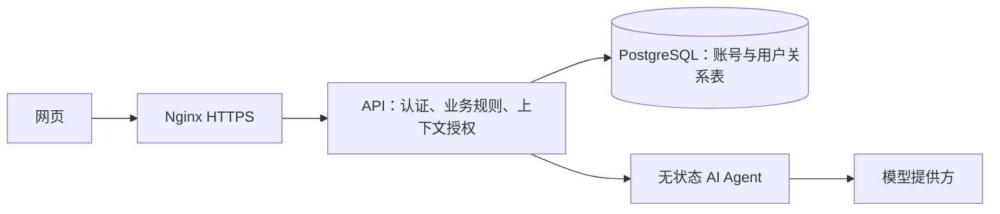

# 架构

当前生产结构：React Web → Rust API → PostgreSQL；Rust API → 独立 AI Agent → 模型提供方。完整配置与运行边界见 [自建部署](self-hosting.md)。

- `client/src/api/` 按领域提供接口；`lib/httpClient.ts` 统一处理认证、超时、版本和账号切换保护。`app/useApplicationData.ts` 管理启动、同步、草稿保护和数据刷新。
- `server/src/hosted.rs` 根据服务端会话选择用户数据库，执行版本检查、数据库 advisory lock、导出和导入。用户请求不能指定租户。
- `server/src/accounts.rs` 管理公开注册、Argon2 密码、随机会话及撤销和登录限速。任何用户均可通过邮箱和密码注册，会话在数据库仅保存哈希。
- `server/src/db/` 保留领域仓储和事务校验；`storage.rs` 隔离 SQL 引擎。PostgreSQL 保存关系表，SQLite 仅用于旧文件迁移和本地开发回归。
- `server/src/runtime.rs` 负责启动配置与维护命令，`http/` 按功能注册路由和转换输入输出，`application/` 复用组合、分析和模型配置的业务流程。
- `server/src/models/` 保存每日资产、行情值和分析轨迹的数据契约。数据库不引用 AI 工作流实现、网络 Provider 或行情刷新模块；HTTP 错误映射独立放在 `http/error.rs`。
- `server/src/ports/analysis.rs` 定义冻结上下文的执行接口；`server/src/agent.rs` 实现独立进程或本地内联执行适配。工作流、Provider、输出验证仍在 `server/src/ai/`，其代码不调用仓储。
- `server/src/db/secrets.rs` 拥有账号凭据持久化，调用 `server/src/secrets.rs` 在托管模式用主密钥加密用户凭据，AAD 包含用户 schema 和密钥用途；本地开发同样使用主密钥加密，按密钥用途绑定 AAD。

账号使用独立 PostgreSQL schema，而不是共用单用户 AppState。每个请求只持有已认证用户的连接；连接关闭即释放任何未显式释放的会话锁。业务写入和数据版本在同一事务推进，避免应用崩溃造成“数据已变而版本未变”。多个 API 实例使用同一数据库锁，客户端旧版本写入返回 409。

AI 分析的预览与执行共享同一准备过程，读取并冻结用户授权的数据；外部模型工作期间释放账户锁，避免长时间阻塞其他设备。应用服务依赖 `ports/analysis::AnalysisExecutor` 执行接口，Agent 适配器负责独立进程调用或本地内联运行。结果保留输入版本与分析轨迹，随后通过 API 写入分析历史。独立 Agent 运行不需要数据库连接或账号服务。

当前同步是在线版本检查及按需刷新，没有离线写入队列、实时推送或持久 AI 作业队列。连接按请求创建，业务请求并发有上限；此实现面向小规模自建，进一步扩大并发应增加连接池、分页/增量资源接口和任务队列。

源码层面的职责、依赖方向、生命周期、扩展步骤与本轮验证见 [模块边界与开发约束](module-boundaries.md)。运行 `npm run check:architecture` 可检查反向依赖、跨功能页面引用和依赖循环；常规测试入口执行该检查。

## 财务一致性约束（2026-10-15）

| 风险 | 领域边界与必须保持的不变量 | 验证入口 |
| --- | --- | --- |
| 历史成交重复扣现金 | cash_state 基准与 trade_settlements 逐笔归属；历史补录不结算，旧更正不推翻已核对余额 | financial_tests 的现金基准测试、HTTP 流程 |
| 异常链被删除 | trading_quarantine 保留原文；隔离暂停计算，预览后显式修复，永久留痕 | trades 异常隔离/修复测试 |
| 拆股估值错配 | corporate_actions 独立于原始成交；先核对，再重放，保持总成本和现金；拒绝不可表示的零碎股 | 拆股、合股、撤回与备份回归 |
| 丢失响应重复提交 | 财务回执与领域变化同事务，先识别回执后版本检查，客户端固定原请求 | 回滚注入、丢响应、双实例 HTTP 测试 |
| 更正不可追溯 | financial_journal 前后原文、精确现金差额、原因、时间、操作编号随事务提交 | 日志写入失败整次回滚测试 |
| 浮点精度漂移 | decimal 输入、cash_state、holding_amounts、源行情/FX、accounting、每日精确原值、备份；number 仅投影 | 大额分位、行情原始十进制、还原一致性测试 |
| 不可信数据生成行动 | 估值来源/时点与 decisionReady；缺失、过期、隔离、待核对时清空行动，AI 输出验证安全动作；不同资产的估值日期可以不同 | valuation、planning、structured_output 测试 |

数据库模块不联网。行情刷新属于显式应用用例；GET 快照/版本/历史汇率不刷新或写入。持仓编辑的外部查询在提交前完成，成交保存不依赖外部行情。每次更正由所属领域事务负责回执、源记录、投影及历史的一致性。

正式验收运行 npm run test:financial，并设置 MARIO_TEST_PG_BIN 指向 PostgreSQL 工具目录。门禁创建独立临时集群，运行真实迁移、SQLite 和 PostgreSQL HTTP、多实例版本/租户隔离、pg_dump/pg_restore；对恢复的账号及租户表逐表比较。它不读取部署 .env 或操作生产数据。默认 scripts/test.sh 包含此门禁，缺少 PostgreSQL 工具时必须失败，不能静默跳过。

功能代码不能保证行情供应商无遗漏，也不能替代券商资产核对、部署环境备份及主密钥托管。本轮实现不提供自动换汇、转托管、零碎股现金替代、交易执行或税务账簿。旧版本已删除的原文和丢失精度不能从当前缓存反推；需要原备份或券商证据。

## 模块独立性增量（2026-10-18）

行情接口位于 `ports/market.rs`，`market_data.rs` 和 `prices.rs` 只实现网络查询、解析和实例缓存。`application/fx.rs`、`application/prices.rs` 负责账号刷新与估值编排，`composition::MarketRuntime` 创建并注入供应商，拥有后台任务并在服务退出时取消。公开行情在同一服务实例内跨账号共享，业务数据与密钥不进入缓存；强制刷新通过供应商接口失效缓存。

分析事件属于 `models/inference.rs`，执行接口和发送通道属于 `ports/analysis.rs`；应用、HTTP 和 Agent 不再从 AI 工作流实现中导入这些公共契约。凭据数据库操作归 `db/secrets.rs`，加解密模块不依赖数据库。

前端跨页提问由应用壳接收 `onAsk`、导航并传入待接收草稿；功能页不依赖应用导航或约定存储键。财务回执恢复属于 `api/portfolio/financialRequest.ts`，通用 HTTP 负责认证、版本与传输，并在回执核对完成前持续保护正在进行的写入。

迁移边界、验收与尚未实施的问题见 [模块独立性审计](module-independence-2026-10-18.md)。模型配置事务、行情等待期间的账号锁、模型管理端口与前端会话状态仍需后续改造；此次检查通过不代表这些问题已消失。
