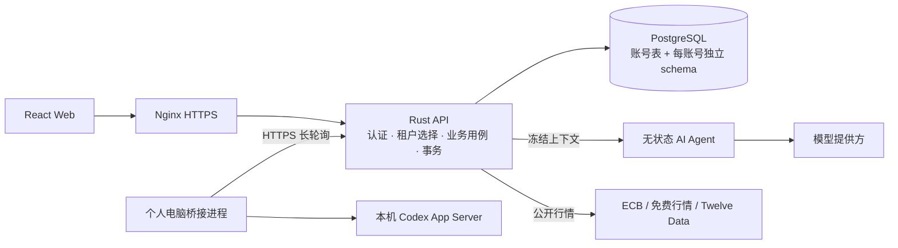
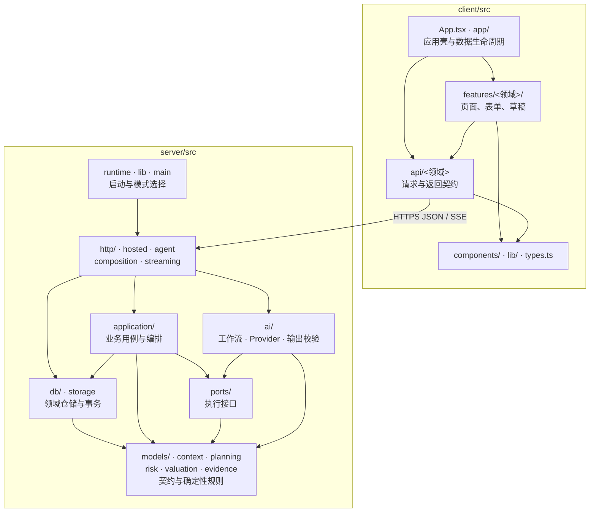
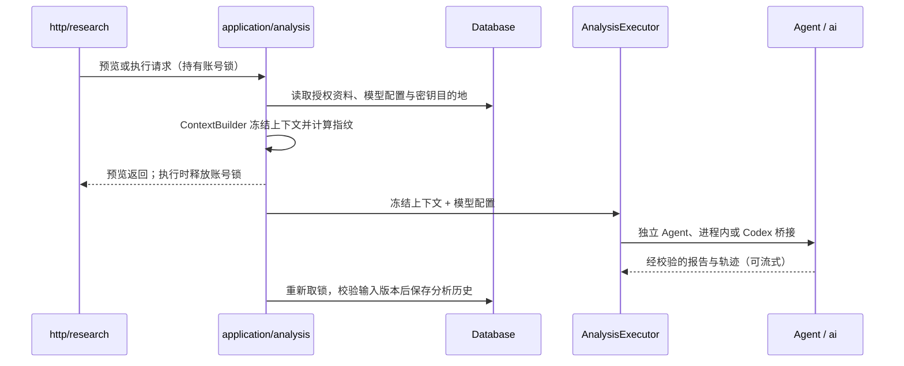

# 架构

本文是全局代码设计的总体说明：系统由哪些运行单元组成、源码如何分层、依赖朝哪个方向、状态和事务归谁、关键数据怎样流动，以及哪些不变量不能被局部改动破坏。修改跨模块结构前先读本文；具体模块的扩展步骤、耦合审计与验收记录见 [模块边界与开发约束](module-boundaries.md)，部署与运维见 [自建宿主机服务](self-hosting.md)。

本文只描述当前生产路径。长期有效的架构变化必须在同次提交中更新本文与 [模块边界](module-boundaries.md)；一次性的验收数据写入对应的审计或发布文档，不在这里累积。

## 1. 系统形态

项目是模块化单体：一个 Rust 二进制按启动参数承担不同角色，一个 React 单页应用，一个 PostgreSQL。没有微服务、消息总线或持久作业队列。

同一个 `mario-server` 二进制由 [`runtime.rs`](../server/src/runtime.rs) 选择运行角色：

| 角色 | 触发条件 | 入口 | 数据 |
| --- | --- | --- | --- |
| 多用户 API（默认） | 必须设置 `DATABASE_URL` | `hosted::serve` | PostgreSQL，按账号 schema 隔离 |
| 无状态 Agent | `MARIO_ROLE=agent` | `agent::serve` | 无数据库，只接收 API 发来的冻结任务 |
| Codex 桥接 worker | `--codex-bridge <站点>` | `codex_bridge_worker::run` | 运行在用户电脑，不监听端口，不读 `auth.json` |
| 维护命令 | `--reset-password` | `runtime.rs` | 重置指定账号密码 |

PostgreSQL 是唯一的数据存储，没有单机或免登录模式。本地开发（`npm run dev`）与测试使用同一条多用户路径：[`scripts/postgres-cluster.mjs`](../scripts/postgres-cluster.mjs) 在 `.runtime/dev` 维护持久开发集群，或为测试创建一次性集群；开发者在浏览器注册账号，与生产流程一致。

生产部署由 [`deploy.sh`](../deploy.sh) 在宿主机以 systemd 启动一个主运行器（[`scripts/host-runtime.mjs`](../scripts/host-runtime.mjs)），依次拉起 PostgreSQL、Agent（仅监听本机端口）和 API；Nginx 反向代理 API 与静态网页。推送代码不等于部署。

## 2. 设计原则

1. **服务端是唯一事实来源。** 前端只持有已显示快照和未保存草稿；金额、会计结果、估值状态和数据版本都由服务端计算并返回。
2. **账号隔离由服务端决定。** 请求不能指定租户；认证后由服务端按用户 ID 选择数据库连接，账号数据不进入跨账号缓存。
3. **写入有版本，财务写入有回执。** 业务写入与数据版本在同一事务推进；客户端用 `If-Match` 提交，过期写入返回 409；财务写入的回执与领域变化同事务提交，丢失响应可以安全重放。
4. **精确金额。** 金额以十进制原文和精确值持久化，浮点只作展示投影；前端显示不经过二进制浮点重算。
5. **AI 只消费冻结输入。** 分析前在服务端读取、授权、冻结上下文并计算指纹；AI 模块不读数据库、不写资产、不执行交易，模型输出必须经过结构校验才成为结果。
6. **可替换能力经端口注入。** 模型执行与行情查询通过 `ports/` 中的 trait 注入，测试可以替换；不为普通仓储查询或单步 CRUD 增加抽象层。
7. **单一生产路径。** 非兼容更新删除旧实现；只为存量数据恢复保留隔离的迁移适配，并写明移除条件（见第 9 节）。

## 3. 分层与依赖方向

箭头表示"可以依赖"。底层（契约与确定性规则）不依赖任何上层；`ports/` 只依赖契约，实现放在适配器中；`application/` 不认识 Axum、Agent 进程或具体行情供应商。简单仓储查询与单次 CRUD 允许沿用 HTTP → `Database` 的直接路径。

`npm run check:architecture`（[`scripts/check-architecture.mjs`](../scripts/check-architecture.mjs)）静态强制以下规则，并检测前后端依赖循环：

| 范围 | 禁止 |
| --- | --- |
| 前端功能页 | 引用 `app/`、`App.tsx`、`main.tsx`；引用其他功能目录 |
| 前端共享层 | `lib/`、`components/`、`api/`、`types.ts` 引用功能页或应用壳；`lib/` 引用 `api/`；`api/` 跨领域互相引用 |
| 前端可达性 | 任何生产模块无法从 `main.tsx` 到达 |
| 契约与确定性规则 | `models`、`context`、`planning`、`risk`、`valuation`、`evidence` 依赖仓储、网络、传输、`application`、`ai` 或 `ports` |
| `ports` | 依赖 `models`、`context`、`error` 以外的模块 |
| `ai` | 依赖仓储、账号、行情供应商、传输适配器或 `application` |
| `db` | 依赖 `application`、`ai`、`agent`、`http`、`hosted`、`runtime` 或行情网络模块 |
| `application` | 依赖传输/进程适配器或具体行情供应商；`application/analysis.rs` 直接引用 `ai` |
| `agent` | 依赖 `db`、`storage`、`accounts`、`application`、`http`、`hosted`、`runtime` |
| `secrets`、行情适配器 | `secrets` 依赖 `error` 以外模块；`prices`/`market_data` 依赖 `models`、`ports`、`error` 以外模块或持有静态可变资源 |
| 通用 | 非 `db` 模块使用通配导入；契约、仓储、应用层使用 `axum`；`application`/`ports` 直接使用 `reqwest`；`storage.rs` 以外直接使用数据库驱动 |

静态检查与编译、行为测试互补，不能证明宏展开或所有运行时路径的隔离。新增或调整边界时同步更新检查器及其测试，不通过扩大豁免掩盖耦合。

## 4. 后端模块地图

| 模块 | 职责 |
| --- | --- |
| `main.rs`、`lib.rs`、`runtime.rs` | 进程入口、模块声明、环境与参数解析、模式选择、维护命令、优雅退出 |
| `composition.rs` | 创建行情供应商，组装 `MarketServices`，拥有后台刷新任务并在服务退出时取消 |
| `hosted.rs` | 多用户模式：公开注册/登录路由、认证中间件、并发槽位、账号锁、`If-Match` 版本检查、财务回执重放、导出/导入、CORS 与静态网页 |
| `http/` | 按领域注册路由（`portfolio`、`research`、`reviews`、`settings`、`codex_bridge`）并转换输入输出；`policy.rs` 定义免版本检查的显式例外；`error.rs` 把领域错误映射为 HTTP 状态 |
| `accounts.rs`、`authentication.rs` | 自建账号、Argon2 密码、随机会话（库内只存哈希）、撤销与登录限速；Agent 令牌的常量时间比较 |
| `application/` | 跨仓储与外部端口的用例：`analysis`（冻结、预览、执行、保存）、`portfolio`/`prices`/`fx`（行情刷新与估值编排）、`model_settings`（模型接口切换策略、Provider 构造与连接测试）、`codex_bridge`（账号配对） |
| `ports/` | `analysis::AnalysisExecutor` 与事件通道；`market::FxRateProvider`、`SecurityPriceProvider` |
| `agent.rs` | `AgentExecutor`：配置 `MARIO_AGENT_URL` 时把冻结任务发给独立 Agent，否则进程内执行；Codex 桥接任务始终在 API 进程经桥接中继执行。同文件提供 Agent HTTP 服务 |
| `ai/` | `orchestrator` 按 `workflow`（当前 v8）执行可选搜索、资料筛选与单次报告生成；格式错误只修复一次；`provider` 定义模型接口，API 侧实现为 `native_provider`（供应商 HTTP 接口）与 `bridge`（经配对桥接中继），`codex` 只由用户电脑上的桥接 worker 调用；`selection`、`structured_output` 负责筛选与确定性引用、输出校验；`streaming` 解析流式草稿 |
| `codex_bridge_worker.rs` | 用户电脑上的桥接进程，长轮询 API 领取任务并调用本机 Codex |
| `market_data.rs`、`prices.rs` | 行情端口的网络实现与实例内有界缓存；只处理公开行情，不读写账号数据 |
| `db/`、`storage.rs` | `Database` 门面下的领域仓储（持仓、成交、期权关联与报价、现金、公司行动、金额、每日资产、汇率、研究、复盘、设置、凭据）、财务回执与日志、快照构建、同步/备份格式与校验、schema 迁移；`storage.rs` 是唯一的 PostgreSQL 驱动适配：专用客户端线程、动态类型行、事务与 `search_path` 绑定的账号 schema |
| `models.rs`、`models/` | 序列化契约、值校验、精度与日期规则、期权合约计价及多空头重放、推理事件与执行时限 |
| `context.rs` / `context/fact_sheet.rs`、`planning.rs`、`risk.rs`、`valuation.rs`、`evidence.rs` | 确定性计算：分析上下文构建与预览、再平衡规划、风险检查、估值状态、本地证据检索 |
| `attachments.rs`、`secrets.rs`、`streaming.rs`、`error.rs` | 附件解码与文本提取、主密钥加解密（AAD 绑定 schema 与用途）、共享 SSE 响应、统一错误类型 |

## 5. 前端模块地图

| 模块 | 职责 |
| --- | --- |
| `main.tsx`、`App.tsx` | 挂载、页面组合与导航；跨页动作（如 `onAsk`、`onOpenSettings`）由应用壳接收并转发 |
| `app/useApplicationData.ts` | 服务端数据生命周期：启动、快照与模型配置加载、自动同步、请求代次、草稿保护与远程更新提示 |
| `app/navigation.ts` | 视图、导航分组与标签 |
| `features/portfolio` | 我的情况：持仓、成交、股票关联期权与报价、现金、汇率、每日资产、资产历史与财务日志 |
| `features/methodology` | 左侧独立入口“投资方法论”：编辑账号专属提示词、保存及填入初始范本；页面持有草稿，应用壳负责同步保护 |
| `features/research` | 问答（流式回复、报告、引用来源）与研究证据工作台 |
| `features/reviews`、`features/settings`、`features/account` | 复盘；模型设置、问答预设与 Codex 桥接；网页账号与服务端数据备份 |
| `api/<领域>.ts` | 领域请求与返回契约；`api/portfolio/financialRequest.ts` 负责财务回执核对与快速编辑排队 |
| `lib/httpClient.ts`、`transport.ts`、`requestPolicy.ts` | 认证、超时与只读重试、版本采纳、账号切换保护、请求类别 |
| `lib/autoSync.ts`、`syncEvents.ts`、`webSession.ts`、`useRequestGuard.ts` | 版本轮询、数据事件、网页会话与多账号、过期响应抑制 |
| `components/`、其余 `lib/`、`types.ts` | 无功能生命周期的展示组件、格式化与日期工具、共享契约类型 |

### 界面与显示约定

- `main.tsx` 先加载 `styles/tokens.css`，再加载基础样式和工作区样式。颜色、字体、字号、间距、圆角和动效使用统一变量；沿用 React、原生 CSS 和 lucide，不请求外部字体、不引入 UI 或图表框架。
- `app/useDisplayPreferences.ts` 拥有浏览器本地显示偏好，通过受控属性传给资产页和共享设置表单，再更新根节点 `data-pnl`、`data-mask-amounts`。默认红涨绿跌，可切换绿涨红跌；盈亏统一使用 `--up/--down` 并配符号，买卖方向用中性描边。偏好不进入账号数据库、备份或写入版本。
- `lib/format.ts` 直接对十进制源字符串舍入和分组，金额按币种精度补齐（通常两位，JPY 为零位），数量和价格可显式指定精度，负号使用 `−`。数字列右对齐并采用等宽数字；数值输入保留原文，不把千分位文本写进原生数值控件。
- 结构化金额使用 `data-money`，金额输入使用 `data-money-input`；隐藏金额只影响显示，原文、复制和导出仍含真实数据。它不构成数据脱敏或加密。
- `Callout`、`Badge`、`DataStamp`、`Menu`、`Skeleton`、`EmptyState` 和 `Drawer` 只提供共享展示与可访问交互。菜单支持键盘与关闭后焦点恢复；抽屉保留草稿保护、忙碌锁定、背景隔离和焦点约束。
- 同步入口集中在侧栏状态块，移动端顶部显示同一状态。汇率由侧栏入口打开抽屉；不再有页头同步上下文或浮动汇率组件。页面内容上限 1440px，阅读和表单页上限 960px。
- 数据问题只在相关持仓行显示一次，按 `IssueCode` 提供汇率、拆合股、交易链或存款核对入口；总览显示问题数量并定位到该行，不显示全局停用横幅。日期、来源和参考价使用中性元数据，其他币种存款与常用币种共用列表。缺汇率或持仓金额不可用时不以旧历史总值替代当前总值。
- `features/portfolio/useAssetHistory` 持有单页历史请求、区间与分页状态，供 `AssetOverview` 与 `AssetHistory` 共享。资产总览读取服务端每日精确总额或会计快照，趋势默认展开；前端只投影曲线坐标，不新增会计合计、持仓占比或汇兑计算。
- 问答提供实际资料预览，已完成报告的引用在抽屉查看；流式阶段只映射服务端状态，未知阶段保留原文。来源、方法论版本等元信息仅显示契约中实际存在的字段。

## 6. 关键数据流

### 6.1 多用户请求生命周期

1. Nginx 转发到 API；公开路由只有注册、登录、登出与服务信息，请求体上限 16 KB。
2. 私有路由先取并发槽位（业务 24、认证 2），满载返回繁忙。
3. 校验 Bearer 会话，按用户 ID 打开该账号 schema 的连接，取数据库 advisory 账号锁并读取数据版本。
4. 写入请求（由 `http/policy.rs` 判定）比较 `If-Match`；不一致时，财务写入先查回执，命中则返回原结果，否则返回 409 与当前版本。
5. 构造只含该账号连接与共享依赖的 `RequestContext`，交给领域路由；响应带 `x-data-revision` 与 `no-store`。连接关闭时释放残留的会话锁。

### 6.2 AI 分析

预览与执行共享 `AnalysisService::prepare`，避免授权与指纹出现两套实现。执行失败不写历史；外部模型运行期间不持有账号锁。AI 上下文统一使用 `facts` 事实卡，精确金额去重、比例在领域层计算，`facts.dataIssues` 合并问题码、影响持仓、计算范围与期权再平衡排除信息；原始档案、会计双份投影、规则、复盘与每日资产不再作为上下文构建。估值计算链只冻结在 `BuiltContext.valuationEvidence` 并写入轨迹审计，模型输入使用紧凑 JSON；输出校验保留结构、证据 ID 与原值引用规则，不强制动作逐字匹配固定文案。追问单独冻结 previousTurn（上一轮问题、结论与动作，总计至多 800 字符），当前 question 不拼接历史；历史摘要不可作为事实引用。历史分析冻结上下文不改写。新报告使用回答、建议、事实和可选追问的最小契约；`models/analysis_history` 隔离旧报告读取类型，旧生成契约不再接受。

投资方法论通过 `GET/PUT /api/investment-methodology` 管理，正文与初始范本契约归 `models/methodology.rs`，使用账号 schema 内的 `settings[investment.methodology]` 保存。没有存量值时返回初始范本，不执行隐式写入。准备时服务端读取已保存正文并纳入冻结 payload、预览指纹和历史轨迹；分析各阶段将该正文作为方法论指令，数据解释、来源校验与输出格式仍由系统约束。更改方法论使旧预览失效，已启动分析继续使用冻结版本。

### 6.3 行情与汇率

`composition::MarketRuntime` 在进程启动时创建供应商并定时刷新公开行情；`application/prices.rs`、`fx.rs` 通过端口查询并在账号事务中写入估值与汇率来源。快照、版本与历史汇率的 GET 不触发刷新或写入；持仓编辑的外部查询在提交事务前完成，成交保存不依赖外部行情。

### 股票与关联期权

期权以 `holding_options` 绑定账号内同账户、同币种的标的股票，自身复用持仓和成交。`models/options` 按整数张数、每单位权利金及显式合约乘数独立重放：多头为权利金资产，空头为有符号负债，不混入股票股数与成本。`db/options` 维护不可变合约定义、独立人工报价及 `stockOptionTotals` 展示投影；现金、审计、回执、每日观测与数据版本沿用同一仓储事务。组合会计按底层资产计数一次，股票列表按标的汇总显示。普通股票行情与拆股计算不得作用于期权；未平仓期权及其标的从再平衡目标排除，其他持仓仍按完整组合总值计算偏差，行权、被指派、保证金及合约调整尚无自动处理路径。到期作废只接受到期日经核对后的显式记录。每日观测冻结合约元数据，备份 v23 包含关联，旧版无期权备份可事务恢复。

快照构建先读取全部 `SnapshotData`，由 `amounts` 生成精确会计投影，`valuation::issues` 唯一判定问题，再单次构建快照；`planning` 根据问题码、完整组合分母及期权排除清单计算精确再平衡。目标权重合计不为 100%（十进制容差 1e-8）只阻止再平衡，通过 `invalidTargetWeights` 和 `targetTotalPct` 表达。规划日期覆盖参与分母的全部持仓，包括只排除动作的期权及标的。不可用持仓的列表、详情和交易汇总不展示不可靠的派生数字，原始成交仍可核对。快照派生字段不持久化，不改变备份格式。

### 6.4 同步、备份与恢复

前端按版本轮询，版本变化后才拉取快照，没有离线写入队列或实时推送。投资方法论随账号备份的 settings 行导出，恢复前校验非空及 4000 字符上限；缺少该项的旧备份恢复为初始范本。沿用现有备份结构，不新增 schema 迁移；恢复失败整体回滚。账号导出/导入使用版本化的同步数据集（`db/sync_format.rs`），导入在单一事务内校验表关联、精确金额与财务一致性后整体替换，失败整次回滚。宿主机级加密备份与迁移见 [服务器间打包、下载与恢复](data-migration.md)。

## 7. 状态与事务归属

| 状态 | 所有者 | 说明 |
| --- | --- | --- |
| 启动配置、行情供应商、AI 执行器 | 进程（`runtime`、`composition`） | 可替换，不持有账号数据 |
| 公开行情缓存 | `prices`/`market_data` 实例 | 有界、失败退避，跨账号共享，只含公开数据 |
| 会话与账号 | `accounts` | 会话仅存哈希，可撤销 |
| 账号业务数据与版本 | `db` 领域仓储 | 业务写入、回执、日志、投影与版本同事务提交 |
| 模型配置与凭据 | `db/settings.rs` + `db/secrets.rs` + `secrets.rs` | 接口、地址、模型名、密文与目标绑定由 `save_model_configuration` 在同一事务写入，失败保留原配置；主密钥加密，AAD 绑定账号 schema 与用途 |
| 冻结分析输入 | 单次分析请求 | 执行期间不可变，结果记录输入版本与轨迹 |
| 桥接配对 | `application/codex_bridge` + `ai/bridge` | 只存配对摘要与短期通道，不接触 OpenAI 凭据 |
| 已显示快照、同步状态 | `app/useApplicationData` | 请求代次防止旧响应覆盖新数据 |
| 显示偏好 | `app/useDisplayPreferences` | 当前浏览器 localStorage；不触发同步、账号写入或数据迁移 |
| 未保存草稿与单页请求状态 | 各功能页 | 应用层只知道是否需要保护 |

## 8. 关键不变量

- 账号之间不共享连接、缓存中的业务数据或密钥；客户端无法选择租户。
- 数据库模块不联网，AI 模块不访问数据库，Agent 不需要数据库连接或账号服务。
- 多步财务写入是单一领域事务，不能为拆分文件而拆开。
- 只停用无法正确计算的部分。缺汇率、待确认拆合股、隔离交易使组合总值与再平衡不可用；其他持仓仍显示原币金额。存款待核对不阻止计算，日期、参考价和手工来源只作元数据。

### 财务一致性约束（2026-10-15）

| 风险 | 领域边界与必须保持的不变量 | 验证入口 |
| --- | --- | --- |
| 历史成交重复扣现金 | cash_state 基准与 trade_settlements 逐笔归属；历史补录不结算，旧更正不推翻已核对余额 | financial_tests 的现金基准测试、HTTP 流程 |
| 异常链被删除 | trading_quarantine 保留原文；隔离暂停计算，预览后显式修复，永久留痕 | trades 异常隔离/修复测试 |
| 拆股估值错配 | corporate_actions 独立于原始成交；先核对，再重放，保持总成本和现金；拒绝不可表示的零碎股 | 拆股、合股、撤回与备份回归 |
| 丢失响应重复提交 | 财务回执与领域变化同事务，先识别回执后版本检查，客户端固定原请求 | 回滚注入、丢响应、双实例 HTTP 测试 |
| 更正不可追溯 | financial_journal 前后原文、精确现金差额、原因、时间、操作编号随事务提交 | 日志写入失败整次回滚测试 |
| 浮点精度漂移 | decimal 输入、cash_state、holding_amounts、源行情/FX、accounting、每日精确原值、备份；number 仅投影 | 大额分位、行情原始十进制、还原一致性测试 |
| 不可信数据生成行动 | 结构化 issues 定位持仓；缺汇率、待确认拆合股和隔离阻止依赖总值的计算；存款核对与价格时点不阻止计算；plan 返回阻止原因与排除持仓 | valuation、planning、structured_output 测试 |

每次更正由所属领域事务负责回执、源记录、投影及历史的一致性。正式验收运行 `npm run test:financial`：门禁创建独立临时集群，运行真实迁移、托管 HTTP 流程、多实例版本/租户隔离、`pg_dump`/`pg_restore` 并逐表比较，不读取部署 `.env` 或生产数据。PostgreSQL 工具从 `MARIO_TEST_PG_BIN` 或 `pg_config --bindir` 查找；`scripts/test.sh` 包含此门禁，缺少 PostgreSQL 工具时必须失败。

功能代码不能保证行情供应商无遗漏，也不能替代券商资产核对、部署环境备份及主密钥托管。当前不提供自动换汇、转托管、零碎股现金替代、交易执行或税务账簿。

## 9. 保留的迁移适配

以下代码只服务存量数据恢复，不构成第二条生产路径：

- 旧 JSON 备份结构（同步数据集 v1 起）、旧租户 schema 补列与一次性数据迁移（`db/schema.rs`、按 `POSTGRES_SCHEMA_VERSION` 只执行一次）。
- 旧收支缺少 exactAmounts 时，将已保存数值转换为事实卡十进制字符串；不推测此前已丢失精度，待存量收支均以精确值重存后可移除。
- 历史报告与引用的读取适配，保留历史原文；v7 的研究计划、候选、风险审查及模型证据核对字段仅供读取，v8 不再产生这些内容。

### SQLite 退役（2026-10-18）

运行时只有 PostgreSQL。本地 SQLite 服务、单令牌认证、`--allow-unauthenticated-dev`、旧数据目录迁移、`--export-data` 与服务器本机 Codex 登录已删除；Codex 只通过用户电脑上的配对桥接使用。仓储 SQL 改为原生 PostgreSQL 写法，不再在运行时改写方言。旧 SQLite 文件的唯一迁移路径是 Git 标签 `legacy-sqlite-export` 中的 `--export-data`，导出的同步数据集由当前版本导入（见 [数据迁移](data-migration.md#旧版-sqlite-数据)）；该标签不再接收修复。

### 长期记忆移除（2026-10-18）

问答准备过程仅冻结本轮授权档案和研究证据，历史 AI 回答不再构建为候选记忆或自动召回；Agent 不接收独立的 memories 参数。前端入口、偏好接口、检索模块及专属契约已删除。仓储在升级时删除旧偏好表、清理预设开关和分析中的记忆元数据；历史问答正文及冻结引用保留。当前快照格式不导出记忆偏好，旧备份只校验退役表形状并跳过，导入在同一事务内清理元数据并执行财务一致性校验，失败整次回滚。升级前可用现有备份流程保留恢复点。这部分适配待停止支持 v1–v21 备份时移除。

## 10. 容量边界与已知架构债

当前实现面向小规模自建：PostgreSQL 连接按请求创建，业务并发有固定上限，快照为全量读取，同步为轮询，分析没有持久作业或跨实例取消。扩大规模时的接入点分别是连接池、分页/增量资源接口和任务队列；在需求出现前不预先引入。

尚未完成的边界改造见 [模块独立性审计](module-independence-2026-10-18.md)：行情等待期间的账号锁、模型管理端口与前端会话状态。架构检查通过不代表这些问题已消失。

## 11. 修改架构时

1. 先写简明设计：目标、涉及模块与职责、接口与数据流、依赖方向、状态和事务归属、验证方式；非兼容更新说明替换关系与数据迁移。
2. 确定数据与事务的所属领域，再放置契约、仓储操作与用例；需要外部能力时增加或复用 `ports/` 接口并在适配器装配。
3. 更新本文受影响的章节与 [模块边界](module-boundaries.md)，必要时调整 `scripts/check-architecture.mjs` 及其测试。
4. 删除被替代的旧实现，运行 `npm run check:architecture` 与范围匹配的测试（入口见 [模块边界](module-boundaries.md#开发流程)）。

## 相关文档

- 产品与方法：[产品目标与长期原则](product-vision.md)、[投资方法论](methodology.md)、[确定性风险与再平衡模型](planning-model.md)
- 安全与数据：[自建服务信任边界](threat-model.md)、[账号与数据同步](cloud-sync.md)、[AI 数据边界](ai-data-boundary.md)、[可追溯市场数据](market-data.md)
- 领域行为：[真实成交与持仓](holding-trades.md)、[每日资产](daily-assets.md)、[研究证据](research-evidence.md)、[复盘与规则](review-and-rules.md)
- AI：[AI 分析工作流契约](ai-workflow.md)、[问答流式回复](ai-streaming.md)、[可审计的 AI 分析档案](analysis-history.md)、[Codex 桥接](codex-bridge.md)
- 运维：[自建宿主机服务](self-hosting.md)、[宿主机部署](deploy-madeagents.md)、[数据迁移](data-migration.md)、[Web 构建](client-builds.md)
