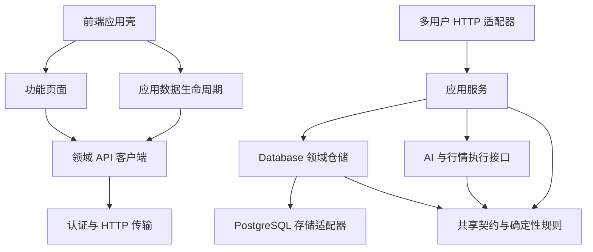

# 模块边界与开发约束

## 设计选择

当前功能增量优先解决[买点观察主线](product-vision.md)中的实际障碍。持仓和交易提供个人事实，AI 负责授权资料上的讨论。以下既有模块和扩展约束不是必须实施的路线图。

采用模块化单体，保持 React Web、Rust API、PostgreSQL 和无状态 Agent 的运行方式。业务边界通过明确的接口、依赖方向和状态所有权约束；独立模块可以单独测试，涉及多个领域的流程由应用层组合。当前规模下，增加服务进程、通用事件总线或每张表一个仓储接口只会增加维护成本。

## 依赖方向



| 层 | 拥有的职责 | 扩展约束 |
| --- | --- | --- |
| `client/src/features/` | 表单、页面请求状态、领域交互 | 不引用其他功能的页面实现；通过共享组件或应用壳组合 |
| `client/src/api/` | 某领域的 URL、请求和返回类型 | 不访问 DOM，不引用其他领域客户端，不自行处理账号与同步 |
| `client/src/lib/httpClient.ts` | 令牌、请求时限、写入前同步、响应版本与账号校验 | 不引用功能页面或领域客户端 |
| `client/src/app/` | 启动、全局同步、跨页组合与刷新 | 页面草稿保留在页面，应用层只记录是否需要保护 |
| `server/src/runtime.rs` | 环境与参数、维护命令、运行角色、退出信号 | 不放业务用例或 HTTP handler |
| `server/src/http/`、`hosted.rs` | 路由、认证、租户选择、版本检查、输入输出转换 | 多步业务流程交给应用服务；简单仓储查询和单次 CRUD 可直接调用 Database |
| `server/src/application/` | 冻结与保存分析、模型设置、行情辅助的组合写入 | 不依赖 Axum、启动入口或 Agent 进程适配器 |
| `server/src/models/` 与确定性计算模块 | 序列化契约、值校验、风险、规划、估值、上下文构建 | 不依赖仓储、网络刷新、工作流实现或 HTTP |
| `server/src/db/` | 领域事务、历史不可变性、同步导入和校验 | 不依赖应用流程、AI、HTTP 或行情网络服务 |
| `server/src/ai/` | 冻结输入上的工作流、模型 Provider、输出验证、执行接口 | 不读数据库或账号状态 |
| `server/src/agent.rs` | AI 执行接口的本地/远程适配和无状态 Agent HTTP 服务 | 无账户数据库、业务写入或用户会话依赖 |

`Database` 是领域仓储门面。表的内部协作、组合快照以及持仓成交和每日资产之间的事务是一致性边界，不能为了分文件而拆开事务。`models.rs` 和前端 `types.ts` 是共享契约入口，不复制跨域公共类型；只有具有明确所属职责的契约放入子模块。

`AppError` 负责序列化与底层错误转换；错误如何变成 HTTP 状态码、以及如何隐藏内部诊断，由 `http/error.rs` 决定。

## 状态与生命周期

### 服务端

- 启动配置属于进程。行情 Provider 和 AI 执行器属于进程依赖，可以替换；它们不持有账号数据库。
- 多用户请求先认证，再按服务端用户 ID 选择数据库连接。`RequestContext` 只组合该请求的账号数据库与共享服务依赖；客户端不能提供租户 ID。
- 五年价格历史按证券归公共数据库，来源更新和失败退避跨账号及重启共享；用户汇率覆盖、持仓、密钥和分析历史继续归账号。
- 多用户请求在数据库账户锁内检查 `If-Match`。分析预览、模型连接测试等实际例外只由 `http/policy.rs` 声明，前端 `requestPolicy` 同步对应政策。新增操作默认要求版本，不能因为名字含 `preview` 或 `test` 就自动豁免。
- 分析执行在锁内冻结上下文、模型配置、密钥目的地和指纹；模型执行期间释放账户锁，执行结束重新取锁后保存。失败不产生分析历史；请求退出会关闭连接并释放残留的数据库会话锁。

- 组合快照先读取 `db/snapshot::SnapshotData`，`amounts::build` 生成精确投影，再调用一次 `build_snapshot`。AI 上下文消费结构化问题及规划范围，`structured_output` 校验结构与来源，不按固定中文动作判定有效性。数据问题只由 `valuation::issues` 判定，问题码、持仓 ID 和币种是公开契约；不得按文案筛选风险项或在仓储中事后清空规划。`planning` 拥有再平衡范围与精确金额计算，未平仓期权及标的只排除自身动作，分母仍用完整组合。

### 前端

- 功能页面拥有未保存输入和单页请求状态。`useApplicationData` 拥有已显示快照、可选模型配置、远程更新提示、页面刷新版本和同步控制器。
- 核心快照与模型配置分别加载，模型读取失败不阻止财务功能。刷新时可保留已可用的模型配置，同时记录其读取错误。
- 每次整体加载或刷新使用递增请求代次，较旧响应与卸载后的响应不得更新 UI 或发布数据更新事件。
- 自动刷新在请求前和返回后都检查草稿，避免“开始刷新之后才输入”的内容被覆盖。用户接受新资料后再清除草稿与写入保护；刷新失败继续保留输入。
- `httpClient` 捕获请求的账号与服务地址，发送前、收响应和采纳版本时都校验当前账号。金额快速编辑队列属于组合 API，排队任务保留原账号身份，不会在切换账号后写入新账号。
- 版本轮询、局部汇率读取和长时间分析返回的版本，不直接代替页面已核对的资料版本。普通写入与完整快照按请求策略采纳版本；不能用局部 GET 的版本提前确认尚未加载的远端资产变化。
- 应用壳在离开会卸载的页面前确认草稿；拒绝浏览器历史或地址跳转时恢复原地址与输入。同页导航保留草稿，常驻问答的离开不要求放弃输入。问答接收新公司问题时使旧历史详情请求失效，避免较晚响应清空新问题。
- 功能代码与测试直接引用领域 API 模块。财务回执未确认时 `financialRequest` 抛出 `FinancialRequestError`（`kind: "pending"`），页面经类型守卫保留原请求和输入，不匹配错误文案。
- `MyFacts` 组合问题导航和修复入口，`AssetAmountRow` 只显示属于该持仓（包括关联期权）的 `issues`；日期、参考价与来源使用中性样式。汇率修复复用 `ExchangeRates`，拆合股和交易链修复复用已展开的 `FinancialHistory`，不引入第二套修复状态。不可用会计投影的派生数量、价格和盈亏汇总隐藏，原始成交与审计记录仍保留；概览和迷你走势不推测缺失原因，具体原因归行内问题。
- 资产页的 Ant Design 标签页只拥有展示选择；收支草稿由 `MyFacts` 通过受控属性传给 `ProfileForm`，资产与交易草稿归各自编辑器。打开编辑器和保存期间禁止切换分类。`portfolio.css` 只管理本领域的紧凑布局，继续使用统一设计变量。共享 `NumberField` 用 `Input type="number"` 传递原始字符串和单位，不能用显示格式化结果替换金额输入或改变财务保存协议。
- `app/useDisplayPreferences` 管理本地涨跌色与金额隐藏偏好。功能页通过属性接收值和回调，共享 `DisplayPreferences` 表单不导入应用壳；显示控件标注 `data-presentation`，不将本地偏好视为业务草稿。
- `features/portfolio/useAssetHistory` 是资产页历史查询的唯一状态来源，只供总览读取最近 30 条记录；不得从持仓投影重算服务端总资产。
- 共享界面能力放在 `components/`，无领域 API 依赖。新增提示使用 `Callout`，状态使用 `Badge`，时点使用 `DataStamp`；行尾操作使用支持方向键、Esc 和焦点恢复的 `Menu`。抽屉内 Esc 先关闭菜单，再关闭抽屉。
- `components/InterfaceProvider` 只负责 Ant Design 中文语言与视觉主题，从 `styles/tokens.css` 读取设计变量并跟随系统明暗切换，不持有账号、路由或领域状态。买点观察主要操作与搜索、登录输入使用 Ant Design；既有共享菜单、抽屉和领域控件保留自身的键盘、焦点与草稿保护契约。顶部位置导航由应用壳组合，不让共享展示层反向引用 `app/`。
- 新增金额输出使用 `data-money`，输入使用 `data-money-input`，数量与百分比保持可见；金额格式化仅作用于输出，原生数值输入保留源精度。颜色与字号只在 `styles/tokens.css` 定义，新增颜色须同时给出明暗两套取值；品牌色上的文字使用 `--on-brand`，吸顶元素以 `--chrome-height` 计算偏移。
- 新增页面沿用 1200/900/600px 断点，校验桌面、平板和手机；不得用全局最小宽度掩盖溢出。

## 简化原则

- 持仓、现金和收支只在“我的情况”编辑；“存款与收支”页的收支区域直接展示收支、负债、备用金、投资期限和可承受回撤，标题旁的记账币种即账号基准币种，切换并保存前须确认汇总口径随之改变。财务档案不再包含可投资资产和风险倾向；旧档案与备份中的这两个字段在读取时忽略。
- 问答和历史对话使用同一份报告展示与原始引用，不维护第二套报告、审计面板或无入口组件。
- 本地证据检索直接调用 `search_evidence`，只有一个实现，不预留动态接口。模型、远程 Agent 和行情有多实现接口。
- TypeScript 编译检查未使用的变量与参数；删页面时同时删专用组件、测试和失效样式。动态状态类需结合实际页面核对。
- 汇率入口属于侧栏状态区，打开共享抽屉；抽屉显示当前资产涉及币种及手动覆盖，编辑控件和其他币种按需展开。架构检查同时阻止没有任何生产入口的前端模块。

## 领域扩展约束

### 执行接口与适配器

- `ports/` 是外部执行契约层，只依赖领域契约、冻结上下文和错误类型；流式事件结构归 `models/inference.rs`。
- `application/portfolio.rs`、`fx.rs`、`prices.rs` 只使用行情端口；`composition.rs` 负责实际供应商装配与生命周期；`market_data.rs` 与 `market_data/history` 不读写账号数据，也不持有静态可变资源。
- 账号凭据读写归 `db/secrets.rs`，`secrets.rs` 不依赖仓储。
- 功能页不引用 `app/`（包括导航类型），通过回调通知应用壳：参考资料与复盘使用 `onAsk(question)`，问答使用 `onOpenSettings()`。
- `api/<领域>.ts` 可引用 `api/<同领域>/` 内部实现，禁止跨领域 API 互相引用。财务回执恢复只属于组合 API，`lib/httpClient.ts` 不解释财务回执或组合快照。
- `storage.rs` 是唯一使用数据库驱动的模块，提供自有的 `Value`、`ToSql`/`FromSql`、`Row` 与错误类型；仓储 SQL 使用原生 PostgreSQL 写法。账号锁、版本检查和财务回执只有多用户一条路径，本地开发 `npm run dev` 走同一认证与租户流程。
- Rust 检查解析相对 `super::` / `self::` 路径，防止以相对导入隐藏反向依赖；分析生命周期不得导入 AI 工作流实现。

### 买点观察趋势

`models/watch/trends` 只消费观察计算器已经归一的日期与调整收盘，不访问来源、仓储、账号配置或交易；复用领域 BOLL 计算，中轨均为简单移动平均。`features/watch/WatchTrends` 只读取服务端 `Observation.trends`，拥有范围及查看日期，不在浏览器重算指标、金叉或观察状态；自选和行业详情通过 `WatchEvidence` 共同装配。数据归属与旧观察恢复见[趋势 spec](buy-watch.md#股价趋势与金叉图)，不另建图表接口或行情缓存。

扩展时验证跨 ISO 年周与日历月的聚合、历史周点不引用未来月末、原始／复权价格日期对齐及统一单位、各窗口独立缺失、金叉只在相邻有效周上穿时出现、最新未结束周暂态、旧记录缺字段、JSON 与备份往返。前端覆盖曲线断点、单点与空数据、范围切换、键盘日期查看及自选／行业共用入口；沿用现有架构与完整集成门禁，不放宽原交易和账号事务要求。

### 持仓收盘估值

`models/market/history` 定义五年窗口、精确原价／前复权序列、复权基准及报价，观察投影归 `application/watch_market`；`market_data/history` 只通过公开来源整组取得数据，无账号数据库或价格缓存。`db/public_prices` 拥有每证券完整版本、原子更换、跨进程租约和失败状态；`application/public_prices` 通过历史端口抓取、按证券合并并发、限制来源流程、协调后台更新，禁止依赖账号、HTTP 或具体供应商。四层边界由架构检查强制。

持仓、单独报价及观察都消费同一公共库。`application/prices` 负责账号估值应用，快照读取只采用已入库价格，不联网；显式／后台刷新释放账号锁等待共享资料，重取锁逐持仓校验。账号精确会计、估值证据及当日观测沿用同一事务，不生成交易或现金流。公共价格版本不推进账号版本；账号真正采用新价格后才推进，并返回最终完整快照版本。来源、时点、时限和迁移规则统一见[市场数据](market-data.md#统一公共价格库)。

验证必须覆盖同证券别名归一、多账号价格相同但数量／成本隔离、重启与原生备份恢复、租约过期和旧令牌、实际行情日期倒退、原价／前复权按日期对齐、精确金额、盘中与收盘／夏令时／周末、缺口保留、来源失败不清空、同日更正及快照幂等。公共数据库表不读账号，个人备份不覆盖公共行情；旧证据来源只为恢复保留校验，旧运行入口和内存缓存已删除。

### 网站 ChatGPT 身份登录

网站 Sign in with ChatGPT 是独立的账号能力：`openai_login` 只能依赖错误类型，不访问账号、数据库、本机凭据或模型执行；仅 `hosted/openai` 使用它。身份映射和一次性 OAuth 事务归 `accounts/openai`，所有 SQL 仍通过 `storage`。前端入口归 account 功能，不能导入 settings 桥接实现。接口、凭据边界、迁移和申请步骤见 [网站登录](chatgpt-sign-in.md)。架构检查限制网站 OIDC 与账号仓储、本机授权之间的反向依赖。

### 本机 ChatGPT 官方授权

- `chatgpt_auth.rs` 及子模块只由本机 CLI、桥接 worker 和 `ai/chatgpt.rs` 使用；不能引用账号数据库、应用用例或 AI 工作流，也不得被在线 HTTP、Agent、领域或仓储引用。架构检查同时约束顶层模块和 AI 文件级入口。
- OAuth 回调只监听 `127.0.0.1` 临时端口；PKCE、state、nonce、已签名 ID token 的 issuer/audience/expiry、返回的注册 ID 和实际 scopes 全部校验。账号 / 工作区以已验证 subject + issued client ID 区分，不按邮箱合并。
- `store.rs` 只管理本机凭据，不是第二套业务存储。稳定 host ID、注册和令牌保存在系统用户配置目录的 `mario/chatgpt` 下；跨进程锁串行化刷新，轮换后原子保存，Unix owner-only 权限与 Windows 受保护 DACL 限制本机访问。不得写入浏览器、业务导出、部署环境或日志。
- worker 固定启动时的注册和授权会话；切换默认账号不改变已配对进程，退出后取消流并停止领任务。重新登录同一注册也必须重新启动和配对，不允许旧通道悄悄使用新会话。
- ChatGPT Provider 只请求固定官方 models / Responses 端点，不跟随重定向；使用 `instructions`、`store:false`、`stream:true`，不接受服务器下发的地址、凭据、工具执行配置或任意命令。缺少订阅权限时只保留登录注册，不推理、不切换计费路径。
- 新功能复用已有 `codex-bridge` 配对契约、冻结输入、取消、结果校验和持久化，不新增账号表、HTTP OAuth 路由或数据库迁移。已有 Codex App Server 登录是独立可选执行端，不导入其凭据。
- worker 将注册 ID 与授权会话一起传给本机 ChatGPT Provider；模型目录和 Responses 请求均在读取或刷新令牌的同一凭据锁内校验会话。重新登录复用注册 ID 时，旧 worker 不能取得新授权的访问令牌；刷新保留原会话，选择其他默认账号不改变已配对 worker。
- `npm run test:chatgpt` 使用测试 RSA 密钥、临时凭据目录和本机 HTTP 回调，覆盖签名和授权拒绝、账号注册、刷新字段、文件锁与原子替换、SSE 分片及不完整输出；真实 OAuth 和订阅推理需用户本人执行。使用步骤与上游适用范围见 [本机桥接](codex-bridge.md)。

### 只读证券报价

`GET /market-data/security-price` 的网络锁边界归 `application/portfolio::preview_security_quote`：HTTP 仍经统一认证和外层账号锁，应用层在锁内选定供应商与 key，仅 `SecurityPriceProvider::quote` 的等待通过既有 `without_account_lock` 释放一层锁。该 Future 不读写账号库，成功或错误返回前重获锁。新增调用方必须确认已有一层账号锁，不能再次套锁导致只释放内层；取消整个 Future 沿用 helper 原有的保持释放语义。

预览使用共享价格服务，不因并发无关个人写入新增冲突；不写账号、不推进个人版本。公共资料按统一来源和持久化规则准备。认证响应头仍取结束时版本，前端报价 GET 不据此接受新的资料基准。核验估值和保存普通持仓仍沿用其锁边界；价格刷新已共用解锁及重新校验流程，汇率路径不受影响。并发回归必须使用同账号的独立 PostgreSQL 连接，在供应商挂起时实测 advisory lock，而不能仅凭快照读取或同连接重入宣称锁已释放。行为定义见[行情规范](market-data.md#只读证券报价与并发)，验证入口见[应用锁回归](../server/src/application/portfolio_quote_tests.rs)、[认证 HTTP](../server/src/hosted_quote_tests.rs)及[客户端版本回归](../client/src/api.hosted.test.ts)。

### 期权

期权契约、合约计价及多空头重放归 `models/options.rs`；`db/options.rs` 管理标的关联、独立权利金报价与标的汇总投影，不联网。合约复用持仓、成交、现金基准及财务回执；`db/trades.rs` 验证公共成交形状后，经 `db/corporate.rs` 按合约类型分派到股票或期权计算，不把股票拆股重放套用到期权。股票股数和成本仍只由股票成交维护。

前端 `features/portfolio/StockOptions.tsx` 拥有合约与报价草稿，复用 `HoldingTrades` 的成交提交与未知结果核对。`HoldingDetail` 协调股票、期权表单的互斥编辑，应用壳继续管理快照。`stockOptionTotals` 只供标的分组展示，不回写股票估值或再次累加组合资产。新增财务入口仍受现有全局 `If-Match` 保护，不增加豁免。

新增或修改期权行为需验证：多空头现金符号、非 100 乘数、分次开平仓成本、到期零权利金、同账户标的关联、禁止超额平仓和跨合约混算、报价回执、审计失败回滚、v23 备份与早期备份恢复、含空头的每日资产，以及股票列表分组不重复计数。完整 `npm test` 已包含真实 HTTP 期权流程和原生 PostgreSQL 备份恢复入口。

### 买点观察

公共行业目录契约与校验归 `models/watch/catalog`，随程序发布的 `server/data/watch-catalog.json` 用于首次初始化，另按明确代码清单按目录发布版本执行明确批次的一次性迁移，新增公司由用户选领域，后端核对身份与唯一性，来源自动查询、缺失允许后补；不在运行时读取研究目录。`application/watch_catalog` 负责按行业及全池检查、同标的并发合并、截止日跳过和失败重试；`db/public_watch` 持久化公共目录、独立版本、内部维护元数据及公共最新观察与检查状态。架构检查显式禁止公共仓储依赖账号、其他仓储、应用和网络实现，并约束公共编排不引用私有上下文、AI、HTTP 或具体供应商。公共和账号检查共用行情端口及公开分红仓储，价格与分红 HTTP 请求共用最多 2 并发预算，公共单轮截止为 120 秒。

`CatalogSourceProvider` 是公开公司身份与报告来源查询接口，`market_data/watch_catalog` 仅依赖领域契约、端口及错误，不读取数据库、账号或研究模块。`application/watch_catalog` 通过它解析精确名称/代码，并与行情检查并行补齐当前名单的缺失来源；报告最多 2 并发、补齐每轮 30 秒，失败保留来源与可计算行情。`POST /watch/catalog/resolve` 由 HTTP 校验超级账户、释放账号锁，仅返回公司、不写库；在服务端和前端政策中显式免账号版本。`db/public_watch::complete_sources` 原子核对公司未被移除/修改后补齐来源与日期、推进公共版本；不得用旧网络结果恢复成员。前端只填写名称或代码，不要求来源与核查日期。

v1 → v2 只合并 `watch-catalog-additions-20261107.json` 明确指定的公司并整理领域；v2 → v3 再仅合并 `watch-catalog-screened-additions-20261107.json` 核验名单，不重放旧批次。v3 → v4 仅合并 `watch-catalog-broker-additions-20261107.json` 明确列出的券商并新增券商领域；全目录按代码去重，已有公司的分组、名称及来源保持原样。各步均保留自定义记录、资料及未被本批点名的既有删除，与公共版本在同一事务提交。初始 61 公司/11 领域的来源保存在 `watch-catalog.json`，审计快照用生产 `trailing_dividends` 测试分别复算前批严格 >4% 与券商批严格 >3%，不改变线上 ≥5% 或 BOLL。后续启动不重放清单，停止支持对应旧整站备份后才删除迁移适配。失败保留旧目录，修复后重试；整站备份保留目录及来源，个人 JSON 不修改公共目录。

目录 GET 只读并返回认证后计算的 `canEdit`。目录 PUT 由 HTTP 校验超级账户，通过应用服务交给公共仓储事务锁定并比较自身 `revision`；拒绝修改领域身份、重复代码或无效来源地址，来源缺失可保存，允许清空领域。该路径在 `http/policy` 与前端 `requestPolicy` 明确使用公共版本，不受个人 `If-Match` 约束、不推进个人版本。权限在 `mario_auth.users.is_superuser` 持久化，每次认证读取；首次字段迁移只升级指定已有账号，普通注册不提权，之后重启不恢复撤销权限。公共仓储只接受已认证操作者 ID 作内部元数据，不读账号表。行业刷新 POST 沿用认证和 `If-Match`，网络期间释放账号锁，公共写入不推进账号版本。加入自选仍经 `PUT /watch`，可选 `ifAbsent` 由 `db/watch` 在原事务中保证已存在条目的理由、置顶和网格不被覆盖；普通编辑语义保持。公共快照不是个人历史，不能从行业页构造提醒或回填加入前记录。

前端 `WatchDisplayRow` 只组合市场展示字段和可选的真实个人观察。`WatchList` 复用表格/卡片；`WatchEvidence` 复用指标、分红事件及来源；`WatchCatalogEditor` 拥有公共目录草稿和打开时版本，后台轮询不能改变草稿版本，冲突保留输入；`WatchCatalogDetails` 展示公开详情和加入入口，`WatchDetails` 继续拥有个人网格和交易详情。分组和过滤由 `BuyWatch` 持有，公共读取失败不清空自选，行业页仅轮询读取快照。测试覆盖一次性指定账号升级、普通注册/越权拒绝、权限撤销、目录重启持久化与版本冲突、来源校验和唯一性、空领域及在途移除不恢复成员，以及十一领域、组合筛选、添加去重及 50 家上限、个人信息隔离、未知分红、行情滞后、超时与并发检查、重启和公共表备份恢复。

账号规则契约与比较归 `models/watch/rules`：股息门槛用整数基点，日周各自保存参考轨、模式与偏移；BOLL 仍为 (20,2)。`db/watch/rules` 在账号 settings 保存 `watch.rules`，与旧提醒清除同事务提交，比较 `expectedRules` 并复用账号版本校验。读取个人及 HTTP 行业响应时只读投影当前规则，不向公开仓储反向加入账号依赖；在途观察提交时使用最新账号规则。历史观察保留规则与精确股息条件，`application/analysis` 冻结实际规则及历史原值，不能继续拼接固定门槛。`WatchRuleStrip` 在条件栏逐项就地编辑百分比并转换整数基点，默认值来自 `WatchBoard.defaultRules`；后端提供规则、精确达标结果和加入自定义门槛后的参考价。旧的 `minYieldPct`／`bandDistancePct` 板级字段已由 `rules` 替换，不保留第二条固定规则路径。v28 备份显式导出并校验配置，v27 及更早缺项恢复默认，失败保留原配置与数据；没有新增表或账号 schema。验证覆盖全部参考轨／模式／正负偏移／边界、股息精度、配置冲突和写入失败回滚、提醒基准与在途旧结果、账号隔离、公共快照不变、历史不变和备份恢复。

观察桌面内部按职责划分：`BuyWatch` 负责读取、写入和本页筛选/展示状态，`presentation` 负责搜索排序与文本投影，`WatchList` 负责紧凑表格和卡片，`WatchSignals` 负责 BOLL 坐标与参考价呈现，`WatchDetails` 复用共享抽屉展示来源/事件/交易，`WatchWeekly` 将真实观察排成日期矩阵。新视图都消费同一份 `api/watch` 契约，不互相持有业务状态，不访问其他功能实现。`WatchList` 把表头和置顶操作回传给 `BuyWatch`；`presentation` 在筛选结果内将置顶公司排在最前，再按当前指标比较。置顶由 `db/watch` 写入已有名单 JSON，编辑保留该值；后台保存观察时只比较观察输入与条目创建时间。服务端 `models/watch::dividend_prices` 负责精确参考价，仓储仅在读取 `WatchRow` 时装配，不把展示字段写回历史或引入 schema 迁移。

`WatchGrid` 展示金额、各档股数与测算并拥有编辑草稿，`gridDraft` 只负责按用户范围、股息率百分点间距、买卖股数递增比例生成可编辑指令，不计算金额。保存经 `BuyWatch` → `api/watch` → `http/watch` → `db/watch`。仓储保存方案并在备份导入时验证；`models/watch/grid` 校验金额、整数股数与生成设置，用十进制计算下跌至不同深度再反弹至最低股息率档的用款、预算差额、卖出不足和余股估值，不自动清仓；参考价与已有分红依据共用覆盖校验。schema 15 升级及旧备份导入经 `db/watch_grid_migration` 将旧比例方案原样转存 `previousGridPlan`，历史契约和校验归 `models/watch/grid_archive`，只读展示原分母/比例，不参与新测算；旧备份停止支持后移除适配。测试覆盖两个方向的递增/递减、覆盖确认、手改与保存失败保留、超预算、超卖、缺失分红、账号隔离、升级和新旧备份恢复及失败回滚。该投影不写观察、账本或提醒。

桌面交互验证覆盖组合搜索/筛选、未知指标排序、视图切换、原持仓/交易讨论、提醒已读、空结果和完整周内矩阵；参考价测试覆盖含边界、循环小数向下舍分、未知/零分红、缺价格、过期依据及读取不推进账号版本。金额规则变更仍执行完整 `npm test`，不能只验收截图。

`features/watch` 拥有名单草稿、观察卡片与周末汇总，`api/watch` 只处理领域请求；导航和进入问答由应用壳组合。`models/watch` 定义股息与 BOLL 规则及问题码，`ports/market` 暴露分别取价格与完整分红事件集的 `WatchMarketProvider`；公开仓储不读租户 schema，共享编排不依赖账号或私有事实，架构检查对这两个文件设独立约束。来源适配归 `market_data/watch`，按账号刷新归 `application/watch`，公开初始化资料适配与 CSV 导出归 `market_data/watch_archive`，离线原件核验和资料包构建归 `scripts/prepare-watch-dividends.py`，共享公开分红仓储归 `db/public_dividends`，跨账号读取、补抓和进程内合并归 `application/watch_market`，账号采用依据、状态事务和账号备份校验归 `db/watch`；后台任务由 `composition` 装配并随进程关闭。不得让观察计算读取账号库或依赖行情网络实现。

价格、前复权和交易日参考统一由[公共价格模块](#持仓收盘估值)提供。`application/watch_market` 只装配库内价格与公共分红，`market_data/watch` 保留分配分页及计划解析，不再独立抓价。`priceRevision` 是公共序列内容版本，排除轮询采集时间的无效变化；价格更正时即使观察截止日不变，也重新计算当前观察，历史冻结不改写。五年来源联网检查为 `cargo test --manifest-path server/Cargo.toml live_five_year_history -- --ignored --nocapture`，默认忽略不能当作联网通过。

`Band.reference` 指明所选下轨、中轨或上轨，距离与 `matchesRule` 都由领域计算器按参考轨产生。账号 schema 15 升级与旧备份导入复用 `db/watch::migrate_rules`，事务重算存量观察并清除旧条件提醒；备份 v28，v26/v25/v24 仅经这一迁移入口恢复，失败整次回滚。迁移适配在不再支持旧观察备份时移除。

扩展时验证：5% 与日线 ±2% 的包含边界、周线中轨相等/略高/低于下轨、周下轨非正不阻断周条件、日周同时满足、未来数据和未结束周、缺行不填零、分红方案不提前计入、提醒去重/重入、来源失败保留旧日期、在途编辑/删除、账号隔离、分红跨账号与重启复用/同一标的并发合并/公共资料更新触发重算/失败退避/公开库整站恢复/来源更正/已核验空集与失败区分/覆盖不足/滚动重算/内置资料只匹配已有名单/未知来源不初始化为零/原件篡改中止整理、v28/v27/v26/v25/v24 及旧备份恢复，以及交易原值授权和冻结。接口、口径、迁移和产品边界见[买点观察](buy-watch.md)。

### 买点分红三年明细

`models/watch::evaluate` 从来源完整事件集生成可选 `Observation.dividendHistory`（实际行情日向前 36 个月，含两端），原 `dividendEvents` 继续作为 TTM 计算证据；不从旧观察推断完整历史。`features/watch/WatchDividends` 展示倒序明细和 TTM 标记，不计算股息。公开补充包经 `prepare-watch-dividends.py` 核验后由 `market_data/watch_archive` 按证券选择较新历史，CSV 依据各证券覆盖日计算，不批量更改旧证券日期。验证覆盖三年边界、闰日、未来事件排除、TTM 不变、旧记录读取、未知/过期资料与种子日期。当前口径归[买点观察](buy-watch.md#分红事件存储与股息率重算)，首次采集范围和原件留在[历史审计](audits/watch-dividend-history-20261107.md)，不作为新一轮采集要求。

### 分红日历

日历解决买点观察中逐家公司查找未来一个月已披露分红安排的障碍，沿用架构说明第 6.5 节及第 7 节的状态归属。`models/watch/calendar` 拥有阶段、日期、十进制金额、问题码、30 天投影和公共/自选范围合并；`market_data/watch/plans` 校验结构化公开来源，`WatchMarketProvider::dividend_plans` 是替换接口，`SharedWatchProvider` 只转发该查询，不把计划送入 `PublicDividends`。

`application/dividend_calendar` 拥有每证券并发合并、成功/失败统一 24 小时的自动抓取间隔、120 秒截止和公共仓储投影；间隔以上次持久尝试时间计，重启继续复用，手动刷新可绕过，既有半小时调度只作到期检查。显式禁止依赖账号、HTTP、AI 及具体供应商。`db/public_watch/calendar` 拥有计划缓存原子 upsert，必须符合与公共目录仓储相同的禁止私有依赖规则，并防止较慢失败覆盖较新成功。HTTP 只负责认证、从本账号取得范围、校验指定证券和释放/重新取得账号锁；POST 只更新公共缓存，免账号版本例外必须同时写入 `http/policy` 和 `lib/requestPolicy`。后台生命周期归 `composition`，不增加模型执行、全市场扫描或另一套调度框架。

前端 `features/watch/DividendCalendar` 持有展示筛选和日期、只读轮询、更新状态；通过 `api/watch` 请求，不依赖其他功能目录。实际登记/除息/派息日分列，日期待定独立，未知金额和到账日不填零或猜测；问题定位到对应计划并提供重新抓取，不另设逐家覆盖列表。公开计划与个人账本、已实施分红和当前观察门槛保持独立。

验证覆盖：24 小时内成功/失败均不重复抓取、过期再取、重启复用与手动绕过、范围去重与账号隔离、GET 无网络、公告/报告期与真实实施日区别、未来公告排除、方案取消、预案不入日期格、空金额与派息日未知、局部坏数据、分页/身份失败、并发合并、失败与重启保留、旧请求不覆盖、免个人版本、整站备份恢复，以及前端日期选择、待定列表和重试。跨前后端执行完整 `npm test`。公开来源另可手动执行 `cargo test --manifest-path server/Cargo.toml live_dividend_calendar_structured_plans -- --ignored --nocapture`，只查公开公司，不连接账号数据；联网测试默认忽略，不能把忽略称为联网验证通过。

### 投资方法论

- `features/methodology` 只依赖设置 API、共享契约与展示组件；应用壳提供导航和保存后的草稿清理回调，不引用问答页内部状态。编辑时沿用应用层远程更新保护，未保存内容不进入问答。
- `models/methodology.rs` 定义初始范本、正文契约与 4000 字符上限。`db/settings.rs` 按当前账号保存，HTTP 使用认证、账号锁及 `If-Match`，没有绕过版本检查的例外。
- `application/analysis.rs` 读取方法论，`context.rs` 将正文纳入冻结上下文与指纹；`ai/workflow.rs` 只消费冻结值，格式修复只消费原输出与校验错误。固定系统约束只负责数据解释、来源与输出契约，投资原则在可编辑的初始范本中。
- 账号备份沿用 settings 表结构，`sync_validation.rs` 校验设置白名单与方法论正文，`fx.rs` 只验证汇率设置。备份没有方法论时使用初始范本；导入失败整次回滚，不覆盖现有正文。

### 问答报告、事实卡与追问

- `models::StructuredAnalysis` 是生成契约；唯一生产工作流为 v9，沿用单次生成与至多一次格式修复，不新增语义评判模型阶段。结论、理由与前提可按问题展开，字符预算以[输出规范](ai-workflow.md#结构化输出契约)为准；不强制每个动作带金额，依赖目标的动作先写明假设。`models/analysis_history` 的独立类型只读历史报告，仓储以 `headline()` 获取两类报告的列表摘要，不转换历史正文。
- `ai/structured_output` 校验字段、数量、字数、事实索引和引用，拒绝缺少原值引用的个人事实；路径校验保证存在与授权，不替代语义核对。`ai/streaming` 只投影报告的用户可见字段。`features/research/ModelReport` 共享来源抽屉，按报告形状读取历史或显示新回答。
- `context/fact_sheet` 是领域层确定性投影：精确金额只输出一次，结余、占比、偏差和浮盈使用 Decimal；组合合计缺失时保留空值与结构化影响范围，其他持仓及现金继续计算。不重算或写入财务事实。`application/analysis` 不查询个人规则、复盘和每日资产。
- `BuiltContext` 区分模型 payload 与授权估值审计，二者共同冻结指纹；模型只消费紧凑 payload，估值链进入轨迹。预览的事实卡与模型使用的卡一致。
- `features/research/previousTurn` 按 Unicode 字符截取上一轮问题、结构化结论和最多 3 条动作（额度 200/300/每条 100）；纯文本历史记录最多取 300 字。`models::PreviousTurn` 校验总计 800 字符、非空正文及最多 3 条建议；`ContextBuilder` 单独冻结它，应用层保存当前 question，不把历史模型内容拼进问题。输出引用只允许当前问题与已授权事实卡。新对话清空摘要。
- `application/analysis` 优先组装问题中明确提及公司的最新及本周观察证据，`evidence::search_evidence` 补齐剩余额度，共最多 5 条；`relevant_excerpt` 返回最多 2000 字连续原文；`application` 读取并授权候选，`context` 冻结原文与片段，AI 不读仓储、不额外筛选。网页搜索由用户主动开关授权，默认关闭，原生搜索结果直接进入生成。
- [真实质量评测](../server/tests/fixtures/qa_eval/README.md)的场景输入、模型调用与人工评阅分别留证。子集先检查依赖，不隐式补题增加付费调用；默认／场景授权在实际请求中记录。它只使用虚构资料，不把当前模型参数复用声称为读取用户账号数据。质量判断按相关事实、推理、反方与下一步核对，格式和引用门禁不代替逐题语义检查。

### 宿主机部署权限

宿主机部署权限准备归 `deploy.sh`：root 仅管理系统依赖与 systemd，用户工具、配置生成、构建和服务运行归同一个非 root 账号。部署在下载工具和停服前自动创建缺失 home，修复默认专用 home 本身及 `.cargo`、`.rustup`、`.local/bin` 的历史权限；自定义已有 home 须属于服务账号，不递归修改其他个人文件或 `.local` 应用数据，不跟随工具链接写入外部目标。`npm run test:deploy` 覆盖旧权限修复、服务用户实际写入、可执行位/链接保留、重复执行、缺失 home 和修复范围；不要把构建改成 root 来绕过权限准备。既有数据库仍归原运行账号，不迁移数据。部署使用见 [服务用户权限](deploy-madeagents.md#服务用户-home-与工具目录权限)。

## 开发流程

先从[当前 spec 索引](README.md)确定模块、已采纳行为、实现与验证入口，避免把历史实验或未采纳建议当作需求。并行修改按文件分工，共享契约和架构由主负责人整合；行为或边界变化同次更新所属 spec 与索引。

新增功能时先确定数据与事务的所属领域，再放置共享契约和仓储操作。需要调用市场接口、检索多类资料或执行模型时，在 `application` 增加用例，并从 HTTP 装配执行依赖。HTTP handler 只解析请求、调用该用例并返回结果。

前端在对应 `api` 模块增加接口，功能页面维护自身交互。多个功能需要同屏出现时由应用壳组合；仅供显示、无功能生命周期的组件可以进入 `components`。已有明确边界的单步操作不必再增加一层空壳服务。

开发与测试需要本机 PostgreSQL 工具（从 `MARIO_TEST_PG_BIN` 或 `pg_config --bindir` 查找）。Rust 测试与 HTTP 脚本只连接 `MARIO_TEST_DATABASE_URL` 指向的一次性数据库；`scripts/postgres-cluster.mjs <命令…>` 创建临时集群、设置该变量并在命令结束后删除集群。统一子进程启动边界剔除父环境的功能测试站点与令牌，仅允许调用方显式传入自己创建的临时服务目标；对应 Node 回归纳入完整门禁。

后端构建与验收产物定位由 [`server-artifacts.mjs`](../scripts/server-artifacts.mjs) 统一维护。`CARGO_TARGET_DIR` 相对路径按仓库根解析；构建入口先将其规范为明确绝对目录或显式传给 Cargo，空值使用该入口的默认目录。完整 `npm test` 固定在仓库根执行，清除继承的 `MARIO_TEST_SERVER_BIN`，构建与后续 HTTP 验收使用同一 target，不能只因磁盘已有可执行文件就验收旧产物。独立 HTTP、备份和启动验收仍允许显式 `MARIO_TEST_SERVER_BIN`，建议使用绝对路径；显式 binary 的相对路径保留调用者当前目录语义，未指定时使用相应 Cargo target 的 debug 程序。财务门禁将迁移测试、构建和 HTTP 的 target 一起绑定：有显式 target 时复用，否则使用独立 `.runtime/financial-build`。本机桥接源码启动器显式构建并启动同一 target，不增加 CLI 参数。路径和真实子进程启动回归归 [`server-artifacts.test.mjs`](../scripts/server-artifacts.test.mjs)。

提交前执行：

```bash
npm run check:architecture
npm run build --prefix client
npm run format:check --prefix client
npm test --prefix client
cargo fmt --manifest-path server/Cargo.toml -- --check
npm run test:server
cargo clippy --manifest-path server/Cargo.toml --all-targets -- -D warnings
cargo build --manifest-path server/Cargo.toml
```

跨前后端、数据格式、财务逻辑或公共契约的修改运行完整 `npm test`（[`scripts/test.sh`](../scripts/test.sh)）：上述检查之后，在同一个临时集群中依次运行 Rust 测试、`test-functional-api`、`test-web`、`test-codex-bridge`，再运行独立建集群的 `npm run test:financial`。

依赖检查解析 TypeScript 导入/导出，包括类型导入与动态导入；Rust 检查去除字符串、注释与测试专属项后提取显式 crate 依赖。它阻止上层反向引用、跨功能 UI 引用、领域客户端之间的引用以及依赖循环。DB 内部实现仍允许使用父模块门面的共享导入。检查属于静态约束，与编译及行为测试互补，不代表所有宏展开或运行时隔离已经被证明。
