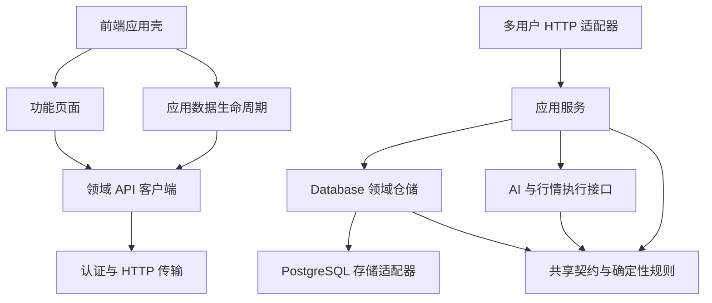

# 模块边界与开发约束

## 设计选择

当前功能增量优先解决[买点观察主线](product-vision.md)中的实际障碍。持仓和交易提供个人事实，AI 负责授权资料上的讨论，benchmark 保持独立研究边界；以下既有模块和扩展约束不是必须实施的路线图。

采用模块化单体，保持 React Web、Rust API、PostgreSQL 和无状态 Agent 的运行方式。业务边界通过明确的接口、依赖方向和状态所有权约束；独立模块可以单独测试，涉及多个领域的流程由应用层组合。当前规模下，增加服务进程、通用事件总线或每张表一个仓储接口只会增加维护成本。

## 依赖方向



| 层 | 拥有的职责 | 扩展约束 |
| --- | --- | --- |
| `client/src/features/` | 表单、页面请求状态、领域交互 | 不引用其他功能的页面实现；通过共享组件或应用壳组合 |
| `client/src/api/` | 某领域的 URL、请求和返回类型 | 不访问 DOM，不引用其他领域客户端，不自行处理账号与同步 |
| `client/src/lib/httpClient.ts` | 令牌、请求时限、写入前同步、响应版本与账号校验 | 不引用功能页面或领域客户端 |
| `client/src/app/` | 启动、全局同步、跨页组合与刷新 | 页面草稿保留在页面，应用层只记录是否需要保护 |
| `server/src/runtime.rs` | 环境与参数、维护命令、运行角色、退出信号 | 不放业务用例或 HTTP handler |
| `server/src/http/`、`hosted.rs` | 路由、认证、租户选择、版本检查、输入输出转换 | 多步业务流程交给应用服务；简单仓储查询和单次 CRUD 可直接调用 Database |
| `server/src/application/` | 冻结与保存分析、模型设置、行情辅助的组合写入 | 不依赖 Axum、启动入口或 Agent 进程适配器 |
| `server/src/models/` 与确定性计算模块 | 序列化契约、值校验、风险、规划、估值、上下文构建 | 不依赖仓储、网络刷新、工作流实现或 HTTP |
| `server/src/db/` | 领域事务、历史不可变性、同步导入和校验 | 不依赖应用流程、AI、HTTP 或行情网络服务 |
| `server/src/ai/` | 冻结输入上的工作流、模型 Provider、输出验证、执行接口 | 不读数据库或账号状态 |
| `server/src/agent.rs` | AI 执行接口的本地/远程适配和无状态 Agent HTTP 服务 | 无账户数据库、业务写入或用户会话依赖 |

`Database` 是领域仓储门面。表的内部协作、组合快照以及持仓成交和每日资产之间的事务是一致性边界，不能为了分文件而拆开事务。`models.rs` 和前端 `types.ts` 是共享契约入口，不复制跨域公共类型；只有具有明确所属职责的契约放入子模块。

`AppError` 负责序列化与底层错误转换；错误如何变成 HTTP 状态码、以及如何隐藏内部诊断，由 `http/error.rs` 决定。

## 状态与生命周期

### 服务端

- 启动配置属于进程。行情 Provider 和 AI 执行器属于进程依赖，可以替换；它们不持有账号数据库。
- 多用户请求先认证，再按服务端用户 ID 选择数据库连接。`RequestContext` 只组合该请求的账号数据库与共享服务依赖；客户端不能提供租户 ID。
- 公开行情缓存有界、共享并在失败时退避。用户汇率覆盖、持仓、密钥和分析历史归账号数据库，不进入跨账号缓存。
- 多用户请求在数据库账户锁内检查 `If-Match`。分析预览和模型连接测试不要求写入版本；CSV 预览会缓存汇率，所以仍按写入处理。新增操作默认要求版本，不能因为名字含 `preview` 或 `test` 就自动豁免。
- 分析执行在锁内冻结上下文、模型配置、密钥目的地和指纹；模型执行期间释放账户锁，执行结束重新取锁后保存。失败不产生分析历史；请求退出会关闭连接并释放残留的数据库会话锁。

- 组合快照先读取 `db/snapshot::SnapshotData`，`amounts::build` 生成精确投影，再调用一次 `build_snapshot`。AI 上下文消费结构化问题及规划范围，`structured_output` 校验结构与来源，不按固定中文动作判定有效性。数据问题只由 `valuation::issues` 判定，问题码、持仓 ID 和币种是公开契约；不得按文案筛选风险项或在仓储中事后清空规划。`planning` 拥有再平衡范围与精确金额计算，未平仓期权及标的只排除自身动作，分母仍用完整组合。

### 前端

- 功能页面拥有未保存输入和单页请求状态。`useApplicationData` 拥有已显示快照、可选模型配置、远程更新提示、页面刷新版本和同步控制器。
- 核心快照与模型配置分别加载，模型读取失败不阻止财务功能。刷新时可保留已可用的模型配置，同时记录其读取错误。
- 每次整体加载或刷新使用递增请求代次，较旧响应与卸载后的响应不得更新 UI 或发布数据更新事件。
- 自动刷新在请求前和返回后都检查草稿，避免“开始刷新之后才输入”的内容被覆盖。用户接受新资料后再清除草稿与写入保护；刷新失败继续保留输入。
- `httpClient` 捕获请求的账号与服务地址，发送前、收响应和采纳版本时都校验当前账号。金额快速编辑队列属于组合 API，排队任务保留原账号身份，不会在切换账号后写入新账号。
- 版本轮询和长时间分析返回的版本，不直接代替页面已核对的资料版本。普通写入、快照和汇率读取按请求策略采纳版本。
- 功能代码与测试直接引用领域 API 模块。财务回执未确认时 `financialRequest` 抛出 `FinancialRequestError`（`kind: "pending"`），页面经类型守卫保留原请求和输入，不匹配错误文案。
- `MyFacts` 组合问题导航和修复入口，`AssetAmountRow` 只显示属于该持仓（包括关联期权）的 `issues`；日期、参考价与来源使用中性样式。汇率修复复用 `ExchangeRates`，拆合股和交易链修复复用已展开的 `FinancialHistory`，不引入第二套修复状态。不可用会计投影的派生数量、价格和盈亏汇总隐藏，原始成交与审计记录仍保留；概览和趋势不推测缺失原因，具体原因归行内问题。
- `app/useDisplayPreferences` 管理本地涨跌色与金额隐藏偏好。功能页通过属性接收值和回调，共享 `DisplayPreferences` 表单不导入应用壳；显示控件标注 `data-presentation`，不将本地偏好视为业务草稿。
- `features/portfolio/useAssetHistory` 是资产页历史查询的唯一状态来源，总览与完整趋势共用请求、区间与分页；不得分别发起相同查询，或从持仓投影重算服务端总资产。
- 共享界面能力放在 `components/`，无领域 API 依赖。新增提示使用 `Callout`，状态使用 `Badge`，时点使用 `DataStamp`；行尾操作使用支持方向键、Esc 和焦点恢复的 `Menu`。抽屉内 Esc 先关闭菜单，再关闭抽屉。
- 新增金额输出使用 `data-money`，输入使用 `data-money-input`，数量与百分比保持可见；金额格式化仅作用于输出，原生数值输入保留源精度。颜色与字号只在 `styles/tokens.css` 定义。
- 新增页面沿用 1200/900/600px 断点，校验桌面、平板和手机；不得用全局最小宽度掩盖溢出。

## 简化原则

- 持仓、现金和收支只在“我的情况”编辑，风险偏好与基准币种放在收支区域的可选详情中。
- 问答和历史对话使用同一份报告展示与原始引用，不维护第二套报告、审计面板或无入口组件。
- 本地证据检索直接调用 `search_evidence`，只有一个实现，不预留动态接口。模型、远程 Agent 和行情有多实现接口。
- TypeScript 编译检查未使用的变量与参数；删页面时同时删专用组件、测试和失效样式。动态状态类需结合实际页面核对。
- 汇率入口属于侧栏状态区，打开共享抽屉；抽屉显示当前资产涉及币种及手动覆盖，编辑控件和其他币种按需展开。架构检查同时阻止没有任何生产入口的前端模块。

## 领域扩展约束

### 执行接口与适配器

- `ports/` 是外部执行契约层，只依赖领域契约、冻结上下文和错误类型；流式事件结构归 `models/inference.rs`。
- `application/portfolio.rs`、`fx.rs`、`prices.rs` 只使用行情端口；`composition.rs` 负责实际供应商装配与生命周期；`market_data.rs`、`prices.rs` 不读写账号数据，也不持有静态可变资源。
- 账号凭据读写归 `db/secrets.rs`，`secrets.rs` 不依赖仓储。
- 功能页不引用 `app/`（包括导航类型），通过回调通知应用壳：参考资料与复盘使用 `onAsk(question)`，问答使用 `onOpenSettings()`。
- `api/<领域>.ts` 可引用 `api/<同领域>/` 内部实现，禁止跨领域 API 互相引用。财务回执恢复只属于组合 API，`lib/httpClient.ts` 不解释财务回执或组合快照。
- `storage.rs` 是唯一使用数据库驱动的模块，提供自有的 `Value`、`ToSql`/`FromSql`、`Row` 与错误类型；仓储 SQL 使用原生 PostgreSQL 写法。账号锁、版本检查和财务回执只有多用户一条路径，本地开发 `npm run dev` 走同一认证与租户流程。
- Rust 检查解析相对 `super::` / `self::` 路径，防止以相对导入隐藏反向依赖；分析生命周期不得导入 AI 工作流实现。

### 网站 ChatGPT 身份登录

网站 Sign in with ChatGPT 是独立的账号能力：`openai_login` 只能依赖错误类型，不访问账号、数据库、本机凭据或模型执行；仅 `hosted/openai` 使用它。身份映射和一次性 OAuth 事务归 `accounts/openai`，所有 SQL 仍通过 `storage`。前端入口归 account 功能，不能导入 settings 桥接实现。接口、凭据边界、迁移和申请步骤见 [网站登录](chatgpt-sign-in.md)。架构检查限制网站 OIDC 与账号仓储、本机授权之间的反向依赖。

### 本机 ChatGPT 官方授权

- `chatgpt_auth.rs` 及子模块只由本机 CLI、桥接 worker 和 `ai/chatgpt.rs` 使用；不能引用账号数据库、应用用例或 AI 工作流，也不得被在线 HTTP、Agent、领域或仓储引用。架构检查同时约束顶层模块和 AI 文件级入口。
- OAuth 回调只监听 `127.0.0.1` 临时端口；PKCE、state、nonce、已签名 ID token 的 issuer/audience/expiry、返回的注册 ID 和实际 scopes 全部校验。账号 / 工作区以已验证 subject + issued client ID 区分，不按邮箱合并。
- `store.rs` 只管理本机凭据，不是第二套业务存储。稳定 host ID、注册和令牌保存在系统用户配置目录的 `mario/chatgpt` 下；跨进程锁串行化刷新，轮换后原子保存，Unix owner-only 权限与 Windows 受保护 DACL 限制本机访问。不得写入浏览器、业务导出、部署环境或日志。
- worker 固定启动时的注册和授权会话；切换默认账号不改变已配对进程，退出后取消流并停止领任务。重新登录同一注册也必须重新启动和配对，不允许旧通道悄悄使用新会话。
- ChatGPT Provider 只请求固定官方 models / Responses 端点，不跟随重定向；使用 `instructions`、`store:false`、`stream:true`，不接受服务器下发的地址、凭据、工具执行配置或任意命令。缺少订阅权限时只保留登录注册，不推理、不切换计费路径。
- 新功能复用已有 `codex-bridge` 配对契约、冻结输入、取消、结果校验和持久化，不新增账号表、HTTP OAuth 路由或数据库迁移。已有 Codex App Server 登录是独立可选执行端，不导入其凭据。
- worker 将注册 ID 与授权会话一起传给本机 ChatGPT Provider；模型目录和 Responses 请求均在读取或刷新令牌的同一凭据锁内校验会话。重新登录复用注册 ID 时，旧 worker 不能取得新授权的访问令牌；刷新保留原会话，选择其他默认账号不改变已配对 worker。
- `npm run test:chatgpt` 使用测试 RSA 密钥、临时凭据目录和本机 HTTP 回调，覆盖签名和授权拒绝、账号注册、刷新字段、文件锁与原子替换、SSE 分片及不完整输出；真实 OAuth 和订阅推理需用户本人执行。使用步骤与上游适用范围见 [本机桥接](codex-bridge.md)。

### 期权

期权契约、合约计价及多空头重放归 `models/options.rs`；`db/options.rs` 管理标的关联、独立权利金报价与标的汇总投影，不联网。合约复用持仓、成交、现金基准及财务回执；`db/trades.rs` 验证公共成交形状后，经 `db/corporate.rs` 按合约类型分派到股票或期权计算，不把股票拆股重放套用到期权。股票股数和成本仍只由股票成交维护。

前端 `features/portfolio/StockOptions.tsx` 拥有合约与报价草稿，复用 `HoldingTrades` 的成交提交与未知结果核对。`HoldingDetail` 协调股票、期权表单的互斥编辑，应用壳继续管理快照。`stockOptionTotals` 只供标的分组展示，不回写股票估值或再次累加组合资产。新增财务入口仍受现有全局 `If-Match` 保护，不增加豁免。

新增或修改期权行为需验证：多空头现金符号、非 100 乘数、分次开平仓成本、到期零权利金、同账户标的关联、禁止超额平仓和跨合约混算、报价回执、审计失败回滚、v23 备份与早期备份恢复、含空头的每日资产，以及股票列表分组不重复计数。完整 `npm test` 已包含真实 HTTP 期权流程和原生 PostgreSQL 备份恢复入口。

### 买点观察

观察桌面内部按职责划分：`BuyWatch` 负责读取、写入和本页筛选/展示状态，`presentation` 负责搜索排序与文本投影，`WatchList` 负责紧凑表格和卡片，`WatchSignals` 负责 BOLL 坐标与参考价呈现，`WatchDetails` 复用共享抽屉展示来源/事件/交易，`WatchWeekly` 将真实观察排成日期矩阵。新视图都消费同一份 `api/watch` 契约，不互相持有业务状态，不访问其他功能实现。服务端 `models/watch::dividend_prices` 负责精确参考价，仓储仅在读取 `WatchRow` 时装配，不把展示字段写回历史或引入 schema 迁移。

桌面交互验证覆盖组合搜索/筛选、未知指标排序、视图切换、原持仓/交易讨论、提醒已读、空结果和完整周内矩阵；参考价测试覆盖含边界、循环小数向下舍分、未知/零分红、缺价格、过期依据及读取不推进账号版本。金额规则变更仍执行完整 `npm test`，不能只验收截图。

`features/watch` 拥有名单草稿、观察卡片与周末汇总，`api/watch` 只处理领域请求；导航和进入问答由应用壳组合。`models/watch` 定义股息与 BOLL 规则及问题码，`ports/market` 暴露分别取价格与完整分红事件集的 `WatchMarketProvider`；公开仓储不读租户 schema，共享编排不依赖账号或私有事实，架构检查对这两个文件设独立约束。来源适配归 `market_data/watch`，按账号刷新归 `application/watch`，公开初始化资料适配与 CSV 导出归 `market_data/watch_archive`，离线原件核验和资料包构建归 `scripts/prepare-watch-dividends.py`，共享公开分红仓储归 `db/public_dividends`，跨账号读取、补抓和进程内合并归 `application/watch_market`，账号采用依据、状态事务和账号备份校验归 `db/watch`；后台任务由 `composition` 装配并随进程关闭。不得让观察计算调用 benchmark、读取账号库或依赖行情网络实现。

国内日线协议归 `market_data/watch/eastmoney`，未复权、后复权和上证日期组成一次完整来源查询；`market_data/watch` 负责优先国内来源及失败后整组回退 Yahoo。新增来源必须校验证券与交易所、按日期而非数组下标对齐，不得跨来源拼接；调整序列和原价的单位归一仍只在 `models/watch` 完成。`market_data/watch/source_tests` 使用本地 HTTP 验证无 Yahoo 时的国内查询、复权缺行保留价格与股息、整组回退及全失败；真实云铝股份查询作为显式忽略的联网检查，通过 `cargo test --manifest-path server/Cargo.toml live_yunlu_prices_and_dividends -- --ignored --nocapture` 手动执行。失败日志归来源适配与账号检查应用层，不修改公开接口或备份格式。

扩展时验证：5% 与 ±2% 的包含边界、日周同时满足、未来数据和未结束周、缺行不填零、分红方案不提前计入、提醒去重/重入、来源失败保留旧日期、在途编辑/删除、账号隔离、分红跨账号与重启复用/同一标的并发合并/公共资料更新触发重算/失败退避/公开库整站恢复/来源更正/已核验空集与失败区分/覆盖不足/滚动重算/内置资料只匹配已有名单/未知来源不初始化为零/原件篡改中止整理、v25/v24 及旧备份恢复，以及交易原值授权和冻结。接口、口径、迁移和产品边界见[买点观察](buy-watch.md)。

### 投资方法论

- `features/methodology` 只依赖设置 API、共享契约与展示组件；应用壳提供左侧导航和保存后的草稿清理回调，不引用问答页内部状态。编辑时沿用应用层远程更新保护，未保存内容不进入问答。
- `models/methodology.rs` 定义初始范本、正文契约与 4000 字符上限。`db/settings.rs` 按当前账号保存，HTTP 使用认证、账号锁及 `If-Match`，没有绕过版本检查的例外。
- `application/analysis.rs` 读取方法论，`context.rs` 将正文纳入冻结上下文与指纹；`ai/workflow.rs` 只消费冻结值，格式修复只消费原输出与校验错误。固定系统约束只负责数据解释、来源与输出契约，投资原则在可编辑的初始范本中。
- 账号备份沿用 settings 表结构，`sync_validation.rs` 校验设置白名单与方法论正文，`fx.rs` 只验证汇率设置。备份没有方法论时使用初始范本；导入失败整次回滚，不覆盖现有正文。

### 问答报告、事实卡与追问

- `models::StructuredAnalysis` 是生成契约；`models/analysis_history` 的独立类型只读历史报告，仓储以 `headline()` 获取两类报告的列表摘要，不转换历史正文。
- `ai/structured_output` 校验字段、数量、字数、事实索引和引用，拒绝缺少原值引用的个人事实；路径校验保证存在与授权，不替代语义核对。`ai/streaming` 只投影报告的用户可见字段。`features/research/ModelReport` 共享来源抽屉，按报告形状读取历史或显示新回答。
- `context/fact_sheet` 是领域层确定性投影：精确金额只输出一次，结余、占比、偏差和浮盈使用 Decimal；组合合计缺失时保留空值与结构化影响范围，其他持仓及现金继续计算。不重算或写入财务事实。`application/analysis` 不查询个人规则、复盘和每日资产。
- `BuiltContext` 区分模型 payload 与授权估值审计，二者共同冻结指纹；模型只消费紧凑 payload，估值链进入轨迹。预览的事实卡与模型使用的卡一致。
- `features/research/previousTurn` 按 Unicode 字符截取上一轮问题、结构化结论和最多 3 条动作（额度 200/300/每条 100）；纯文本历史记录最多取 300 字。`models::PreviousTurn` 校验总计 800 字符、非空正文及最多 3 条建议；`ContextBuilder` 单独冻结它，应用层保存当前 question，不把历史模型内容拼进问题。输出引用只允许当前问题与已授权事实卡。新对话清空摘要。
- `application/analysis` 优先组装问题中明确提及公司的最新及本周观察证据，`evidence::search_evidence` 补齐剩余额度，共最多 5 条；`relevant_excerpt` 返回最多 2000 字连续原文；`application` 读取并授权候选，`context` 冻结原文与片段，AI 不读仓储、不额外筛选。网页搜索由用户主动开关授权，默认关闭，原生搜索结果直接进入生成。

## 开发流程

分红原始 HTTP 适配归`public_sources.dividend_page`，采集、分页核验、实施/其他方案分离与逐股输出归`dividends.py`，只依赖公开来源与文件契约，不依赖策略执行。`test_dividends`覆盖实施窗口、跨年报告、十进制单位、方案状态、空来源保留与分页缓存；数据不作为已核验历史时点指标。

离线 benchmark 的数据扩展遵循 [原始数据与衍生指标](benchmark-data.md)：来源格式适配、原始归档与财报证据核验归 `raw_data.py`，确定性计算归四个 `*_indicators.py`，按字段组合与派生包归 `feature_pipeline.py`，实际策略输入检查归 `input_contract.py`。计算模块只依赖共享值校验，不能读原始文件、网络、来源 SDK 或标签；组合层不能依赖策略执行和 HF 发布。静态方向由 `check-architecture.mjs` 检查，AST 与行为边界由 `test_feature_pipeline.py` 检查。新增行情指标只增加定义和必要的纯函数，策略在 `REQUIRES` 声明消费路径；额外字段允许存在，不按整包版本限制。公式语义变化使用新输出名称或新建显式重算快照，保留来源、时点、单位、缺失原因与代码指纹。原始导入、`features-build`、`bench-run --raw` 的命令和迁移步骤均见该文档。

宿主机部署权限准备归 `deploy.sh`：root 仅管理系统依赖与 systemd，用户工具、配置生成、构建和服务运行归同一个非 root 账号。部署在下载工具和停服前自动创建缺失 home，修复默认专用 home 本身及 `.cargo`、`.rustup`、`.local/bin` 的历史权限；自定义已有 home 须属于服务账号，不递归修改其他个人文件或 `.local` 应用数据，不跟随工具链接写入外部目标。`npm run test:deploy` 覆盖旧权限修复、服务用户实际写入、可执行位/链接保留、重复执行、缺失 home 和修复范围；不要把构建改成 root 来绕过权限准备。既有数据库仍归原运行账号，不迁移数据。部署使用见 [服务用户权限](deploy-madeagents.md#服务用户-home-与工具目录权限)。

研究看板的侧边栏入口由应用壳和 `app/navigation.ts` 管理，放在“研究”分组，使用网站前缀下的 `dashboard` 链接在新标签页打开；不作为内部 `View`，不触发当前页切换或清理草稿。导航链接沿用侧栏样式、移动端抽屉关闭和键盘焦点约束，看板继续使用现有页面与会话认证。

持续评测先执行`live.prepare`固定并下载原始来源和选样事实，禁止下载预计算`inputs.jsonl`；再由`evaluation_data.py`从零生成策略依赖字段。该模块只依赖原始读取、确定性日历/指标和契约检查，不访问网络、不执行策略、不解析未来标签；来源下载仍仅归`hub`，将未来标签原样复制进新评分包发生在输入计算和校验之后。`test_evaluation_data`覆盖预计算输入拒绝、原始缺失拒绝回退、新字段扩展和股数/价格重算；HF测试覆盖固定提交和下载白名单。

持续评测由 `.github/workflows/benchmark-live.yml` 触发可信主分支，`benchmark/live.py` 编排评分、进度与完整快照发布，执行仍归 `strategy_runner`，计算仍归 `scoring`，所有 HF 访问归 `hub`；公开与已有私有仓库均可读取和发布，不自动改变可见性，新建研究仓库按当前约定公开。失败保留上次成功成绩，同一切片全部成功才替换；状态和成绩是 HF/Git 可追溯的研究派生文件，不进入账号事务。线上只同步 `dashboard/current.json`，不下载执行远端脚本。

HF 镜像配置 `HF_ENDPOINT` 由 `host-runtime --prepare` 保存到 `.env`，不传时保留，显式空值恢复官方站；`benchmark-deploy.benchEnvironment` 为首次同步和后台同步统一注入端点，后台不依赖终端的 `export`。配置不注入 API 或 Agent；HF 请求仍只经 Python `hub` 适配器。部署测试覆盖镜像写入、重复部署保留、清空恢复及同步环境传递。

部署看板环境归 `scripts/benchmark-deploy.mjs`，使用服务用户专属 Python，初次同步当前快照。`host-runtime` 管理 `benchmark.live sync --watch` 生命周期，固定 `.runtime/benchmark/current/` 为 API 读取目录；每 30 秒同步，临时文件替换保证单个 JSON 原子可见，失败保留旧结果。网页持现有会话每 10 秒读取，状态变化不重绘排行榜，成功结果变化才按原视图重载。评分计划及原始行情分别由 Actions Variable `BENCHMARK_PLAN_REVISION`、`BENCHMARK_RAW_REVISION` 固定；`MARIO_BENCH_ENABLED=true` 启用同步，旧标签配置不再读取。本机 `bench-run`/`bench-serve` 仍用于复现，部署不再执行评分。`test_live` 覆盖成功、失败保留、公开读取与写入鉴权与会话轮询，`npm run test:deploy` 覆盖环境隔离和失败短路；二者纳入完整 `npm test`。

离线研究工具位于 `benchmark/`，契约与入口见 [benchmark](benchmark.md)。免费来源覆盖探测归 `public_sources.py`，授权来源与原件下载归 `sources.py`，确定性选样/时点规则归 `dataset.py`，指标归 `evaluate.py`，发布格式归 `release.py`，股票池共用的按时点市值口径、剔除原因与行情/股本缓存归 `market_cap.py`，科技股池候选归 `tech_universe.py`，红利股池成分重建归 `dividend_universe.py`（两个池子互不引用，新增股票池同样只依赖 `market_cap.py` 并产出同构的 `universe/<池>-<年>.json`，再在 `pool_release.POOLS` 登记），旧版 Excel 解析归 `xls.py`，多池切片构建归 `pool_release.py`，主指标（收益得分与胜率）打分、卖出规则与网格执行归 `scoring.py`（不访问网络），策略发现、静态检查、子进程生成仓位与结果缓存归 `strategy_runner.py`，策略本身是 `strategies/<名字>/` 下的 `strategy.md` 与只实现 `decide(sample)` 的 `strategy.py`（新增策略只加目录，不改其他模块；策略代码只能导入纯计算标准库；执行器以 `-I -X utf8` 启动隔离 Python，通信显式使用 UTF-8，不依赖会被隔离模式忽略的环境编码设置），策略得分看板与本机看板服务归 `dashboard.py`（只读 `bench-run` 输出的成绩与说明，不读输入与标签；输出页面、脚本、数据三个文件，部署后由 `hosted.rs` 按同一路径提供，数据接口只对已登录账号开放），Hugging Face 上传与按标签下载归 `hub.py`，CLI 只装配流程；这些模块只依赖 Python 标准库和本包，不引用在线业务实现或账号数据。第三方依赖只允许出现在单一适配器中：`baostock_market.py` 是唯一导入 `baostock` 的模块，`hub.py` 是唯一导入 `huggingface_hub` 的模块，依赖分别在 `pyproject.toml` 的 `market`、`publish` 依赖组声明，其他模块不得直接导入；新增此类适配器需同步更新边界测试的白名单。`npm run test:benchmark` 验证该隔离边界与数据行为，并纳入 `scripts/test.sh`。新增来源不能把未经证实的披露时间或供应商缺失自动升级成已核对事实；发布目录不可覆盖，原始数据修正需生成新版本，未来接入在线问答需走现有冻结和授权接口。

已开展的外部策略研究来源与数据依赖记在 [历史研究记录](benchmark-research.md)，逐批执行结果记在审计文档。自定义 `--strategies` 可以使用相对目录；执行器在进入子进程策略工作目录前解析策略文件绝对路径，避免路径重复拼接，输入与导入隔离保持不变。

长窗口研究入口 `scripts/benchmark_long_history_study.py` 的 `build` 校验独立缓存、共同字段与历史完整性，构造只截至决策日的特征；`scan` 生成临时候选并比较配置，不安装正式策略或修改线上切片。它只依赖标准库与离线 `benchmark` 公开函数，不直接导入来源 SDK。缓存契约、命令和统计限制见 [长窗口实验](audits/benchmark-long-signals-20261102.md)，时点、缺失、停牌和隔离测试归 `benchmark/tests/test_long_history_study.py`。

`scripts/benchmark_risk_study.py` 通过显式特征函数、字段和规则配置复用上述工具，不改变默认长窗口研究结果。周末、三年回看与月内停牌估值归特征构建；协方差预算归候选策略，不能用个股标准差均值替代。`--minimal --built-on <日期>` 构造 `monthly-risk-v1` 最小升级输入，仍保留原标签与字段，发布和策略安装是另外的显式步骤。相关测试归 `benchmark/tests/test_risk_study.py`，数据卡说明归 `hub.py` 与 `test_hub.py`；新旧机制和升级评审见 [第三批实验](audits/benchmark-risk-signals-20261102.md)。

`scripts/benchmark_earnings_study.py` 只消费公告/市场/个股缓存，复用 `public_sources.report_catalog`、长历史构建与月内收益计算；首次报告选择、修订排除和证券代码核对归该研究工具，公告窗口截止和CAR计算归`announcement_indicators.py`，检验见 `benchmark/tests/test_earnings_study.py`。公告源、排除记录和市场源哈希写入研究切片配置，未结束窗口保留问题码，不从未来标签补全。方法与缓存契约见[公告反应实验](audits/benchmark-earnings-signals-20261102.md)。

`scripts/benchmark_sue_study.py` 是财务输入试点工具，读取已人工核验的普通股利润与恒定股数台账；原件路径/哈希和来源时间校验归`raw_data.py`，累计转单季、季度版本选择与八季同比窗口归`financial_indicators.py`，该工具只装配研究输入与输出，边界检验见`benchmark/tests/test_sue_study.py`。它不接入正式发布构建，不代替PDF语义审阅，不引入财务供应商SDK；口径、台账契约及未就绪项见[SUE试点](audits/benchmark-sue-pilot-20261102.md)。

`price_indicators.py`拥有90日回归信号及停牌估值敏感性口径，`scripts/benchmark_regression_study.py`只编排研究构建与候选生成；复用长历史构建/扫描和月内收益，最小v7只添加`clenow_mark_90`。实际权重倾斜与倾斜后方差预算归正式策略，不把估计前旧权重的方差沿用到新篮子。时点、缺失、价格单位、并列排名、现金预算及正式契约测试见`benchmark/tests/test_regression_study.py`；数据卡说明归`hub.py`与`test_hub.py`，规则和成绩见[回归实验](audits/benchmark-regression-signals-20261102.md)。

策略扩展先按机制去重：同一逻辑只更新原目录的最佳参数，删除被替代的参数目录、专属测试配置与当前文档入口，再用 `bench-run` 清理旧结果并刷新看板。不同选股、风险预算或执行机制可以分别登记；完整搜索空间及参数选择范围写入策略说明与审计，不把参数扫描变成多条策略。

买卖操作比重沿用同一仓位/执行路径：`strategy_runner.generate_weights` 将条件卖出的默认 `sell_fraction` 显式写入仓位；`scoring.exit_rule` 校验触发条件与持股比例，`simulate_exit` 只执行一次并保留余股，`simulate_grid` 按实际成交记录预算使用和减持股数；`portfolio_segments` 维护扣费估值并汇总逐笔 `operations` 到每期成绩。看板只展示这些记录，禁止按价格触发自行补造成交。调整比例或增加执行机制须验证部分卖出后估值、停牌顺延、网格跨格与不同分母、失败不记成交，以及既有策略得分不变；相关测试归 `test_operation_ratios.py`、`test_scoring.py`、`test_dashboard.py` 与策略输出测试。旧报告必须重跑，不维护第二条旧格式展示路径。

`scripts/benchmark_fugui_study.py`只读取既有Baostock后复权与独立日历缓存，检查重叠档案及原动量字段，生成截至决策日的BOLL、月MACD与首次回踩信号；未知周期保持缺失，明确停牌沿用此前已知收盘。`--minimal`须显式指定构建日期，并按实际行情依赖新增`fugui`四个底仓信号和问题码，不限制基础切片版本，保留原字段与结果标签。富贵策略按用户明确要求登记唯一的`strategies/fugui/`实现，默认发现和看板不再依赖临时候选；删除旧`candidate`命令和重复源码。执行仍经隔离子进程与原评分器，不将缺失基本面视为满足，也不以固定网格冒充底仓/机动仓分账。规则及复跑见[富贵策略](fugui-strategy.md)，时点、缺失、首次回踩、仓位、最小v8和不可覆盖检查归`test_fugui_study.py`；数据卡说明归`hub.py`与`test_hub.py`。

完整指数采集清单归 `index_membership.py`，复用XLS解析与公开下载器，核对中证A50/上证50各50只，保存原件、获取/来源日期和哈希。每日行情归 `daily_prices.py`，只调用 `public_sources`/`collect` 的公开HTTP能力，最多2个线程；按证券保存完整供应商历史，首次/显式整段刷新；22:37更新独立报价，23:37显式整段刷新历史，按月累计日期记录及源元数据，不混用价格尺度。旧Baostock每日采集代码已退役，SDK仍仅供其他显式研究工具使用；旧双口径归档按不可变标签只读引用，元数据核验归 `hub.historical_prices_reference`，不得用旧价格填充新来源。

脚本只编排范围、来源、门禁与摘要。退市引用、来源缺失、闭市及非法观察、日线及独立最新报价覆盖归行情模块；两指数最新覆盖不足、活跃来源缺失或日历范围不明时不能发布。新布局使用 `prices/<证券>.jsonl`，缓存仅支持首次恢复；不使用Actions cache作为事实来源。HF固定版本恢复、临时分支上传、远端全集/内容核验和非强制快进归 `hub`；workflow与持续评测共用 `benchmark-hf-main`，只安装发布依赖，不调用被限制的供应商。测试覆盖来源隔离、退市引用不掩盖活跃缺失、全区间调整、完整名单、日历截断、缓存损坏、旧路径只读、缺口拒绝发布与原子发布；见[每日行情](benchmark.md#每日行情自动更新)。

批量免费补采由 `collect.py` 拥有任务进度、固定请求与断点恢复，调用 `public_sources` 的目录和行情能力；`files.symbol` 明确支持沪深北代码，不按首位数字或默认深市猜测交易所。`universes/` 的当前成分清单只用于候选数据预采，不替代 `dataset` 的历史选样。价格口径不可隐式拼接，日历闭市与真实交易日缺口分别计数；测试覆盖节假日排除、范围截断、标题简写、来源隔离和恢复校验。

新增功能时先确定数据与事务的所属领域，再放置共享契约和仓储操作。需要调用市场接口、检索多类资料或执行模型时，在 `application` 增加用例，并从 HTTP 装配执行依赖。HTTP handler 只解析请求、调用该用例并返回结果。

前端在对应 `api` 模块增加接口，功能页面维护自身交互。多个功能需要同屏出现时由应用壳组合；仅供显示、无功能生命周期的组件可以进入 `components`。已有明确边界的单步操作不必再增加一层空壳服务。

开发与测试需要本机 PostgreSQL 工具（从 `MARIO_TEST_PG_BIN` 或 `pg_config --bindir` 查找）。Rust 测试与 HTTP 脚本只连接 `MARIO_TEST_DATABASE_URL` 指向的一次性数据库；`scripts/postgres-cluster.mjs <命令…>` 创建临时集群、设置该变量并在命令结束后删除集群。

提交前执行：

```bash
npm run check:architecture
npm run build --prefix client
npm run format:check --prefix client
npm test --prefix client
cargo fmt --manifest-path server/Cargo.toml -- --check
npm run test:server
cargo clippy --manifest-path server/Cargo.toml --all-targets -- -D warnings
cargo build --manifest-path server/Cargo.toml
```

跨前后端、数据格式、财务逻辑或公共契约的修改运行完整 `npm test`（[`scripts/test.sh`](../scripts/test.sh)）：上述检查之后，在同一个临时集群中依次运行 Rust 测试、`test-functional-api`、`test-web`、`test-codex-bridge`，再运行独立建集群的 `npm run test:financial`。

依赖检查解析 TypeScript 导入/导出，包括类型导入与动态导入；Rust 检查去除字符串、注释与测试专属项后提取显式 crate 依赖。它阻止上层反向引用、跨功能 UI 引用、领域客户端之间的引用以及依赖循环。DB 内部实现仍允许使用父模块门面的共享导入。检查属于静态约束，与编译及行为测试互补，不代表所有宏展开或运行时隔离已经被证明。
