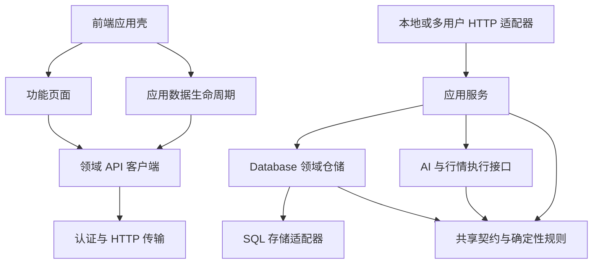

# 模块边界与开发约束

## 设计选择

采用模块化单体，保持 React Web、Rust API、PostgreSQL 和现有无状态 Agent 的运行方式。业务边界通过明确的接口、依赖方向和状态所有权约束；独立模块可以单独测试，涉及多个领域的流程由应用层组合。当前规模下，继续增加服务进程、通用事件总线或每张表一个仓储接口，会增加维护成本。

2026-10-12 的模块拆分保持当时业务契约。2026-10-15 财务修复另行增加精确源、核对基准、隔离修复、回执和公司行动接口，使用托管 schema 8、备份 v21，见 [财务一致性约束](architecture.md#财务一致性约束2026-10-15)。证券代码的归一化、汇率日期、来源验证和分析授权规则移动到了正确的所属层，原有语义保留。

## 耦合审计与处理

| 原耦合 | 开发风险 | 当前边界 |
| --- | --- | --- |
| `lib.rs` 同时负责启动、路由、认证、行情、模型配置与分析 | 改一个功能容易影响两种运行模式；子模块借用根模块的隐式导入 | 根模块声明模块与公开启动入口；配置在 `runtime`，传输在 `http`/`hosted`，流程在 `application` |
| 分析预览与执行各自读取、检索和拼装上下文 | 数据授权、过滤和指纹容易发生偏差 | `AnalysisService::prepare` 是两者唯一的准备流程 |
| 应用流程直接调用 Agent 环境入口 | 不启动远程服务就很难测试完整的冻结、执行与保存过程 | 应用层依赖 `ports/analysis::AnalysisExecutor`；HTTP 装配 `AgentExecutor`；测试注入替代执行器 |
| `models` 引用 AI 筛选和审查实现里的类型 | 共享契约和工作流形成循环依赖 | 轨迹数据属于 `models/information`；AI 模块只实现处理与校验 |
| 数据库引用行情刷新模块里的类型、代码校验和日期规则 | 仓储与网络流程形成循环依赖 | FX 值、日期与证券代码规则在 `models/market`；每日资产契约在 `models/daily` |
| 附件提取模块理解完整数据库同步包 | 解析工具和存储格式相互依赖 | 同步表关联、重复 ID 和累计大小校验归 `db/sync_validation`；附件解码与提取归 `attachments` |
| 多用户请求逐个构造行情提供方 | 生命周期和业务状态混杂，扩展 Provider 会影响认证中间件 | 行情服务在进程启动时创建，认证后只注入该账号的数据库和共享执行依赖 |
| 前端 `api.ts` 混合领域接口、认证和同步政策 | 所有页面共享一个实现入口，功能隔离测试困难 | `api/` 提供领域接口；`httpClient` 处理请求；`requestPolicy` 处理请求类别 |
| `App` 同时管理页面、启动、同步与草稿 | 异步刷新容易覆盖草稿或较新的结果 | `useApplicationData` 管理服务端数据生命周期；`App` 组合页面与导航 |
| 设置页直接引用账号页面，研究页引用记忆功能内部组件 | 页面无法独立组合与验证 | 账号区域由应用壳组合；问答和历史对话共享研究领域的报告与引用组件 |

## 依赖方向



| 层 | 拥有的职责 | 扩展约束 |
| --- | --- | --- |
| `client/src/features/` | 表单、页面请求状态、领域交互 | 不引用其他功能的页面实现；通过共享组件或应用壳组合 |
| `client/src/api/` | 某领域的 URL、请求和返回类型 | 不访问 DOM，不引用其他领域客户端，不自行处理账号与同步 |
| `client/src/lib/httpClient.ts` | 令牌、请求时限、写入前同步、响应版本与账号校验 | 不引用功能页面或领域客户端 |
| `client/src/app/` | 启动、全局同步、跨页组合与刷新 | 页面草稿保留在页面，应用层只记录是否需要保护 |
| `server/src/runtime.rs` | 环境与参数、维护命令、启动模式、退出信号 | 不放业务用例或 HTTP handler |
| `server/src/http/`、`hosted.rs` | 路由、认证、租户选择、版本检查、输入输出转换 | 多步业务流程交给应用服务；简单仓储查询和单次 CRUD 可直接调用 Database |
| `server/src/application/` | 冻结与保存分析、模型设置、行情辅助的组合写入 | 不依赖 Axum、启动入口或 Agent 进程适配器 |
| `server/src/models/` 与确定性计算模块 | 序列化契约、值校验、风险、规划、估值、上下文构建 | 不依赖仓储、网络刷新、工作流实现或 HTTP |
| `server/src/db/` | 领域事务、历史不可变性、同步导入和校验 | 不依赖应用流程、AI、HTTP 或行情网络服务 |
| `server/src/ai/` | 冻结输入上的工作流、模型 Provider、输出验证、执行接口 | 不读数据库或账号状态 |
| `server/src/agent.rs` | AI 执行接口的本地/远程适配和无状态 Agent HTTP 服务 | 无账户数据库、业务写入或用户会话依赖 |

`Database` 继续作为领域仓储门面。表的内部协作、组合快照以及持仓成交和每日资产之间的事务是一致性边界，不能为了分文件而拆开事务。`models.rs` 和前端 `types.ts` 仍保留共享契约入口，不复制跨域公共类型；只有具有明确所属职责的契约放入子模块。

`AppError` 保留现有序列化与底层错误转换以维持兼容。错误如何变成 HTTP 状态码、以及如何隐藏内部诊断，由 `http/error.rs` 决定。

## 状态与生命周期

### 服务端

- 启动配置属于进程。行情 Provider 和 AI 执行器属于进程依赖，可以替换；它们不持有账号数据库。
- 多用户请求先认证，再按服务端用户 ID 选择数据库连接。`RequestContext` 只组合该请求的账号数据库与共享服务依赖；客户端不能提供租户 ID。
- 公开行情缓存继续保持有界、共享与失败退避。用户汇率覆盖、持仓、密钥和分析历史仍归账号数据库，不进入跨账号缓存。
- 多用户请求在数据库账户锁内检查 `If-Match`。分析预览和模型连接测试不要求写入版本；CSV 预览会缓存汇率，所以仍按写入处理。新增操作默认要求版本，不能因为名字含 `preview` 或 `test` 就自动豁免。
- 分析执行在锁内冻结上下文、模型配置、密钥目的地和指纹；模型执行期间释放账户锁，执行结束重新取锁后保存。失败不产生分析历史；请求退出会关闭连接并释放残留的数据库会话锁。
- SQLite 开发模式继续使用本地请求串行锁；不把这一模式的并发能力等同于多用户生产模式。

### 前端

- 功能页面拥有未保存输入和单页请求状态。`useApplicationData` 拥有已显示快照、可选模型配置、远程更新提示、页面刷新版本和同步控制器。
- 核心快照与模型配置分别加载，模型读取失败不阻止财务功能。刷新时可保留已可用的模型配置，同时记录其读取错误。
- 每次整体加载或刷新使用递增请求代次，较旧响应与卸载后的响应不得更新 UI 或发布数据更新事件。
- 自动刷新在请求前和返回后都检查草稿，避免“开始刷新之后才输入”的内容被覆盖。用户接受新资料后再清除草稿与写入保护；刷新失败继续保留输入。
- `httpClient` 捕获请求的账号与服务地址，发送前、收响应和采纳版本时都校验当前账号。金额快速编辑队列属于组合 API，排队任务保留原账号身份，不会在切换账号后写入新账号。
- 版本轮询和长时间分析返回的版本，不直接代替页面已核对的资料版本。普通写入、快照和汇率读取仍按已有策略采纳版本。
- 功能代码与测试直接引用领域 API 模块；没有额外的兼容转发出口。

## 简化原则

- 持仓、现金和收支只在“我的情况”编辑，风险偏好与基准币种放在收支区域的可选详情中。
- 问答和历史对话使用同一份报告展示与原始引用，不维护第二套报告、审计面板或无入口组件。
- 本地证据检索直接调用 `search_evidence`，记忆检索直接使用 `HybridMemoryRetriever`；两者各只有一个实现，不预留动态接口。模型、远程 Agent 和行情的多实现接口继续保留。
- TypeScript 编译检查未使用的变量与参数；删页面时同时删专用组件、测试和失效样式。动态状态类需结合实际页面核对。
- 汇率区直接显示当前资产涉及币种及手动覆盖；编辑控件和其他币种按需展开。架构检查同时阻止没有任何生产入口的前端模块。

2026-10-13 清理验收：178 项前端测试、170 项后端测试、86 项真实 SQLite HTTP 断言和 Web 鉴权／重启检查通过；6 项需 PostgreSQL 或真实模型／网络的后端测试保持忽略。构建、格式、严格 Clippy 和架构检查通过。使用示例 API 数据在 1440、768、390 像素宽度检查全部九个页面，没有横向溢出或浏览器异常；该界面检查不等同于生产后端验收。CSS 构建体积由 77.63 KB 降至 51.26 KB。本机没有配置临时 PostgreSQL，未执行多租户验收。

## 开发流程

新增功能时先确定数据与事务的所属领域，再放置共享契约和仓储操作。需要调用市场接口、检索多类资料或执行模型时，在 `application` 增加用例，并从 HTTP 装配执行依赖。HTTP handler 只解析请求、调用该用例并返回结果。

前端在对应 `api` 模块增加接口，功能页面维护自身交互。多个功能需要同屏出现时由应用壳组合；仅供显示、无功能生命周期的组件可以进入 `components`。已有明确边界的单步操作不必再增加一层空壳服务。

提交前执行：

```bash
npm run check:architecture
npm run build --prefix client
npm run format:check --prefix client
npm test --prefix client
cargo fmt --manifest-path server/Cargo.toml -- --check
cargo test --manifest-path server/Cargo.toml
cargo clippy --manifest-path server/Cargo.toml --all-targets -- -D warnings
cargo build --manifest-path server/Cargo.toml
node scripts/test-functional-api.mjs
node scripts/test-web.mjs
```

依赖检查解析 TypeScript 导入/导出，包括类型导入与动态导入；Rust 检查去除字符串、注释与测试专属项后提取显式 crate 依赖。它阻止上层反向引用、跨功能 UI 引用、领域客户端之间的引用以及依赖循环。DB 内部实现仍允许使用父模块门面的共享导入。检查属于静态约束，与编译及行为测试互补，不代表所有宏展开或运行时隔离已经被证明。

## 验证与剩余边界

2026-10-12 本轮检查结果：

- 前端：28 个测试文件、174 项测试全部通过；TypeScript/Vite 构建与 Prettier 检查通过。
- 服务端：166 项测试通过，6 项需要 PostgreSQL 或真实模型/公共网络的测试保持显式忽略；Rust 格式与严格 Clippy 检查通过，隔离目录构建成功。
- 架构：检查前端 54 个源码文件、后端 24 个顶层模块，无检出的反向依赖或循环；检查器的 4 项测试通过。
- 真实 HTTP：2026-10-14 删除两个模块后，隔离 SQLite 下 105 项认证业务断言通过，包含资产、已移除接口的 404、研究附件、复盘、分析边界、实际交易记录与重启持久性；旧数据 CLI 导出与覆盖保护通过。
- Web 服务：公开静态资源、API 鉴权、错误令牌拒绝、私有文件不可访问与重启持久性检查通过。
- 兼容：已移除模块的路由返回 404；旧备份中的退役表只校验结构并跳过，其他有效数据继续恢复。

核心新增回归覆盖：预览和执行使用同一载荷、数据/授权变化阻止执行、执行失败不写历史、刷新中的草稿保护、较旧响应和卸载响应抑制、失败恢复保留写入保护、HTTP 错误映射以及依赖检查自身的错误检出能力。

默认服务可执行文件被本机现有后台进程占用，本轮用 `cargo build --manifest-path server/Cargo.toml --target-dir .runtime/architecture-build` 构建隔离产物，使用 `MARIO_TEST_SERVER_BIN` 指向该产物运行两项 HTTP 脚本。此变量只影响测试脚本，不改变服务启动或部署配置。

本机没有 PostgreSQL 工具，也没有设置临时测试数据库。本轮不声称已实跑 PostgreSQL 多租户验收。GitHub 自动工作流已移除；租户、双实例版本冲突、锁释放、密钥、恢复和重启持久性仍由本地测试脚本验证。可以在具备临时数据库的环境设置 `MARIO_TEST_DATABASE_URL` 后运行：

```bash
cargo test --manifest-path server/Cargo.toml db::postgres_tests -- --ignored
node scripts/test-hosted.mjs
```

这次仍保留请求级 PostgreSQL 连接、进程内公开行情缓存、全量组合快照和同步轮询。连接池、增量读模型、持久分析作业与工作流取消属于后续容量或产品需求；当前用例边界已提供明确的接入位置。没有为这些尚未发生的需求加入通用框架。

## 2026-10-15 财务验收补充

本轮在一次性 PostgreSQL 17 集群实跑 5 项迁移测试、完整 SQLite/托管 HTTP 流程、跨实例回执与租户隔离。原生 pg_dump/pg_restore 对 141 张账号及租户表逐表比对一致。产品加密备份命令的在线/离线备份、错误密码与篡改拒绝、覆盖保护、SQL 失败回滚、安全备份恢复也通过。本段补充上述历史记录，不代表生产数据已迁移或部署。

当前本地回归：217 项前端测试、202 项 Rust 测试通过；常规 Rust 套件的 9 项忽略包括 5 项已在独立门禁实跑的 PostgreSQL 测试，以及 4 项需真实模型/公共网络的显式测试。生产构建、Prettier、Rust 格式、严格 Clippy、架构检查、Web 鉴权与重启检查通过。财务门禁默认接入 scripts/test.sh；MARIO_TEST_PG_BIN 必须指向 PostgreSQL 工具目录。

## 2026-10-18 独立性规则补充

- `ports/` 是外部执行契约层，只依赖领域契约、冻结上下文和错误类型，不依赖数据库、AI 实现或传输适配器。流式事件结构归 `models/inference.rs`。
- `application/portfolio.rs`、`application/fx.rs`、`application/prices.rs` 只使用行情端口。`composition.rs` 负责实际供应商装配与生命周期；`market_data.rs` / `prices.rs` 不读写账号数据，也不持有静态可变资源。
- 账号凭据读写归 `db/secrets.rs`，`secrets.rs` 不依赖仓储。多步财务写入继续保持同一领域事务。
- 功能页不得引用 `app/`，包括导航类型；向应用壳发出明确回调。参考资料与复盘使用 `onAsk(question)`，问答使用 `onOpenSettings()`。
- `api/<领域>.ts` 可引用 `api/<同领域>/` 内部实现；仍禁止跨领域 API 互相引用。财务回执恢复只属于组合 API，`lib/httpClient.ts` 不解释财务回执或组合快照。
- Rust 检查解析相对 `super::` / `self::` 路径，防止以相对导入隐藏反向依赖；分析生命周期不得导入 AI 工作流实现。静态检查与行为测试互补，仍不保证宏或所有运行时路径。

完整职责划分、替换关系、迁移和待解决方案见 [模块独立性审计](module-independence-2026-10-18.md)。
