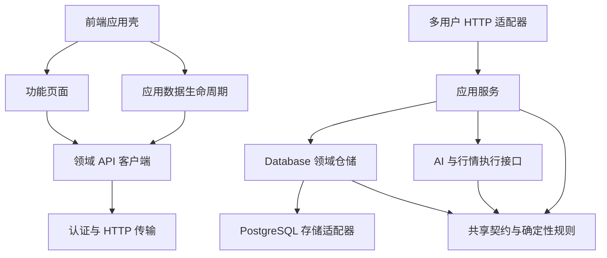

# 模块边界与开发约束

## 设计选择

采用模块化单体，保持 React Web、Rust API、PostgreSQL 和现有无状态 Agent 的运行方式。业务边界通过明确的接口、依赖方向和状态所有权约束；独立模块可以单独测试，涉及多个领域的流程由应用层组合。当前规模下，继续增加服务进程、通用事件总线或每张表一个仓储接口，会增加维护成本。

2026-10-12 的模块拆分保持当时业务契约。2026-10-15 财务修复另行增加精确源、核对基准、隔离修复、回执和公司行动接口，使用托管 schema 8、备份 v21，见 [财务一致性约束](architecture.md#财务一致性约束2026-10-15)。证券代码的归一化、汇率日期、来源验证和分析授权规则移动到了正确的所属层，原有语义保留。

## 耦合审计与处理

| 原耦合 | 开发风险 | 当前边界 |
| --- | --- | --- |
| `lib.rs` 同时负责启动、路由、认证、行情、模型配置与分析 | 改一个功能容易影响两种运行模式；子模块借用根模块的隐式导入 | 根模块声明模块与公开启动入口；配置在 `runtime`，传输在 `http`/`hosted`，流程在 `application` |
| 分析预览与执行各自读取、检索和拼装上下文 | 数据授权、过滤和指纹容易发生偏差 | `AnalysisService::prepare` 是两者唯一的准备流程 |
| 应用流程直接调用 Agent 环境入口 | 不启动远程服务就很难测试完整的冻结、执行与保存过程 | 应用层依赖 `ports/analysis::AnalysisExecutor`；HTTP 装配 `AgentExecutor`；测试注入替代执行器 |
| `models` 引用 AI 筛选和审查实现里的类型 | 共享契约和工作流形成循环依赖 | 轨迹数据属于 `models/information`；AI 模块只实现处理与校验 |
| 数据库引用行情刷新模块里的类型、代码校验和日期规则 | 仓储与网络流程形成循环依赖 | FX 值、日期与证券代码规则在 `models/market`；每日资产契约在 `models/daily` |
| 附件提取模块理解完整数据库同步包 | 解析工具和存储格式相互依赖 | 同步表关联、重复 ID 和累计大小校验归 `db/sync_validation`；附件解码与提取归 `attachments` |
| 多用户请求逐个构造行情提供方 | 生命周期和业务状态混杂，扩展 Provider 会影响认证中间件 | 行情服务在进程启动时创建，认证后只注入该账号的数据库和共享执行依赖 |
| 前端 `api.ts` 混合领域接口、认证和同步政策 | 所有页面共享一个实现入口，功能隔离测试困难 | `api/` 提供领域接口；`httpClient` 处理请求；`requestPolicy` 处理请求类别 |
| `App` 同时管理页面、启动、同步与草稿 | 异步刷新容易覆盖草稿或较新的结果 | `useApplicationData` 管理服务端数据生命周期；`App` 组合页面与导航 |
| 设置页直接引用账号页面，研究页引用其他功能内部组件 | 页面无法独立组合与验证 | 账号区域由应用壳组合；问答和历史对话共享研究领域的报告与引用组件 |

## 依赖方向



| 层 | 拥有的职责 | 扩展约束 |
| --- | --- | --- |
| `client/src/features/` | 表单、页面请求状态、领域交互 | 不引用其他功能的页面实现；通过共享组件或应用壳组合 |
| `client/src/api/` | 某领域的 URL、请求和返回类型 | 不访问 DOM，不引用其他领域客户端，不自行处理账号与同步 |
| `client/src/lib/httpClient.ts` | 令牌、请求时限、写入前同步、响应版本与账号校验 | 不引用功能页面或领域客户端 |
| `client/src/app/` | 启动、全局同步、跨页组合与刷新 | 页面草稿保留在页面，应用层只记录是否需要保护 |
| `server/src/runtime.rs` | 环境与参数、维护命令、运行角色、退出信号 | 不放业务用例或 HTTP handler |
| `server/src/http/`、`hosted.rs` | 路由、认证、租户选择、版本检查、输入输出转换 | 多步业务流程交给应用服务；简单仓储查询和单次 CRUD 可直接调用 Database |
| `server/src/application/` | 冻结与保存分析、模型设置、行情辅助的组合写入 | 不依赖 Axum、启动入口或 Agent 进程适配器 |
| `server/src/models/` 与确定性计算模块 | 序列化契约、值校验、风险、规划、估值、上下文构建 | 不依赖仓储、网络刷新、工作流实现或 HTTP |
| `server/src/db/` | 领域事务、历史不可变性、同步导入和校验 | 不依赖应用流程、AI、HTTP 或行情网络服务 |
| `server/src/ai/` | 冻结输入上的工作流、模型 Provider、输出验证、执行接口 | 不读数据库或账号状态 |
| `server/src/agent.rs` | AI 执行接口的本地/远程适配和无状态 Agent HTTP 服务 | 无账户数据库、业务写入或用户会话依赖 |

`Database` 继续作为领域仓储门面。表的内部协作、组合快照以及持仓成交和每日资产之间的事务是一致性边界，不能为了分文件而拆开事务。`models.rs` 和前端 `types.ts` 仍保留共享契约入口，不复制跨域公共类型；只有具有明确所属职责的契约放入子模块。

`AppError` 保留现有序列化与底层错误转换以维持兼容。错误如何变成 HTTP 状态码、以及如何隐藏内部诊断，由 `http/error.rs` 决定。

## 状态与生命周期

### 服务端

- 启动配置属于进程。行情 Provider 和 AI 执行器属于进程依赖，可以替换；它们不持有账号数据库。
- 多用户请求先认证，再按服务端用户 ID 选择数据库连接。`RequestContext` 只组合该请求的账号数据库与共享服务依赖；客户端不能提供租户 ID。
- 公开行情缓存继续保持有界、共享与失败退避。用户汇率覆盖、持仓、密钥和分析历史仍归账号数据库，不进入跨账号缓存。
- 多用户请求在数据库账户锁内检查 `If-Match`。分析预览和模型连接测试不要求写入版本；CSV 预览会缓存汇率，所以仍按写入处理。新增操作默认要求版本，不能因为名字含 `preview` 或 `test` 就自动豁免。
- 分析执行在锁内冻结上下文、模型配置、密钥目的地和指纹；模型执行期间释放账户锁，执行结束重新取锁后保存。失败不产生分析历史；请求退出会关闭连接并释放残留的数据库会话锁。

- 组合快照先读取 `db/snapshot::SnapshotData`，`amounts::build` 生成精确投影，再调用一次 `build_snapshot`。AI 上下文消费结构化问题及规划范围，`structured_output` 校验结构与来源，不按固定中文动作判定有效性。数据问题只由 `valuation::issues` 判定，问题码、持仓 ID 和币种是公开契约；不得按文案筛选风险项或在仓储中事后清空规划。`planning` 拥有再平衡范围与精确金额计算，未平仓期权及标的只排除自身动作，分母仍用完整组合。

### 前端

- 功能页面拥有未保存输入和单页请求状态。`useApplicationData` 拥有已显示快照、可选模型配置、远程更新提示、页面刷新版本和同步控制器。
- 核心快照与模型配置分别加载，模型读取失败不阻止财务功能。刷新时可保留已可用的模型配置，同时记录其读取错误。
- 每次整体加载或刷新使用递增请求代次，较旧响应与卸载后的响应不得更新 UI 或发布数据更新事件。
- 自动刷新在请求前和返回后都检查草稿，避免“开始刷新之后才输入”的内容被覆盖。用户接受新资料后再清除草稿与写入保护；刷新失败继续保留输入。
- `httpClient` 捕获请求的账号与服务地址，发送前、收响应和采纳版本时都校验当前账号。金额快速编辑队列属于组合 API，排队任务保留原账号身份，不会在切换账号后写入新账号。
- 版本轮询和长时间分析返回的版本，不直接代替页面已核对的资料版本。普通写入、快照和汇率读取仍按已有策略采纳版本。
- 功能代码与测试直接引用领域 API 模块；没有额外的兼容转发出口。财务回执未确认时 `financialRequest` 抛出 `FinancialRequestError`（`kind: "pending"`），页面经类型守卫保留原请求和输入，不匹配错误文案。
- `MyFacts` 组合问题导航和修复入口，`AssetAmountRow` 只显示属于该持仓（包括关联期权）的 `issues`；日期、参考价与来源使用中性样式。汇率修复复用 `ExchangeRates`，拆合股和交易链修复复用已展开的 `FinancialHistory`，不引入第二套修复状态。不可用会计投影的派生数量、价格和盈亏汇总隐藏，原始成交与审计记录仍保留；概览和趋势不推测缺失原因，具体原因归行内问题。
- `app/useDisplayPreferences` 管理本地涨跌色与金额隐藏偏好。功能页通过属性接收值和回调，共享 `DisplayPreferences` 表单不导入应用壳；显示控件标注 `data-presentation`，不将本地偏好视为业务草稿。
- `features/portfolio/useAssetHistory` 是资产页历史查询的唯一状态来源，总览与完整趋势共用请求、区间与分页；不得分别发起相同查询，或从持仓投影重算服务端总资产。
- 共享界面能力放在 `components/`，无领域 API 依赖。新增提示使用 `Callout`，状态使用 `Badge`，时点使用 `DataStamp`；行尾操作使用支持方向键、Esc 和焦点恢复的 `Menu`。抽屉内 Esc 先关闭菜单，再关闭抽屉。
- 新增金额输出使用 `data-money`，输入使用 `data-money-input`，数量与百分比保持可见；金额格式化仅作用于输出，原生数值输入保留源精度。颜色与字号只在 `styles/tokens.css` 定义，不恢复旧变量别名。
- 新增页面沿用 1200/900/600px 断点，校验桌面、平板和手机；不得用全局最小宽度掩盖溢出。

## 简化原则

- 持仓、现金和收支只在“我的情况”编辑，风险偏好与基准币种放在收支区域的可选详情中。
- 问答和历史对话使用同一份报告展示与原始引用，不维护第二套报告、审计面板或无入口组件。
- 本地证据检索直接调用 `search_evidence`，只有一个实现，不预留动态接口。模型、远程 Agent 和行情的多实现接口继续保留。
- TypeScript 编译检查未使用的变量与参数；删页面时同时删专用组件、测试和失效样式。动态状态类需结合实际页面核对。
- 汇率入口属于侧栏状态区，打开共享抽屉；抽屉显示当前资产涉及币种及手动覆盖，编辑控件和其他币种按需展开。架构检查同时阻止没有任何生产入口的前端模块。

2026-10-13 清理验收：178 项前端测试、170 项后端测试、86 项真实 SQLite HTTP 断言和 Web 鉴权／重启检查通过；6 项需 PostgreSQL 或真实模型／网络的后端测试保持忽略。构建、格式、严格 Clippy 和架构检查通过。使用示例 API 数据在 1440、768、390 像素宽度检查全部九个页面，没有横向溢出或浏览器异常；该界面检查不等同于生产后端验收。CSS 构建体积由 77.63 KB 降至 51.26 KB。本机没有配置临时 PostgreSQL，未执行多租户验收。

## 开发流程

离线研究工具位于 `benchmark/`，契约与入口见 [benchmark](benchmark.md)。免费来源覆盖探测归 `public_sources.py`，授权来源与原件下载归 `sources.py`，确定性选样/时点规则归 `dataset.py`，指标归 `evaluate.py`，发布格式归 `release.py`，股票池共用的按时点市值口径、剔除原因与行情/股本缓存归 `market_cap.py`，科技股池候选归 `tech_universe.py`，红利股池成分重建归 `dividend_universe.py`（两个池子互不引用，新增股票池同样只依赖 `market_cap.py` 并产出同构的 `universe/<池>-<年>.json`，再在 `pool_release.POOLS` 登记），旧版 Excel 解析归 `xls.py`，多池切片构建归 `pool_release.py`，主指标打分与卖出规则执行归 `scoring.py`（不访问网络），策略发现、静态检查、子进程生成仓位与结果缓存归 `strategy_runner.py`，策略本身是 `strategies/<名字>/` 下的 `strategy.md` 与只实现 `decide(sample)` 的 `strategy.py`（新增策略只加目录，不改其他模块；策略代码只能导入纯计算标准库），策略得分看板归 `dashboard.py`（只读 `bench-run` 输出的成绩与说明，不读输入与标签），Hugging Face 上传归 `hub.py`，CLI 只装配流程；这些模块只依赖 Python 标准库和本包，不引用在线业务实现或账号数据。第三方依赖只允许出现在单一适配器中：`baostock_market.py` 是唯一导入 `baostock` 的模块，`hub.py` 是唯一导入 `huggingface_hub` 的模块，依赖分别在 `pyproject.toml` 的 `market`、`publish` 依赖组声明，其他模块不得直接导入；新增此类适配器需同步更新边界测试的白名单。`npm run test:benchmark` 验证该隔离边界与数据行为，并纳入 `scripts/test.sh`。新增来源不能把未经证实的披露时间或供应商缺失自动升级成已核对事实；发布目录不可覆盖，原始数据修正需生成新版本，未来接入在线问答需走现有冻结和授权接口。

批量免费补采由 `collect.py` 拥有任务进度、固定请求与断点恢复，调用 `public_sources` 的目录和行情能力；`files.symbol` 明确支持沪深北代码，不按首位数字或默认深市猜测交易所。`universes/` 的当前成分清单只用于候选数据预采，不替代 `dataset` 的历史选样。价格口径不可隐式拼接，日历闭市与真实交易日缺口分别计数；测试覆盖节假日排除、范围截断、标题简写、来源隔离和恢复校验。

新增功能时先确定数据与事务的所属领域，再放置共享契约和仓储操作。需要调用市场接口、检索多类资料或执行模型时，在 `application` 增加用例，并从 HTTP 装配执行依赖。HTTP handler 只解析请求、调用该用例并返回结果。

前端在对应 `api` 模块增加接口，功能页面维护自身交互。多个功能需要同屏出现时由应用壳组合；仅供显示、无功能生命周期的组件可以进入 `components`。已有明确边界的单步操作不必再增加一层空壳服务。

开发与测试需要本机 PostgreSQL 工具（从 `MARIO_TEST_PG_BIN` 或 `pg_config --bindir` 查找）。Rust 测试与 HTTP 脚本只连接 `MARIO_TEST_DATABASE_URL` 指向的一次性数据库；`scripts/postgres-cluster.mjs <命令…>` 创建临时集群、设置该变量并在命令结束后删除集群。

提交前执行：

```bash
npm run check:architecture
npm run build --prefix client
npm run format:check --prefix client
npm test --prefix client
cargo fmt --manifest-path server/Cargo.toml -- --check
npm run test:server
cargo clippy --manifest-path server/Cargo.toml --all-targets -- -D warnings
cargo build --manifest-path server/Cargo.toml
```

跨前后端、数据格式、财务逻辑或公共契约的修改运行完整 `npm test`（[`scripts/test.sh`](../scripts/test.sh)）：上述检查之后，在同一个临时集群中依次运行 Rust 测试、`test-functional-api`、`test-web`、`test-codex-bridge`，再运行独立建集群的 `npm run test:financial`。

依赖检查解析 TypeScript 导入/导出，包括类型导入与动态导入；Rust 检查去除字符串、注释与测试专属项后提取显式 crate 依赖。它阻止上层反向引用、跨功能 UI 引用、领域客户端之间的引用以及依赖循环。DB 内部实现仍允许使用父模块门面的共享导入。检查属于静态约束，与编译及行为测试互补，不代表所有宏展开或运行时隔离已经被证明。

## 验证与剩余边界

2026-10-12 本轮检查结果：

- 前端：28 个测试文件、174 项测试全部通过；TypeScript/Vite 构建与 Prettier 检查通过。
- 服务端：166 项测试通过，6 项需要 PostgreSQL 或真实模型/公共网络的测试保持显式忽略；Rust 格式与严格 Clippy 检查通过，隔离目录构建成功。
- 架构：检查前端 54 个源码文件、后端 24 个顶层模块，无检出的反向依赖或循环；检查器的 4 项测试通过。
- 真实 HTTP：2026-10-14 删除两个模块后，隔离 SQLite 下 105 项认证业务断言通过，包含资产、已移除接口的 404、研究附件、复盘、分析边界、实际交易记录与重启持久性；旧数据 CLI 导出与覆盖保护通过。
- Web 服务：公开静态资源、API 鉴权、错误令牌拒绝、私有文件不可访问与重启持久性检查通过。
- 兼容：已移除模块的路由返回 404；旧备份中的退役表只校验结构并跳过，其他有效数据继续恢复。

核心新增回归覆盖：预览和执行使用同一载荷、数据/授权变化阻止执行、执行失败不写历史、刷新中的草稿保护、较旧响应和卸载响应抑制、失败恢复保留写入保护、HTTP 错误映射以及依赖检查自身的错误检出能力。

默认服务可执行文件被本机现有后台进程占用，本轮用 `cargo build --manifest-path server/Cargo.toml --target-dir .runtime/architecture-build` 构建隔离产物，使用 `MARIO_TEST_SERVER_BIN` 指向该产物运行两项 HTTP 脚本。此变量只影响测试脚本，不改变服务启动或部署配置。

本机没有 PostgreSQL 工具，也没有设置临时测试数据库。本轮不声称已实跑 PostgreSQL 多租户验收。GitHub 自动工作流已移除；租户、双实例版本冲突、锁释放、密钥、恢复和重启持久性仍由本地测试脚本验证。可以在具备临时数据库的环境设置 `MARIO_TEST_DATABASE_URL` 后运行：

```bash
npm run test:server -- db::postgres_tests
npm run test:hosted
```

（以上为 2026-10-18 起的现行命令，均自动创建临时集群；PostgreSQL 测试不再标记为忽略。）

这次仍保留请求级 PostgreSQL 连接、进程内公开行情缓存、全量组合快照和同步轮询。连接池、增量读模型、持久分析作业与工作流取消属于后续容量或产品需求；当前用例边界已提供明确的接入位置。没有为这些尚未发生的需求加入通用框架。

## 2026-10-15 财务验收补充

本轮在一次性 PostgreSQL 17 集群实跑 5 项迁移测试、完整 SQLite/托管 HTTP 流程、跨实例回执与租户隔离。原生 pg_dump/pg_restore 对 141 张账号及租户表逐表比对一致。产品加密备份命令的在线/离线备份、错误密码与篡改拒绝、覆盖保护、SQL 失败回滚、安全备份恢复也通过。本段补充上述历史记录，不代表生产数据已迁移或部署。

当前本地回归：217 项前端测试、202 项 Rust 测试通过；常规 Rust 套件的 9 项忽略包括 5 项已在独立门禁实跑的 PostgreSQL 测试，以及 4 项需真实模型/公共网络的显式测试。生产构建、Prettier、Rust 格式、严格 Clippy、架构检查、Web 鉴权与重启检查通过。财务门禁默认接入 scripts/test.sh；MARIO_TEST_PG_BIN 必须指向 PostgreSQL 工具目录。


## 2026-10-17 历史兼容清理

- 删除仅在测试中编译的三方同步合并模块及其专属测试；现行同步检查服务端版本，备份导入继续验证和原子替换。
- 资产概览直接显示服务端精确会计结果；缺少会计结果时提示刷新，不再用前端浮点算法重算。交易写入必须显式选择 history/settle，编辑和删除沿用原有现金归属；移除 auto 日期推断。
- PostgreSQL schema v10 在升级时规范化旧模型 provider 和目标绑定，保留加密密钥；模型读取、执行及前端不再逐层转换旧名称。trading.reset 标记也在升级时清理。
- 移除旧单标签页登录迁移和旧单账号向多账号列表补入逻辑；旧 tab 会话需重新登录。注册不再接收 registrationKey。桥接要求有效的非空模型列表。
- 复盘与研究资料只接受当前原文/附件写入契约，旧记录的读取适配保留。

旧 JSON 备份结构、旧数据库补列、记忆元数据清理、旧品牌/环境文件迁移仍承担存量恢复责任。SQLite 同时服务隔离本地开发；精确金额的浮点字段仍是现役视图投影，异常成交隔离修复仍承担数据完整性责任。旧报告读取与引用适配保留历史原文。quick 仍是可调用的 API，Rust 1.86 仍是声明的最低工具链；这些未作为死代码删除。

## 2026-10-18 独立性规则补充

- `ports/` 是外部执行契约层，只依赖领域契约、冻结上下文和错误类型，不依赖数据库、AI 实现或传输适配器。流式事件结构归 `models/inference.rs`。
- `application/portfolio.rs`、`application/fx.rs`、`application/prices.rs` 只使用行情端口。`composition.rs` 负责实际供应商装配与生命周期；`market_data.rs` / `prices.rs` 不读写账号数据，也不持有静态可变资源。
- 账号凭据读写归 `db/secrets.rs`，`secrets.rs` 不依赖仓储。多步财务写入继续保持同一领域事务。
- 功能页不得引用 `app/`，包括导航类型；向应用壳发出明确回调。参考资料与复盘使用 `onAsk(question)`，问答使用 `onOpenSettings()`。
- `api/<领域>.ts` 可引用 `api/<同领域>/` 内部实现；仍禁止跨领域 API 互相引用。财务回执恢复只属于组合 API，`lib/httpClient.ts` 不解释财务回执或组合快照。
- Rust 检查解析相对 `super::` / `self::` 路径，防止以相对导入隐藏反向依赖；分析生命周期不得导入 AI 工作流实现。静态检查与行为测试互补，仍不保证宏或所有运行时路径。

完整职责划分、替换关系、迁移和待解决方案见 [模块独立性审计](module-independence-2026-10-18.md)。

## 长期记忆移除后的边界（2026-10-18）

- `application/analysis.rs` 准备并校验冻结档案与研究证据；`ports/analysis.rs` 的执行契约只接收模型配置、认证材料、请求与冻结上下文。
- `ai/` 不检索历史问答，不消费记忆偏好；工作流 v8 只生成单次结构化报告，按需搜索并消费领域层检索的原文片段，格式失败修复一次；深度阶段与模型证据核对实现已删除，历史轨迹仅保留读取。
- `db/schema.rs` 承担旧表及元数据清理；`db/sync_format.rs` 仅保留旧备份表形状，`db/sync_store.rs` 跳过退役表并在导入事务内清理，迁移不会重新开放旧接口。旧格式支持结束后删除这部分适配。
- 验证覆盖旧库重复升级、旧备份恢复、历史原文保留、问答不自动引入历史回答、退役接口 404，以及隔离 PostgreSQL 的迁移和备份恢复。

## SQLite 退役后的边界（2026-10-18）

- 运行时只有 PostgreSQL。`http/local.rs`、单令牌认证、`--allow-unauthenticated-dev`、旧数据目录迁移、`--export-data` 和服务器本机 Codex 登录已删除；上文各历史验收中的 SQLite HTTP 流程与本地认证检查不再存在。
- `storage.rs` 是唯一使用数据库驱动的模块，提供自有的 `Value`、`ToSql`/`FromSql`、`Row` 与错误类型；架构检查禁止其他模块直接使用 `postgres::` 或 `rusqlite::`。仓储 SQL 使用原生 PostgreSQL 写法。
- 账号锁、版本检查和财务回执只有多用户这一条路径；本地开发通过 `npm run dev` 走同一认证与租户流程。
- Rust 测试为每个用例创建独立租户 schema（`db::TestAccount`）；升级测试先把 `schema_version` 置零再重新打开，验证一次性迁移，而不是依赖每次打开都重跑迁移。
- 旧 SQLite 文件只能用标签 `legacy-sqlite-export` 导出后导入；当前代码不再承担该格式的读取责任。

## 期权扩展边界

期权契约、合约计价及多空头重放归 `models/options.rs`；`db/options.rs` 管理标的关联、独立权利金报价与标的汇总投影，不联网。合约复用持仓、成交、现金基准及财务回执；`db/trades.rs` 验证公共成交形状后，经 `db/corporate.rs` 按合约类型分派到股票或期权计算，不把股票拆股重放套用到期权。股票股数和成本仍只由股票成交维护。

前端 `features/portfolio/StockOptions.tsx` 拥有合约与报价草稿，复用 `HoldingTrades` 的成交提交与未知结果核对。`HoldingDetail` 协调股票、期权表单的互斥编辑，应用壳继续管理快照。`stockOptionTotals` 只供标的分组展示，不回写股票估值或再次累加组合资产。新增财务入口仍受现有全局 `If-Match` 保护，不增加豁免。

新增或修改期权行为需验证：多空头现金符号、非 100 乘数、分次开平仓成本、到期零权利金、同账户标的关联、禁止超额平仓和跨合约混算、报价回执、审计失败回滚、v23 备份与旧版本恢复、含空头的每日资产，以及股票列表分组不重复计数。完整 `npm test` 已包含真实 HTTP 期权流程和原生 PostgreSQL 备份恢复入口。

## 用户维护的投资方法论

- `features/methodology` 只依赖设置 API、共享契约与展示组件；应用壳提供左侧导航和保存后的草稿清理回调，不引用问答页内部状态。编辑时沿用应用层远程更新保护，未保存内容不进入问答。
- `models/methodology.rs` 定义初始范本、正文契约与 4000 字符上限。`db/settings.rs` 按当前账号保存，HTTP 使用现有认证、账号锁及 `If-Match`；不新增绕过版本检查的例外。
- `application/analysis.rs` 读取方法论，`context.rs` 将正文纳入冻结上下文与指纹。`ai/workflow.rs` 只消费冻结值，单次报告附上；格式修复只消费原输出与校验错误；网页搜索保留单一任务，模型信息筛选已删除。固定系统约束只负责数据解释、来源与输出契约，原投资原则迁入可编辑的初始范本。
- 账号备份沿用现有 settings 表结构，`sync_validation.rs` 校验设置白名单与方法论正文，`fx.rs` 只验证汇率设置。旧备份没有方法论时使用初始范本；导入失败整次回滚，不覆盖现有正文。无需数据库 schema 升级或双轨提示词。
- 验证包括导航直达、编辑和保存失败保留草稿、初始范本不自动提交、无效正文拒绝、账号隔离、重启与备份恢复、方法论变更使预览失效、冻结正文贯穿各分析阶段，以及完整 HTTP/Web/桥接与财务验收。

## 简明问答报告

- `models::StructuredAnalysis` 是当前生成契约；`models/analysis_history` 的独立类型只读旧报告，仓储以 `headline()` 获取两类报告的列表摘要，不转换历史正文。
- `ai/structured_output` 校验字段、数量、字数、事实索引和引用，拒绝旧生成字段及缺少原值引用的个人事实；路径校验保证存在与授权，不替代语义核对。`ai/streaming` 只投影新报告的用户可见字段。`features/research/ModelReport` 共享来源抽屉，按报告形状读取历史或显示新回答，不增加第二条生成路径。
- 当前新默认方法论允许明确方向和比例；账号已经保存的正文保持原值，用户可在方法论页主动使用新范本并保存。

## 问答事实卡

- `context/fact_sheet` 是领域层确定性投影：精确金额仅输出一次，结余、占比、偏差和浮盈使用 Decimal；组合合计缺失时保留空值与结构化影响范围，其他持仓及现金继续计算。不重算或写入财务事实。
- `application/analysis` 不再查询个人规则、复盘和每日资产；旧预设字段反序列化后忽略，不再出现在请求与预设接口的序列化结果中。每日资产数据库和页面继续使用自己的历史与比较接口，已失效的问答区间参数删除。
- `BuiltContext` 区分模型 payload 与授权估值审计，二者共同冻结指纹；模型仅消费紧凑 payload，估值链进入 trace。预览的事实卡与模型使用的卡一致。
- 历史收支无 exactAmounts 时仅转换已保存数值为字符串，属于保留存量资料的最小读取适配；不要借此恢复双份金额上下文。

## 追问摘要

- `features/research/previousTurn` 按 Unicode 字符确定性截取上一轮问题、结构化结论和最多 3 条动作，额度分别为 200/300/每条100；历史报告使用已有的只读形状，纯文本旧记录最多取300字。
- `models::PreviousTurn` 校验总计800字符、非空正文及最多3条建议。`ContextBuilder` 单独冻结 previousTurn；应用层保存当前 question，不把历史模型内容拼进用户问题。输出引用只允许当前问题与已授权事实卡，不能引用 previousTurn。
- 新对话清空摘要，资料预览与实际请求共用该摘要。删除未接入的 conversation.rs，不增加总结调用。

## 可选资料增强

- `evidence::search_evidence` 取前5条，`relevant_excerpt` 返回最多2000字连续原文，属于确定性领域计算。`application` 负责读取和授权候选，`context` 冻结原文与片段；AI 不读仓储、不额外筛选。
- `ai/selection.rs` 已删除；当前没有模型资料筛选或模型证据核对调用。历史 informationSelection/adviceGrounding 只读。网页搜索由用户主动开关授权，默认关闭，原生搜索结果直接进入生成。
- 当前请求和预设移除 reflect/exploreAlternatives；深度请求返回400。旧存储预设忽略退役字段并规范为quick，旧备份仍可恢复，不重新开放旧入口。
