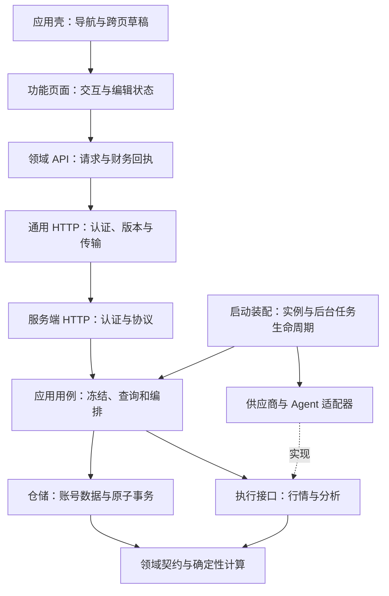

# 模块独立性审计与增量设计（2026-10-18）

## 范围与依据

本次审计覆盖前端页面、应用装配、领域 API、传输与同步，以及后端 HTTP、应用用例、领域契约、仓储、行情和 AI 执行。依据实际调用、状态所有权和事务路径判断耦合，不以文件长度或目录数量作为解耦效果。

开始时主工作区存在 86 个文件的未提交修改，包含记忆功能删除、历史兼容清理和财务界面调整。本次已对照这些修改定位问题；实现从已提交的 `97e9f25` 创建隔离分支，不纳入其他任务的修改。合并时应保留其他任务的新契约，尤其是记忆删除后的 AnalysisExecutor 参数变化，不能恢复退役功能。

保持模块化单体与既有部署，引用 [现有架构](architecture.md) 和 [模块边界](module-boundaries.md)。本次没有新增服务、数据库 schema、备份格式或 HTTP 端点。

## 已落实的职责调整

| 问题与原调用关系 | 调整后的职责和接口 | 状态与验证 |
| --- | --- | --- |
| `prices.rs` 同时解析 Yahoo、维护缓存、读取持仓、登记公司行动及写估值；根 `fx.rs` 混合账号刷新、供应商失效和后台任务 | `market_data.rs` / `prices.rs` 仅实现网络查询；`application/fx.rs` / `application/prices.rs` 组合查询与仓储写入；`ports/market.rs` 定义查询和缓存失效接口 | 财务事务仍在 `db/`；原幂等刷新、失败恢复、来源校验、历史保持、成交不变测试随用例迁移 |
| `MarketServices` 构造 ECB/Yahoo；有密钥时应用层临时创建 Twelve Data，测试无法统一替换 | `composition::MarketRuntime` 创建并注入三个供应商；`MarketServices::new` 仅接收接口 | API 启动实例持有服务，共享公开数据；强制刷新调用注入供应商的 `invalidate`，不访问全局实现 |
| 行情客户端、缓存、并发槽位隐藏在 `OnceLock`；后台循环无生命周期所有者 | 缓存与并发槽位归供应商实例；两个后台任务归 `MarketRuntime`，服务结束时取消 | 同实例并发合并及失败退避继续验证；新增实例间缓存隔离、服务退出取消任务测试 |
| 分析应用、Agent、HTTP 从 AI 工作流模块导入执行接口与事件 | `ports/analysis.rs` 定义 `AnalysisExecutor` 和事件发送通道；`models/inference.rs` 定义 `AnalysisEvent`；AI 仅实现工作流和上游流解析 | 冻结预览、授权变化、长耗时取消、失败不落历史、HTTP 流式回归覆盖 |
| 通用 `httpClient` 识别财务路径、解释回执并返回组合快照 | `api/portfolio/financialRequest.ts` 负责财务请求结果核对；组合 API 明确选择使用它，通用 HTTP 保留认证、版本和写入保护 | 回执查询期间持续持有写入保护；只读核对，不自动重发；覆盖账号切换、401、4xx、丢响应及一次保存通知 |
| 参考资料和复盘通过约定 sessionStorage 键影响问答；功能页引用应用导航类型 | 页面发出 `onAsk(question)`，应用壳拥有待传递草稿并导航；Advisor 接收显式草稿并通知已接收，设置入口使用 `onOpenSettings` | 页面拥有编辑状态；切换账号通过应用卸载清理；覆盖跨页传递、普通导航保留输入、数据重载后不重放已消费草稿 |
| `secrets.rs` 通过扩展 `Database` 实现持久化，仓储职责实际隐藏在加密模块 | 数据库凭据读写移入 `db/secrets.rs`；`secrets.rs` 只处理密钥配置及加解密 | AAD、密文格式、账号隔离和备份边界保持，沿用真实托管与备份门禁 |
| 组合应用层存在只包装一次仓储调用的 async 方法 | 快照、财务档案和成交单次 CRUD 由 HTTP 直接调用仓储；多步估值、刷新、每日确保流程保留应用用例 | 不拆分成交、现金、审计、每日观测和回执的原子事务 |

### 调整后的数据流

### 替换与迁移

- 删除原 `server/src/fx.rs` 和 `server/src/ai/executor.rs`，全部调用方使用新位置；不保留转发模块。
- 删除财务回执在通用 HTTP 中的旧路径分支；相应写入只能通过组合领域的显式恢复函数进入核对流程。
- 删除跨页面 `mario.advisorQuestion`、`compass.advisorQuestion`、`mario.dailyAssetRange` 读写，以及账号页面对这些功能专属键的清理。它们曾是未保存的临时导航状态；新版本不读取旧键，不影响任何已保存分析或业务数据。刷新仍会丢弃未保存的提问草稿。
- 数据库、JSON 备份和公开接口不变，无持久化迁移。回退代码不需要恢复数据库；未保存的页面草稿不作为回退数据。
- 修正回执查询返回 401 时的处理：交给通用会话失效流程，不再将失效会话一直显示为未知财务结果。

## 保留的合理边界

- `db/` 中持仓、现金、公司行动、审计和回执共同维护财务一致性，内部协作是有意的事务边界，不拆成独立服务或每表仓储接口。
- `risk`、`planning`、`valuation`、`context` 保持确定性规则与数据构建职责；它们不读取数据库或调用模型。
- AI Agent 保持冻结输入上的执行器；账号授权、输入冻结和结果保存继续归 API 应用用例。
- `types.ts` / `models` 仍是公共契约入口。按业务逐步拆分具体契约即可，不复制公共结构到各个功能以追求表面独立。
- 公开行情缓存只覆盖可公开查询的报价，账号覆盖值、仓位、密钥和财务记录仍留在仓储。

## 仍不合理的设计与下一步

以下是本次已确认、尚未实施的改造，不应解读为本次已完成。

### P1：模型配置与凭据缺少统一事务

证据：`application/model_settings.rs::save` 依次保存元数据、加密密钥、目的地绑定；`db/settings.rs::save_model_metadata` 又分别写入 provider、base URL 和 model，没有包裹同一事务。更换配置过程中若加密失败或后续 SQL 失败，前面的写入已生效。

影响：配置可能成为部分更新状态。`configured_model_key` 的目的地绑定校验仍会阻止错配密钥发出，但无法保证保存失败后配置保持原样。

建议：在仓储增加有明确职责的 `save_model_configuration` 原子操作。应用层先完成参数、供应商策略及模型目录校验；仓储在事务中写配置、已按账号作用域加密的凭据和绑定。不要用应用层多次调用 `set_setting` 模拟事务。先用测试辅助 `db::fail_inserts` 在 PostgreSQL 中做 SQL 故障注入，再做双实例与密钥导出排除回归。此项不需要 schema 变化。

### P1：账号锁覆盖外部行情等待，同步数据库访问阻塞异步请求

证据：`hosted.rs::authenticate` 在 `next.run(request).await` 前获取账户 advisory lock，之后释放；持仓保存、证券核验、价格/汇率刷新在 handler 内等待供应商。`storage.rs` 使用同步 PostgreSQL 客户端，`Database::postgres` 还会在请求路径建立连接并检查 schema。

影响：慢供应商会延长同账号其他设备请求等待；等待同步锁和同步 SQL 也会占用执行线程。当前 24 请求限额只限制并发数量，不能消除这些等待。并非已经证明生产出现性能问题。

建议先拆用例阶段：锁内读取需要的持仓、现金基准、版本和授权；锁外查询公开行情；重新加锁验证输入仍一致，再由仓储事务应用。发生变化应拒绝或重新准备，不能直接解锁后写入旧结果。验证慢供应商期间其他设备可读取/修改，旧估值不能覆盖新成交、公司行动或现金基准。连接池与异步 SQL 是后续独立改造；必须一起设计 advisory lock 的连接所有权和取消释放，不能简单替换驱动。

### P2：模型管理仍直接依赖具体 AI 实现和进程内桥接表

证据：`application/model_settings.rs` 直接构造原生供应商及桥接供应商（服务器本机 Codex 登录已于 2026-10-18 删除）；`application/codex_bridge.rs` 直接操作 `ai::bridge` 的注册状态。分析执行已使用独立接口，但模型检测、目录读取、连接测试与配对还未采用同样边界。

建议定义模型管理与桥接注册的窄接口，启动时注入本机/原生实现；配置保存仍是账号仓储事务。先以注入的离线、拒绝授权、目录变化和桥接断线实现测试策略，再迁移实际调用。桥接进程内状态是否需要跨 API 实例共享是部署需求，不能仅凭本次解耦引入队列或新服务。

### P2：前端同步依赖单实例全局状态

证据：`lib/service.ts` 保存全局 revision，`lib/syncEvents.ts` 保存正在同步、写入计数和旧表单保护，`useApplicationData` 通过全局事件与这些状态协作。`WebAccess` 在切换账号时重建子树，传输也校验 token，因此现有单应用实例有保护；依赖关系仍需要追踪多个文件才能完整理解。

建议让账号边界创建一个会话运行实例，拥有 revision、同步屏障和生命周期；应用壳和传输共同接收该实例。无需引入全局状态框架。迁移必须覆盖旧响应、新账号排队请求、同步中编辑、失败保留草稿、StrictMode 重挂载；禁止只把全局变量包装成单例类而保留原来的隐式共享。

### 已关闭（2026-10-18）：持仓页面的编辑流程过于集中

证据：`features/portfolio/MyFacts.tsx` 同时承担收支/存款/投资列表、筛选、持仓新增编辑、交易抽屉、删除确认与每日历史组合；多个 busy/dirty/selection 状态相互约束。它属于同一领域，不是跨功能依赖，但修改一个编辑流程需理解页面其他状态。

建议按真实交互提取持仓编辑、现金确认、删除核对三个控制器/组件，列表与概览只接收读模型和回调。金额及盈亏继续使用服务端精确会计结果，不在 UI 重新实现财务规则。每次提取以现有草稿、失败重试、回执和键盘交互测试作为验收，避免纯粹按行数拆文件。

进展：持仓与现金编辑已提取为 `AssetEditor`（自持草稿，现金确认的请求编号仍由页面持有以便重试复用），持仓详情为 `HoldingDetail`，收支表单为受控的 `ProfileForm`（草稿仍由页面持有，切换分类不丢失）。删除核对、列表筛选与排序仍在 `MyFacts.tsx`。

关闭：删除核对提取为 `useHoldingRemoval`（确认文案、缺少版本时拒绝、结果待确认后的对账与忙碌状态）；持仓列表的工具栏、搜索、排序选择、币种分组与空状态提取为 `HoldingsList`，只接收已排序读模型、筛选值和行渲染回调。筛选状态仍由 `MyFacts` 持有，切换分区后保留；概览与列表共用同一排序结果。`MyFacts.tsx` 现只组合分区、抽屉与回调，现有草稿、失败重试、回执与键盘交互测试不变并通过。

### P2：跨语言契约与架构检查仍有覆盖边界

证据：前端 `types.ts` 与 Rust `models` 手动维护；前后端各自维护写入政策。当前检查能验证显式路径和模块方向，但不是 Rust 编译器解析器，不完整理解宏展开、inline 模块或间接转发；它也不证明运行时事务和租户隔离。

建议先为公共 JSON 契约及写入/回执分类建立共同样例和双端契约验收；在字段演进频率确实增加时，再引入生成类型。数据库子模块仍属于共同事务边界，不应为了追求无内部引用而拆开原子操作。

## 验证边界

本次要求完整 `npm test`：架构检查、前端构建/格式/测试、Rust 格式/测试/严格 Clippy/构建、真实 HTTP、Web/本地认证，以及隔离 PostgreSQL 财务验收。真实模型和公共行情网络的忽略测试不能由模拟测试替代；本次重构不宣称验证模型质量或供应商实时可用性。

本机默认 Xcode 许可状态与默认 SDK/链接器组合不可用，已为验证命令指定独立 Command Line Tools 和已安装的 macOS 15.4 SDK。Node 26 内置 webstorage 与当前 jsdom 环境冲突，使用 `NODE_OPTIONS=--no-experimental-webstorage` 使测试继续采用 jsdom 的存储。以上仅为命令环境，不修改系统配置或降低门禁。

### 本次实际结果

完整 `npm test` 已通过：7 项架构检查测试，244 项前端测试，215 项 Rust 常规测试，前端构建/格式、Rust 格式/严格 Clippy/构建、117 项 SQLite HTTP 断言、Web 和本地认证检查。常规 Rust 的 9 项忽略中，5 项 PostgreSQL 测试已由财务门禁在独立临时集群单独实跑通过；其余 4 项仍依赖真实模型或公共网络，没有执行。

财务门禁还通过了托管 PostgreSQL 的 100 项 HTTP 检查、另一轮 112 项业务断言、跨实例回执与版本冲突、账号隔离、精确源/公司行动、覆盖导入与失败回滚，以及原生 pg_dump/pg_restore 后 141 张账号和租户表的逐表比对。没有使用生产数据或部署环境配置。

业务用例迁移后，价格补全/刷新和凭据持久化的实现也与迁移前逐段比较，除模块引用与缓存失效注入外未改变业务规则。真实行情与持仓落库的原忽略集成测试完整迁移到应用层，未以模拟测试替代它。
